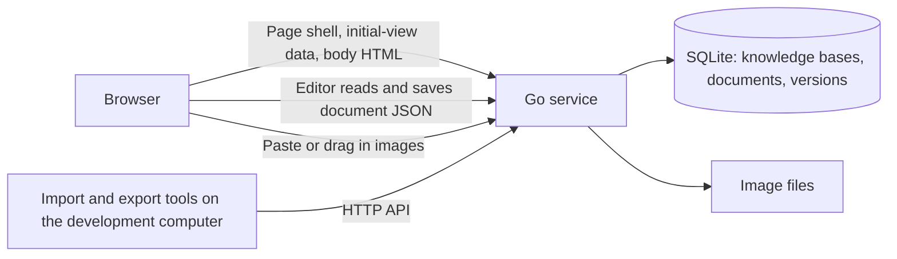

# Yuyan (语燕) Design Discussion Draft

Updated: 2026-10-13

Status: Deployed to ali with all notes formally imported (Phase C; see 11.2); the user has confirmed normal operation on both desktop and mobile. Within the interface and editing-experience redesign (Phase D, Section 12), D1 (single-page application, new interface, directory management, and export) was released after user confirmation; see 12.10 for the results. D2 editor interactions and D3 content blocks have been completed and released; see 12.11 and 12.12 for the results, which the user has accepted. The first batch of Phase E (search panel, version comparison, and reserved image dimensions) has been released; see 13.6 for the results, accepted by the user on 2026-09-27. The second batch of small features (searching knowledge bases and matching full Pinyin, locating content from search results, hiding the outline, and menu scroll indicators) has been released; see Section 14. The third batch (fixes for the mobile outline and code-copy button, stopping image loads after leaving a document, Obsidian-style code boxes, folding body content by heading, and moving the outline to the right) has been released; see Section 15. The fourth batch (Yuque-style code blocks and conversion of every `[!code]` item in production back into a code block) has been released and the production migration is complete; see Section 16. For the fifth batch (collapsing the outline in the Yuque style), see Section 17. For the sixth batch (ten items including unified button tooltips, outline and directory collapsing, canceling edits, and drag-resizing table width and height), see Section 18.

This file is the single discussion entry point for the project design. Future discussions should modify the corresponding sections directly and preserve the distinctions among "confirmed requirements," "under design and implementation," "released," and "items to discuss"; the status marked in each section is authoritative. Technology choices may change; proposals or verification plans must not be described as implemented capabilities. This document retains only designs and constraints. Verification, measured results, and release checks for each batch are archived by this document's section numbers in [VERIFICATION.md](VERIFICATION.md); new records belong there.

Project direction changed on 2026-09-26: Obsidian is no longer the starting point. The previous "multi-vault Obsidian synchronization + image hosting + reading site + configuration center" plan has been discontinued. Its discussion record is preserved in [archive/obsidian-sync-design.md](archive/obsidian-sync-design.md); the note-vault survey in Section 3 of that document remains the basis for importing.

## 1. Project Positioning and Current Scope

Yuyan (语燕, a name modeled after 语雀/Yuque) is a single-user web knowledge base deployed on ali. Writing, editing, and reading all take place in the browser, using the subset of Yuque's web features suitable for one person.

- Yuyan stores its content independently and does not depend on Obsidian. Obsidian remains the user's personal note-taking tool, maintained by the user as a single local vault synchronized through GitHub; the only relationship between the two is import and export.
- The existing `Crashmere/ObsidianRepository` remains the user's note-synchronization repository. The previous plan to rename and archive it has been canceled.
- Naming: the public code repository is `Crashmere/Yuyan`, and the local directory is `~/ali/Yuyan`; the server directory, URL prefix, runtime user, and systemd unit use `yuyan`.
- Yuyan was deployed to ali on 2026-09-26, is accessible through the shared Nginx at `/yuyan/`, and has formally imported all notes.

## 2. Confirmed Requirements

| Aspect | Requirement |
| --- | --- |
| Positioning | A single-user web knowledge base in which one person writes, edits, and reads; only the subset of Yuque's web features suitable for one person is included |
| Relationship with Obsidian | Independent systems: Yuyan stores its own content, which can be exported to Markdown at any time |
| Collaboration and sharing | Not needed: there is no sharing, collaboration, or commenting, and no distinction between public and private content |
| Editing experience | WYSIWYG, modeled after Yuque; Markdown syntax can be entered directly for quick formatting, such as `#` for a heading, `-` for an unordered list, and three backticks for a code block |
| Editor-selection principle | Extensibility and customizability take priority; implement required capabilities through in-house extensions wherever possible |
| Knowledge-base division | Each original top-level directory becomes a knowledge base. `备份` was only a temporary holding directory; each of its child directories is promoted to a top-level knowledge base, while `备份` itself is not retained |
| Existing notes | Import all of them, exactly once. After import, Yuyan is authoritative for these notes and they are modified only in Yuyan; the old copies in Obsidian are no longer synchronized |
| Markdown capabilities | Syntax highlighting, mathematical formulas, tables, images, Callouts and folding, Mermaid, and a table of contents |
| Images | All stored locally on the server |
| Styling preference | Meet styling needs through CSS wherever possible |
| Access and security | Use HTTPS over the public network with a trusted IP certificate and share Nginx with the other applications on ali; redirect HTTP to HTTPS, with login authentication to be integrated later |
| Mobile | Reading only on phones; editing is done on a computer |
| Code repository | `Crashmere/Yuyan` is public; real notes, databases, backups, and the server's public address must not be committed, and tests use synthetic samples |
| Off-machine backup | Not implemented for now |
| Release | Verify and build locally as needed, then release with `make deploy`; GitHub backs up source code only |
| Server | Use the server addressed by the existing SSH alias `ali` and follow the shared `server-operations` conventions |
| Development approach | Accept necessary development costs and clarify the design in documentation first |
| Interface redesign (2026-09-26) | Redesign the interface and editing experience with reference to Yuque; convert the site to a single-page application so switching documents and entering or leaving edit mode do not reload the entire page; improve the overall appearance, directory management, editor operations, and content blocks in sequence, leaving the search panel and knowledge-management features for later |
| Format scope | Begin with formats representable in Markdown, while supporting table dimensions, image/paragraph/table alignment, text colors, image captions, merged/split cells, cell background colors, and optional table headers; preserve content beyond Markdown's capabilities by exporting it as HTML. Columns and attachments have been implemented (Section 23), as has the general-purpose whiteboard (Section 25) |
| Same-named groups and documents | Merge the seven imported occurrences of a same-named group plus same-named document into documents that have child documents. Once directory movement is available, an agent will perform the operation through the API, after taking a backup |

Unified ServerPortal device authentication is now connected for public-network access; authorized devices can view, edit, and delete content. Version history, the recycle bin, and backups (see 3.3 and Section 9) are themselves features and also support recovery from accidental operations or content changes. The user remains responsible for reviewing notes containing sensitive information before import.

Not implementing off-machine backups for now is likewise a user-confirmed choice: after import, newly written content exists only on ali, while the local backup and the data reside on the same disk, so neither can recover from a disk or cloud-host failure. When needed, the export tool can export a local copy of the Markdown and images (see OPERATIONS.md).

## 3. Recommended Architecture

One Go service: SQLite stores knowledge bases, documents, versions, and metadata, while local files store images. The frontend is built locally and embedded in the program. ali requires no Node, Docker, or database service, matching how the other applications run.



### 3.1 Pages and APIs

- All pages and APIs are exposed through the shared Nginx under `/yuyan/`; the service listens only on `127.0.0.1:<port>`.
- Single-page application (starting with Phase D1; see 12.3): Go returns the same shell for every page address and embeds the API data required for the initial view. Switching documents and entering or leaving edit mode all happen within the page without a full-page reload.
- Go still renders body content from document JSON into HTML and delivers it to the page through an API. The editor loads only upon entering edit mode, and editor scripts are not downloaded while reading (ali's downstream bandwidth is only about 0.5 MB/s).
- All write operations are grouped under `/yuyan/api/` and pass through the same middleware entry point. When login is added later, it needs to be integrated only here; the page and API structures need no adjustment.
- Read APIs that pages also preload (reading, directory, title index, link candidates, and so on) return `Cache-Control: private, no-cache` and an ETag calculated from the response content. The browser still checks with the service every time, but receives 304 when the content has not changed and avoids retransmission. Nginx converts the ETag to weak form when compressing, which the server also accepts. Search, errors, and other reads remain `no-store`.
- JSON no longer escapes `<`, `>`, and `&` as `\u003c` and similar sequences (API responses include `nosniff`). In production-instance samples, responses dominated by rendered body content were about 20%-30% smaller uncompressed and about 5%-8% smaller after gzip. Initial-view data embedded in the shell escapes only `<`; the data must neither terminate its containing script element nor begin a comment inside it.
- Character and image counts for the title index, reading page, and directory are cached per document in process, keyed by revision and creation time; only documents written since the previous pass are recounted. One full count is performed after service startup. Sections used as link candidates are cached per document in the same way. None of these caches are persisted or require a migration.

### 3.2 Components

| Component | Recommendation | Notes |
| --- | --- | --- |
| Backend | Go + SQLite | One executable, built locally |
| Editor | Tiptap 3 | See Section 5 |
| Storage format | Tiptap (ProseMirror) document JSON | See 3.4 |
| Reading-page rendering | Go renders HTML from document JSON | Keep it consistent with editor output; see 6.3 |
| Import and export tools | TypeScript, run on the development computer | Share the same extension definitions and Markdown conversion rules as the editor; see 4.3 and Section 9 |
| Images | Content-addressed local files | See Section 7 |
| Search | Server-side full-text matching | Extract plain text from document JSON. The body content totals only a few MiB, so in-memory matching is sufficient; Chinese does not require word segmentation |

### 3.3 Content Organization

- Knowledge bases: name, description, and order (ordered by dragging cards on the home page; see 12.5).
- Document tree: documents can be nested, drag-sorted, and moved, including between knowledge bases (see 12.5); directories from the import become title-only group nodes.
- Home page: a list of knowledge bases and recently edited documents.
- Saving takes effect immediately: editing auto-saves, and the reading page always shows the latest content, with no distinction between drafts and published content.
- Save conflicts: every save carries the document's version number. If the same document is edited concurrently in two tabs or on two computers, the later saver receives a prompt and chooses either to reload or keep their own version; nothing is silently overwritten. The prompt can first open the exact UI action `查看差异` ("View Differences"), which lists changes on the current page relative to the latest saved version using version comparison, then lets the user choose within that comparison. An overwrite from the comparison uses the viewed version as its base; if another save occurs elsewhere in the meantime, the conflict prompt appears again.
- Network loss and save failures: unsaved content is first retained in the browser locally and retried automatically. Closing the page while content remains unsaved triggers a warning.
- Version history: the first save records the content from before editing. During editing, a post-change snapshot is recorded on save every 10 minutes; normally leaving the edit page waits for both body content and the session snapshot to complete. Closing the tab uses a beacon to make a best-effort final record. Snapshots are retained for 30 days and cleaned daily at 03:00 Beijing time, with no minimum version count retained; the current body is stored separately. A structured change summary relative to the preceding snapshot is generated automatically and can be previewed, compared, and restored; see 13.2.
- Recycle bin: deleted documents and knowledge bases first enter the recycle bin and can be restored. The recycle bin is not emptied automatically; permanently deleting an item or emptying the recycle bin both require manual confirmation.

### 3.4 Storage Format

Body content is stored as Tiptap document JSON together with a format-version number; Markdown is used only for import and export.

- The editor reads and writes its native format directly, so routine editing does not rewrite formatting by regenerating Markdown.
- The format can store content Markdown cannot express, such as text colors, alignment, custom Callout titles and collapsed state, and image dimensions and alignment. Block types added later are likewise not constrained by Markdown syntax.
- Costs:
  - The data is less immediately readable than Markdown, so the format must be documented and must remain exportable to Markdown at any time.
  - The reading page needs a Go renderer with a one-to-one correspondence to editor extensions (see 6.3).
  - When extensions change, old documents must be migrated according to their format-version number.
- When exporting Markdown, content expressible in Markdown (Callouts, formulas, Mermaid, tables, highlighting, and so on) uses syntax readable by Obsidian. Parts that cannot be expressed are written as HTML and read back during import, losing as little information as possible; one example is a table with column widths and row heights (Section 18). This is the rule confirmed by the user on 2026-09-27: every capability added beyond Markdown in the future is exported this way. Existing fine-grained styling does not have to be preserved completely; for example, retaining a code-block title is sufficient.

Markdown was previously proposed as the storage format. After the user confirmed that "extensibility and customizability take priority," the design changed to this approach. Tiptap's official Markdown support is still at an early stage, but because it is used only for one-time import and for export, issues can be checked individually in the import report without affecting routine editing.

See 26.1 for database-column order, layout versions, and migrations.

## 4. Importing Existing Notes

### 4.1 Knowledge Bases and Scale

The survey is based on `main@388e3bd` (2026-09-26) of the GitHub repository `Crashmere/ObsidianRepository`; see Section 3 of the archived document for details. The import is performed only once, using the latest state on GitHub at import time; there is no need to wait for Obsidian content to be consolidated and reorganized. Run the survey again before importing.

| Knowledge base | Note count | Source |
| --- | ---: | --- |
| 算法课 | 63 | Top-level directory |
| 读书笔记 | 55 | Top-level directory |
| 开发手册 | 42 | Top-level directory |
| 杂项 | 34 | Top-level directory |
| AI记录 | 14 | Top-level directory |
| MySQL | 26 | `备份/MySQL` |
| CentOS | 18 | `备份/CentOS` |
| Linux服务搭建 | 18 | `备份/Linux服务搭建` |
| 设计模式 | 16 | `备份/设计模式` |
| JUC | 12 | `备份/JUC` |
| CS | 7 | `备份/CS` |
| Spring | 6 | `备份/Spring` |
| 实验记录 | 3 | `备份/实验记录` |

There are 13 knowledge bases and 314 notes in total; no notes are stored directly under the `备份` directory.

- Body content totals about 3.25 MiB; the largest individual note is about 553 KiB.
- There are 1,538 images totaling about 339 MiB: the median size is about 92 KiB, 61 images exceed 2 MiB, and another 21 have content identical to other images.
- No externally linked images or YAML properties were found.

### 4.2 Syntax and Conversion

| Content | Quantity | Converted to |
| --- | ---: | --- |
| Code blocks | About 3,428 | Code-block nodes, preserving the language; unrecognized languages fall back to plain text |
| Callouts | 726, of which 567 have fold markers | Callout nodes, preserving the type, title, and default collapsed state |
| Custom `[!code]` Callouts | 313 | The same as above during the formal import; the fourth batch converted them to collapsible code blocks with title bars while preserving title and expanded state (Section 16) |
| Mathematical formulas | About 79 articles | Inline- and block-formula nodes, checked article by article for renderability |
| Tables | About 177 | Table nodes |
| Markdown images | 1,524 references | Images uploaded to image storage, with image nodes referencing image IDs |
| Other image syntax | Wiki image embeds, plus three `` elements with explicit heights | Image nodes, preserving dimensions |
| Wiki note links | 11 | Internal links to the corresponding documents |
| Highlighting, task lists, strikethrough | Present | Corresponding marks and nodes |

### 4.3 Import Tool and Process

- The import tool is written in TypeScript, runs on the development computer, and shares the same extension definitions and Markdown parsing rules as the editor, ensuring that imports produce the same result as pasting Markdown into the editor. It uploads images and documents through the HTTP API; ali does not require Node.
- Bold syntax permits Chinese punctuation immediately next to asterisks, as in the exact examples `**标签：**正文` and `正文**“引用”**正文`; adjacent pairs such as `**标签：****解释**` are also recognized. `web/src/schema/strong.ts` extends micromark's asterisk boundaries and adjacent-bold pairing while retaining its escaping, code/formula isolation, and nested parsing. Leading and trailing whitespace inside a marker is still treated as ordinary text, and backslash-escaped asterisks remain literal. Body JSON continues to use the existing bold mark; opening a document for routine editing does not reinterpret Markdown characters in it.
- Markdown imports with an `issue` callback inspect the syntax tree for unescaped `**` sequences that still became plain text and report their source-file line and column. Common causes include internal whitespace in the exact example `**重点 **`, a missing closing marker, or confusion between a formula multiplication sign and an emphasis pair. The check depends on positions in the original source and does not scan saved JSON to guess semantics; code, formulas, HTML, link addresses, and escaped literal asterisks are unaffected. yuyan-doc rejects these diagnostics as `conversion_error` before writing, while the maintenance batch importer includes them in its report. Browser paste without a callback retains the existing parsing rules. This import diagnostic is used by the converter on the development computer and does not require restarting the production service.
- Existing-content bold repair uses the original imported version as its basis: it parses with the old and new rules separately, then, only for paragraphs whose matches still agree with the old result, removes the paired asterisks and adjusts bold. Existing link addresses, images, and block attributes are preserved; paragraphs with escaping ambiguity, other formatting changes, or subsequent edits are not repaired automatically. See the exact OPERATIONS heading `存量加粗修复` for the tool and preview/apply process.
- The filename becomes the document title. The original path is recorded in metadata for link resolution and the import report.
- The converter preserves inline code according to Markdown syntax and does not guess whether the author borrowed Typora's code coloring. When this kind of textual emphasis must be restored, the content-migration process changes it to the existing `textColor` according to context; real code and identifiers inside mixed content retain `code`. Standalone text in a composite screenshot should become native content; actually cropped images are uploaded again, with dimensions taken from the new asset. Such semantic repairs are performed through localized yuyan-doc edits and do not change site-wide code styles or image-rendering rules.
- Images are resolved to their original files according to the source repository's rules. The `img-001.png` referenced by `AI记录/Gradle 入门.md` has two same-named files with different content; one must be selected explicitly rather than arbitrarily.
- Links that cannot be resolved or are ambiguous are included in the import report. External links without a protocol, such as `www.rpmfind.net`, are marked for correction.
- First perform a trial run against a local instance on the development computer, generate and sample-check the report, and import into the production instance on ali only after confirmation. Trial runs can be repeated without creating duplicate documents or images.
- The formal import is performed only once. Afterward, Yuyan is authoritative for these notes and they are not re-imported from Obsidian.
- Items requiring a human choice, such as different images with the same filename, are written to an overrides file and not stored in the database. There was only one such item for the formal import: `{"images": {"AI记录/Gradle 入门.md|img-001.png": "AI记录/attachments/img-001.png"}}`. After the import completed, the local file was deleted at the user's request.
- After importing, run `npm --prefix web run roundtrip -- --server <instance-address>` to confirm that the editor accepts every document without changing it.

## 5. Editor

### 5.1 Reasons for Choosing Tiptap 3

Under the principle that "extensibility and customizability take priority," Tiptap 3 is recommended:

- It provides only the editor core, leaving the interface entirely to the application. Every feature is an extension, and the underlying ProseMirror can be used directly when needed.
- It has the largest ecosystem, is actively maintained, and uses the MIT license. Formerly paid extensions including block dragging (DragHandle), collapsible blocks (Details), formulas (Mathematics, based on KaTeX), a table of contents (TableOfContents), file paste and drag-and-drop (FileHandler), and stable block IDs (UniqueID) were made open source under MIT in 2025. Only collaboration, AI, document-format conversion, and cloud services remain paid, none of which Yuyan needs.
- Its native format is JSON, matching the storage design in 3.4. Official Markdown conversion and a browser-independent static renderer are available for the import/export tools and on-demand content checks.

Other candidates previously compared:

- **Milkdown Crepe:** Its out-of-the-box experience is closest to Yuque and its Markdown fidelity is good, but it has more interface presets and is less flexible than Tiptap for deep customization.
- **Vditor:** Feature-complete, but with an older architecture and constrained extension mechanisms.
- **BlockNote:** Provides a ready-made Notion-style interface, but offers less customization space.

### 5.2 Features and Extensions Requiring In-House Development

Existing extensions cover headings, lists and task lists, block quotes, tables, code blocks (highlighted with lowlight), images, links, highlighting, text colors, alignment, undo and redo, placeholders, block dragging, collapsible blocks, formulas, a table of contents, and file paste and drag-and-drop.

The following require in-house development:

- The slash-menu and floating-toolbar interfaces, based on Tiptap's Suggestion and BubbleMenu.
- A Callout node with type, title, and default collapsed state; its type can be changed and it can be expanded or collapsed in the editor.
- A Mermaid block with source editing and live preview.
- Image upload: upload after paste or drag-in and show progress; retain the image and allow retries on failure.
- Language selection and a copy button for code blocks.
- Obsidian-style Markdown parsing and output rules for Callouts, highlights, and image dimensions, used by import, export, and Markdown paste.

### 5.3 Markdown Quick Input

When Markdown symbols are typed at the beginning of a line or after text, the editor immediately converts them to the corresponding format. Pressing Backspace immediately after conversion restores the source text just entered.

- Tiptap's existing input rules:
  - `#` through `######` followed by a space: level-one through level-six headings.
  - `-`, `*`, or `+` followed by a space: unordered list; `1.` followed by a space: ordered list; `[ ]` or `[x]` followed by a space: task list.
  - `>` followed by a space: block quote.
  - Three backticks, optionally followed immediately by a language name, then a space or Enter: code block.
  - `---`: horizontal rule.
  - The exact examples `**粗体**`, `*斜体*`, `` `行内代码` ``, `~~删除线~~`, `==高亮==`, and ``.
- Input rules requiring in-house development:
  - Obsidian syntax such as `> [!note]`: Callout.
  - Three backticks followed by `mermaid`: Mermaid block.
  - `$…$` and `$$`: inline and block formulas, configured according to Obsidian conventions.
  - The exact form `[文字](链接)`: link.
- With a Chinese IME, these symbols are often entered in full-width form, such as a backtick becoming `·`, `>` becoming `》`, or `$` becoming `￥`. The input rules also recognize these full-width forms, so switching to English input is unnecessary.
- Tables are inserted through the slash menu. Pasting a block of Markdown text converts it automatically to the corresponding formatting.
- Common formats also provide keyboard shortcuts; for example, `Ctrl`/`Cmd` + `B` applies bold.

### 5.4 Prototype Verification

Verify with real notes:

- How Callouts, formulas, code, and tables appear after import from Markdown, and the result of exporting them back to Markdown.
- Whether KaTeX can render the existing formulas. These formulas were written for MathJax as used by Obsidian; unsupported KaTeX forms must be listed and a handling strategy chosen.
- Load and editing performance for the 553 KiB long-form document.
- Under a Chinese IME, no dropped characters or cursor jumps, and correct conversion of Markdown quick input, including full-width forms.
- Image upload by paste and drag-in.

## 6. Reading Experience

### 6.1 Pages

- Home page, knowledge-base page (document tree), article page (article table of contents, previous article, and next article), and search page. On phones, the previous and next entries sit side by side, with single-line titles truncated on overflow; if only one direction is available, it occupies the full row.
- The reading page is adapted for phones. The editing page targets computers and does not provide separately adapted mobile editing interactions. Dark mode is optional.

### 6.2 Rendering Capabilities

- Syntax highlighting is performed on the server; wide code blocks and tables can scroll horizontally.
- A Callout displays its type and title, preserves its default collapsed state, and can be expanded and collapsed.
- Formulas and Mermaid load only on pages that contain them. Their scripts are deployed with the site and do not depend on an external CDN.
- Heading anchors support Chinese; images load lazily; scrolling, table-of-contents, and highlighting performance are tested with long documents.
- Chinese text uses system fonts; no Chinese web font is delivered.
- The renderer outputs only known node types and escapes text. An unknown node displays a placeholder instead of causing the page to fail when the editor gains a new extension.
- Browsers do not provide the Clipboard API on HTTP pages, so the code-copy button needs a fallback.

### 6.3 Consistency Between Editing and Reading

The editor renders in the browser, while Go renders the reading page. Their HTML structures and class names remain consistent and share one set of styles.

Mermaid SVG is generated by `shared/mermaid.ts`, which both sides share. Diagram labels are measured outside the body before being inserted into the page. The reading container `.yy-mermaid` and editing preview `.yy-mermaid-svg` both use `overflow-wrap: normal` to preserve the text's intrinsic width from measurement; otherwise, the body's `overflow-wrap: anywhere` would squeeze long labels again while node boxes retained their original dimensions, causing leftward displacement and clipping. Ordinary body text continues to wrap automatically.

## 7. Images

- Use the SHA-256 of image content as its ID, optionally truncated to the first 128 bits: identical content shares one object, while different same-named images receive different IDs. Image objects cannot be overwritten in place.
- Preserve originals and do not apply lossy compression by default; preserve GIF animation. Generate narrower versions separately for web display, and display lossless photographic originals as JPEG when they pass the quality check (26.3); exports, backups, and original-image viewing continue to use the originals.
- Images are uploaded through the editor or import tool, with type validated from file content and size limited.
- Images are returned by the program with a one-year `immutable` cache. The data directory remains mode 0700, preventing direct Nginx reads. ali's measured downstream bandwidth is only about 0.5 MB/s (about 4 Mbps), so long-term caching is essential.
- Documents store only image IDs, not addresses containing a host or prefix. The renderer and editor generate page addresses; export rewrites them to relative paths and includes the image files.
- The first version does not delete images automatically. Future cleanup must consider references from current documents, version history, and the recycle bin together.

## 8. Deployment and Operation

Follow the shared `server-operations` conventions: a dedicated application runtime identity, loopback-only listening, systemd management, an Nginx path entry point, and a locally built program. Before deployment, recheck the shared application inventory and ports, register the new application, and verify existing applications.

- In the application's own Nginx location:
  - Set `client_max_body_size` according to the image-size limit (Nginx defaults to only 1 MB).
  - Enable gzip for CSS, JS, and JSON (ali's `nginx.conf` currently compresses only HTML). `gzip_types` must include the `text/javascript` returned by Go; scripts will not be compressed if only `application/javascript` is listed.
- Set memory and CPU limits for the service; ali has only about 1.7 GiB of memory and no swap.
- Introduce no new system runtime dependencies.
Consequently, Yuyan's release script has compressed files before upload and allowed a longer upload timeout from the outset. This affects only Yuyan's own scripts and does not modify other applications.

Proposed server data structure; this structure is a design proposal, not an inventory of the live directories:

```text
/opt/yuyan/
  config/          Runtime and deployment configuration
  data/
    yuyan.db       SQLite: knowledge bases, documents, versions, image metadata
    assets/        Original images
  backups/         Consistent backups
  releases/        Program release outputs
  docs/            Copies of released project documentation
```

## 9. Backup, Export, and Restore

- Daily backup: a consistent SQLite snapshot plus hard links to images and a verification manifest, following the FabricWorld and RecipeBox approach. The backup unit's writable paths must cover the entire application directory or hard links will fail; see the shared `common-issues`. After enabling the timer, actually run one backup through the unit and confirm that it succeeds.
- No off-machine backup for now (see Section 2); like the other applications on ali, backups remain on the same disk. If needed later, images are immutable files and can be synchronized incrementally elsewhere.
- Export: export one article or one knowledge base from the web interface, and export all content with the export tool. The format is Markdown plus images using relative paths and can be opened directly in Obsidian. The export tool was implemented on 2026-09-26 (see OPERATIONS.md for usage): knowledge bases and groups become folders; a document with child documents becomes a same-named Markdown file plus a same-named folder; images are collected under `attachments/` at the root. Interrupted exports can resume. Web export was implemented with D1 and uses the same layout as the export tool; see 12.10.
- Rehearse restoration on an isolated port; do not use the production database for testing.

## 10. HTTPS and Subsequent Authentication

Yuyan currently shares the Nginx HTTPS entry point with four other applications, using a certificate that covers the server's public IP. The existing `/yuyan/` path remains, and public HTTP redirects to HTTPS. Certificate issuance, automatic renewal, the proxy trust boundary, rollback, and whole-machine checks are maintained centrally in [shared HTTPS operations](https://github.com/Crashmere/agent-config/blob/main/skills/server-operations/references/https.md); this project does not duplicate the shared configuration.

- All write APIs are grouped under `/yuyan/api/` and pass through the same middleware entry point. The Go standard library's `http.CrossOriginProtection` rejects browser mutation requests initiated by other sites according to `Sec-Fetch-Site`, or by comparing `Origin` with `Host` when that header is absent, returning 403 `cross_origin`. Command-line and local calls that carry neither header continue to pass normally. Write APIs that read a JSON body require `Content-Type: application/json` and otherwise return 400, so an ordinary form cannot masquerade as a JSON submission; uploads remain multipart.
- Nginx overwrites `X-Forwarded-Proto`. If protocol decisions later depend on this header, trust it only on connections from loopback addresses, never a client-forged header.
- Pages, images, and APIs use site-relative addresses; public addresses used by the import/export tools use HTTPS.
- Unified device authentication is provided by the shared Nginx and ServerPortal. It uses a cookie with Secure, HttpOnly, SameSite=Strict, and Path=/; operations retain origin checks, and local calls remain available under the shared contract. The five paths are still same-origin and do not constitute security isolation between applications.
- The local backend, service-to-service calls, and loopback-only release checks continue to use HTTP.

## 11. Implementation Phases and Acceptance

### Phase A: Design Discussion (Completed)

- Maintain this document and determine the first-version scope and primary technology choices.

### Phase B: Prototype (Completed; See 11.1 for Results)

- Create the `Crashmere/Yuyan` repository and rename the local directory to `~/ali/Yuyan`.
- Run both the prototype and import trial on the development computer; do not create a separate test instance on ali.
- Editor: set up the Tiptap editor and in-house extensions for Callouts, Mermaid, image upload, Markdown quick input, and related features; verify them with real notes as described in 5.4.
- Import tool: perform a complete trial run against a copy and inspect the import report.
- Reading page: implement the Go renderer and verify it with representative samples, including `题目描述.md`, tree DP, shortest paths, 《Effective C++》, the longest article, and a newly written Mermaid sample.

### 11.1 Phase B Results (2026-09-26)

- **Issues handled during import:**
  - The `img-001.png` referenced by `AI记录/Gradle 入门.md` had two same-named images. The note describes an IDEA project screenshot, so `AI记录/attachments/img-001.png` was selected (the repository's attachment directory in Obsidian is also `./attachments`); the other image is a Windows disk list.
  - The protocol-less link `www.rpmfind.net` in `备份/CentOS/软件安装.md` was imported as `https://www.rpmfind.net`.
  - KaTeX originally failed to render 10 occurrences, chiefly environments such as `align` written inside inline formulas, which MathJax could display. After rendering them as block formulas and ignoring strict-mode notices that affect only details, the failure count fell to zero.
  - The converter originally added duplicate marks to nested occurrences of the same format, and inline code could not coexist with bold or links under Tiptap's default rules. Ten documents contained format combinations rejected by the editor. Now only one mark of the same type is retained, and the schema allows inline code to coexist with other formatting.
  - During import, an empty paragraph was appended to each of the 162 documents ending in a code block or similar node, preventing the act of merely opening the edit page from triggering an auto-save.
- **Found and fixed:** Go's embed ignores files beginning with `_` by default, so Vite-generated `_baseUniq-*.js` was omitted and Mermaid failed to load. The `all:` prefix is now used.

### Phase C: First Version (Deployment and Formal Import Completed; See 11.2 for Results)

- Install and deploy on ali: runtime identity, directories, systemd, Nginx location including compression and image caching, release script with compressed uploads, local release job, backups, and isolated restore verification.
- Formally import all notes into an empty instance on ali, using the same overrides file as the trial run, then run the unchanged-save check.
- After the user tries it, complete the first version's feature details based on feedback.

### 11.2 Phase C Results (2026-09-26)

- **Installation:** `/opt/yuyan`; the service listens on 127.0.0.1:18084 and is accessed through `/yuyan/` on the shared Nginx. The runtime identity is yuyan and the release identity is yuyan-deploy, which can execute only release commands; sudo permits only the root-managed release script. The release private key is stored on the maintenance computer, and the host public key matches the fingerprint recorded locally. See [OPERATIONS.md](OPERATIONS.md) for operational details.

### Phase D: Interface and Editing-Experience Redesign (Completed; See Section 12 for the Design)

- The export tool, D1 including web export, D2 editor interactions, and D3 content blocks were all released on 2026-09-26; see 12.10-12.12. At the user's direction, D2 and D3 were completed consecutively and released together, and the user finished production acceptance on 2026-09-26.

### Phase E: Subsequent Work as Needed

- First batch (Section 13): keyboard-driven search panel, historical-version diff comparison, and reserved image dimensions on the reading page. All were released on 2026-09-26 and accepted by the user on 2026-09-27.
- Second batch (Section 14): searching knowledge bases and full Pinyin, locating matches from search results, hiding the reading-page outline, and menu scroll indicators. Released on 2026-09-27.
- Third batch (Section 15): fixes for the mobile outline and code-copy button, stopping image loads after leaving a document, Monokai Pro code boxes for `[!code]`, folding body content by heading, and moving the outline to the right side of the page. Released on 2026-09-27.
- Fourth batch (Section 16): Yuque-style code blocks using One Dark Pro, with title bars and collapsing; every `[!code]` item in production was converted back to a code block. Released and migrated on 2026-09-27.
- Fifth batch (Section 17): collapsing the outline in the Yuque style, displaying it as a horizontal line when unpinned and temporarily expanding it when the pointer approaches. Released on 2026-09-27.
- Sixth batch (Section 18): unified button tooltips, outline and directory collapsing, an edit-page outline, select-all within a structure, heading levels, pressing E twice, canceling edits, a table-insertion icon, drag-resizing table width and height, and scrolling wide tables. Released on 2026-09-27.
- Other work as needed: tags, favorites, and custom CSS. Attachment upload has been implemented; see 23.8. Document templates, content snippets, the inter-document link picker (`[[`), and backlinks are covered in Section 24.
- Format extensions beyond Markdown (see 12.1).
- Service-wide HTTPS and unified ServerPortal device authentication have been enabled; see [OPERATIONS.md](OPERATIONS.md).

### First-Version Acceptance Criteria

1. Creation, editing, auto-save, historical-version restoration, and recycle-bin restoration all work; Chinese input is smooth and Markdown quick input works; pasted or dragged-in images upload successfully.
2. All 13 knowledge bases and 314 notes are imported; ambiguities and broken links in the import report are either handled or explicitly recorded; sampled content displays correctly on both the reading page and in the editor; Callouts, formulas, code, and tables remain correct after Markdown export.
3. The reading page supports syntax highlighting, formulas, Mermaid, collapsible Callouts, tables, and an article table of contents, and works normally on phones. Content covered by this phase appears consistently between editing and reading pages.
4. Images are stored locally on the server and deduplicated by content, and long-term caching takes effect during reading.
5. Backups include SQLite and images, isolated restore verification is complete, and all content can be exported.
6. Editing the same document in two places does not silently overwrite content, and unsaved content is not lost during network outages.
7. The new service does not change the access or runtime behavior of other applications on ali.

## 12. Interface and Editing-Experience Redesign (Phase D)

On 2026-09-26, the user reported that the existing interface was too rudimentary and that its editing capabilities fell far short of Yuque, prompting planning for a redesign. This section describes the proposed implementation for the scope confirmed by the user. D1, D2, and D3 have all been implemented and released; see 12.10-12.12 for the results.

### 12.1 Scope

- Model the interface and interactions after Yuque's web version, with visuals close to Yuque: green as the primary color, a light-gray sidebar, line icons, and compact interface text.
- Follow the priority confirmed by the user: improve the overall appearance, directory management, editor operations, and content blocks in that order. Leave the keyboard-driven search panel and knowledge-management features (inter-document links and backlinks, historical-version comparison, templates, tags, and favorites) for Phase E.
- Phase D optimizes only within what Markdown can express. At the user's request, Phase E added code-block titles and collapsing (Section 16), table dimensions (Section 18), and image, paragraph, and table alignment (Section 19); see Section 23 for text colors, image captions, and richer tables. Export anything Markdown can express as Markdown, preserve all other formats in HTML, and make them importable again. Columns and attachments have been implemented (Section 23), as has the general-purpose whiteboard (Section 25).
- Code line numbers are always visible. Soft wrapping is toggled independently in each code block's title bar, affects only the current display, and is not written to the document. Preferences such as the theme are stored locally in the browser. All pages use the wide layout with a maximum width of 1100 px; width switching is no longer provided.
- Phones remain reading-only; editing targets computers.

### 12.2 Problems in the Previous State

Results of a read-only inspection of the code and production pages on 2026-09-26:

- **Basic components:** Creation, renaming, deletion, link insertion, and formula editing all used native browser dialogs; the interface had no icons, drop-down menus, context menus, or dialogs.
- **Directory:** It could not collapse (all 75 nodes in 算法课 were expanded), had no hover or context-menu actions, and could not drag-sort or move items. The server had no move or sort API, and the recycle bin had no permanent-delete operation; all of these belong to 3.3 and had not yet been implemented.
- **Pages:** Reading and editing pages used two separate layouts, and the directory was unavailable while editing. The knowledge-base page merely listed the sidebar directory a second time. On phones, the directory was stacked above the body and occupied up to 40% of the screen height.
- **Editor:** There was no top toolbar, and the selection toolbar had only six buttons. A drag handle was the only control to the left of a block. The slash menu was a plain text list. Links and formulas were edited with browser dialogs. Rows and columns could not be added or removed through the interface after inserting a table. Images could not be resized, nor enlarged on the reading page. Code-block languages used a native select element. There was no find and replace, editing outline, or keyboard-shortcut reference.
- **Export:** Neither the web export nor the export tool from Section 9 had been implemented; only Markdown conversion functions and tests existed. Therefore, "all content can be exported" in acceptance criterion 5 for the first version had not been achieved. The export tool was added later that day, and web export was implemented with D1.
- **Data:** The import turned seven Obsidian folder notes into parallel "same-named group + same-named document" pairs; see 12.8.

### 12.3 Page Architecture: Single-Page Application

The user confirmed the change to a single-page application: switching documents and entering or leaving edit mode do not reload the full page; reading and editing share the sidebar and outline, whose persistent presence depends on window width.

- Page addresses remain unchanged: `/`, `/books/{id}`, `/docs/{id}`, `/docs/{id}/edit`, `/docs/{id}/history`, `/versions/{id}`, `/search`, and `/trash`. Internal links in body content and existing bookmarks remain valid; clicking an internal link navigates within the application.
- Go returns the same page shell for these addresses and embeds the initial data needed by the current address, so the initial view need not wait for another API request. A nonexistent ID returns HTTP 404, and the application displays the exact UI text `找不到内容` ("Content Not Found"). The existing Go page templates and reading-page entry script are deleted as a consequence.
- Upon entering a knowledge-base home page, the body, sidebar, and breadcrumbs switch together according to the knowledge-base ID in the route; any existing cache displays immediately instead of delaying navigation until the detail request returns. The top progress indicator covers both knowledge-base detail and directory loading. Successful or failed requests that return after the page has been left can no longer modify the current page context or title, preventing the wrong knowledge base from appearing on slow networks or during rapid switching.
  - The knowledge-base home page loads details, the knowledge-base list, and the directory in parallel through one unified flow; the sidebar reuses the same directory request.
- The Go renderer continues to generate body content. A new API returns rendered HTML, the article outline, and previous/next articles, retaining revision-keyed caching. Enhancements for formulas, Mermaid, code copying, and Callout folding continue to use the existing scripts. The editor, KaTeX, and Mermaid remain loaded on demand; the editor is not downloaded while reading.
- When the user clicks the exact `编辑` ("Edit") action on the reading page or presses E twice, the editing page continues at the current reading position, with the cursor placed near the visible content. Before leaving the reading page, the router records the body block and the offset within that block, then restores them after the editor body and node views mount, subtracting the height of the editing toolbar. Earlier collapsed sections, long code blocks, and tables do not displace the target. The position applies only to this transition within the same document; directly opening an edit URL or entering from the beginning still starts at the top.
- When returning from the editing page to the same document through the exact `完成` ("Done") or `取消` ("Cancel") actions or the browser Back action, the reading page continues at the position occupied at the moment editing ended. It restores the position after body content, formulas, and diagrams finish rendering, first expanding any section hiding the target and any Callout or long code block containing the target. `取消` maps block-position changes made during editing back to the original document; if the newly added block occupied at exit is discarded, it targets the nearest position in the original. The position is restored only once, and later theme changes do not jump again.
- Before leaving the edit view by clicking `完成`, switching documents, clicking the directory, or opening history, wait for both the body save and session snapshot to complete. If the snapshot fails, state that the body has been saved and remain on the editing page for a retry. On offline status, save failure, or conflict, show a message and retain unsaved content in the local draft. Saving invalidates the body cache, so returning to the reading view shows the latest content immediately; title changes synchronize to the directory.
- Script budget: the application scripts initially loaded by the reading page must not exceed about 115 KB after gzip and are cached long-term by content hash. Only the reading page loads with the application entry point; the home, knowledge-base, edit, history, version, search, recycle-bin, and not-found pages load when opened. According to the address, the page shell lists all static chunks for the entry point plus that page's chunk, allowing the browser to download them all in parallel rather than discovering them layer by layer. The page's own chunk and styles use low priority, so large chunks such as the editor do not delay display of the application and placeholders. Any newly lazy-loaded page must also be registered in `routeViews` in `internal/server/app.go`; if the build and registration disagree, the service reports an error at startup. Before every release, follow static imports from the app entry in the build manifest `web/dist/manifest.json` and check the gzip size.
  - Initial reading-page loading is about 107 KiB (2026-10-14, 30 chunks): Vue and vue-router account for about 50 KB; the rest is reading, the sidebar directory, icons, and shared logic. reka-ui menus and dialogs plus floating-ui positioning, about 33 KB, now download on first use and prefetch while idle after the initial view appears (26.5); entry code no longer imports them statically.
- After a release, old tabs may reference chunks that no longer exist. Globally listen for Vite module-load failures and display a refresh prompt covering on-demand features such as the editor, Mermaid, and its diagram types; routing failures do not trigger automatic refresh loops. The exact `保存并刷新` ("Save and Refresh") action on the editing page first waits for uploads and all modifications to save; content entered while saving is saved again. Conflicts or failures retain the current page and local draft. The reading page can refresh directly. Network outages use the same recovery entry point.
- When an edit address is opened directly, show the document title and several placeholder lines in their original positions while the editor chunk downloads. The toolbar height and body-column width match the editor, so the title does not move after loading. If chunk loading fails, annotate the placeholder and use the refresh prompt above. Entering edit mode from the reading page retains the reading page and top progress bar until the editor is ready. A failed document read on the editing page can be retried in place.
- Mermaid distinguishes component-load failures, syntax errors, and other rendering failures in its messages. On failure, the editing page retains the last successful preview and the reading page retains the source. Clear a failed loading Promise, and prevent stale asynchronous preview results from overwriting the latest input. After a module failure, a full-page refresh obtains the current build and its complete dependencies so the browser does not keep reusing a failed module record.
- Write APIs remain grouped behind the same middleware entry point under `/api/`, without affecting later login integration.

### 12.4 Interface Foundations

- **Design system:** Define colors, font sizes, spacing, corner radii, and shadows with CSS variables, with separate light and dark sets. Add a manual switch with the exact choices `跟随系统 / 浅色 / 深色` ("Follow System / Light / Dark"); the Mermaid theme changes with it.
- **Body headings:** Place a thin divider below level-one headings, emphasizing the first 44 px in green; place a 3 px green vertical line to the left of level-two headings. Reading and editing pages share the styles, and light and dark modes use their respective theme colors. The decorations are not written into the document and do not occupy the folding indicator or editing-placeholder text. On the reading page, leave outward spacing for the level and fold controls to the left of headings: shift the whole group 6 px left on desktop (`left: -42 px`) and shift level-two headings 3 px left on mobile (`left: -19 px`), keeping the icon inside the viewport.
- **Components:** Continue using Vue 3, adding Reka UI, which provides unstyled, accessible components with keyboard support for menus, dialogs, popovers, context menus, tooltips, and similar controls under the MIT license, plus Lucide icons under the ISC license, bundling only the icons in use. Write the styles in-house. Tiptap's official interface components are React-only and serve solely as interaction references.
- **Immediate positioning and heading cues:** Reading/editing outlines, body anchors, search matches, recent changes, sidebar positioning, column browsing, and horizontal table paging share `shared/scroll.ts`; regardless of distance, they jump directly in one step with no smooth-scrolling animation. When the outline, a heading link, or a URL anchor targets a body heading, the entire target-heading row displays a soft, rounded Yuyan-green background, reusing the theme's `--yy-primary-soft`: #e8f7ef in light mode, #173826 in dark mode, with a 6 px radius. Its total duration remains 2.2 seconds: 500 ms fade-in, 1.2 seconds held, and 500 ms fade-out. Repeated clicks restart the timer; jumping elsewhere or changing pages clears the old cue. Under reduced motion, display it statically for about two seconds, then restore it immediately without a fade. The cue uses Web Animations and writes no DOM style/attribute, body formatting, or editing history. It preserves heading layout, existing text colors, and the caret, restoring the original background when finished. Content positioning retains the heading scroll margin and moves only the body page; sidebar and horizontal positioning each move only their own container. When the outline updates the URL anchor, the outline action and body-anchor listener must result in only one positioning operation.
- **Menu scrolling:** Drop-down and context menus isolate scroll propagation. While the pointer is inside a menu, subsequent wheel input does not pass to the body even after reaching the top or bottom or moving between items. The body scrolls normally once the menu is closed.
- Replace all native browser dialogs (`prompt`, `confirm`, and `alert`) with in-application dialogs, popovers, and toasts.
- First create a clickable local prototype using synthetic data, covering the home page, knowledge-base home page, reading-page and editing-page shells, and directory operations. Implement the full version only after the user confirms the visuals and interactions. The user tried and confirmed the local version and approved release on 2026-09-26.

### 12.5 Shell, Directory, and Export (D1)

- **Top bar:** Breadcrumbs (knowledge base / parent document / current document), search entry point, create action, and theme switcher.
- **Body position:** The reading and editing pages both use the previous wide page, with a maximum width of 1100 px, positioned relative to the whole window using the sidebar-collapsed position as the baseline. Opening, closing, or resizing the sidebar and switching Focus Mode do not push the body; the old standard-page preference no longer applies.
- **Sidebar:** There are two forms: workspace (home, knowledge-base list, recycle bin) and knowledge base (name and directory). Above 1700 px window width, it is fixed in the whitespace to the left of the body; it can be drag-resized and collapsed, its state is stored locally, and its actual width cannot exceed the available whitespace. Only the top bar and editing toolbar make room for the sidebar. At 1700 px or narrower, the top bar opens a directory drawer; clicking the body or finishing document selection collapses it, including when the current document is selected, while expanding a group keeps the drawer open. Both sidebar forms use an approximately 180 ms slide plus fade transition while the body remains stationary; animations are removed when the system requests reduced motion.
- **Knowledge-base creation entry points:** The `+` beside the current knowledge-base name and the exact `新建` ("New") action in the knowledge-base home page's top bar share a menu containing the exact actions `新建文档` ("New Document") and `新建分组` ("New Group"); both create at the root of the current knowledge base's directory. Creating a document enters its editing page. Creating a group first requests a name, then updates the directory while retaining the current page after confirmation; canceling creates nothing.
- **Directory tree:**
  - Supports collapsing and expanding, remembering expanded state per knowledge base. Opening a document automatically expands the path to the current document and scrolls it into view.
  - The document list consistently uses the ordinary arrow cursor; titles, expand buttons, checkboxes, and hover action buttons inherit the whole row's cursor, avoiding alternation between arrow and hand cursors during slow movement in Chrome. Rename inputs retain the text cursor, while disabled states and native dragging retain their respective feedback. A directory row uses its full rectangle for pointer input; rounded corners are drawn only on a background layer that does not receive pointer events. Hover, current-document, batch-selection, and drag-over highlighting share that background layer, while the drop insertion line is drawn separately.
  - To the right of the exact heading `目录` ("Directory") and left of the collapse-all button is the exact action `定位当前文档` ("Locate Current Document"). Its icon is an outer circle with four short ticks crossing the circumference and an empty center. It expands parent nodes and scrolls the corresponding row to the middle of the sidebar's visible region, scrolling only the directory without changing the body position. It is disabled when there is no current document or the current object is not in the tree, and follows the system reduced-motion setting.
  - Directory groups in the sidebar and on the knowledge-base home page share a section marker: a 2 x 12 px short gray-green vertical line to the left of the title, backed by a pale green background fading to the right, while retaining a semibold secondary text color. Openable documents retain ordinary text. The decoration adapts to light and dark themes, remains confined to the title area, and adds no icon placeholder or animation. Long titles retain ellipsis; drop indicators, batch selection, and expansion arrows display independently. Hover shows `+` for creating a child document and `…`. The `…` and context menu provide the exact operations `新建子文档`, `新建分组`, `重命名` (edited in place), `移动到`, `复制链接`, `导出`, and `删除`.
  - Items can be dragged before, after, or inside a node, with a drop-location indicator. A green insertion line extends rightward from the title start at the actual target level, becoming 16 px shorter with each deeper directory indentation. Dropping at the lower edge of an expanded node places the item before its first child, with the indicator indented to the child level; same-level ordering uses that level's indentation. Whitespace below the directory list provides the exact `放到最顶层末尾` ("Place at End of Top Level") drop target, with an insertion line at top-level indentation. Even if the final item is an expanded group, a document or entire group can be placed at the end of the top level, with its children moving with it; if already last, it is not saved again. An item cannot be dragged into its own descendant. Holding a drag within the top or bottom 80 px edge of the directory scroll area continuously auto-scrolls the directory, faster nearer the edge (120-900 px/s); it recalculates the current row and drop position even when the pointer does not move. Scrolling stops upon moving to the middle, leaving the directory, or reaching a boundary; tracking is cleaned up when dropping, canceling, or unmounting the directory. Listen to both `dragenter` and `dragover` to accommodate WebKit not immediately dispatching `dragover` after entering a new element. The exact `移动到` ("Move To") dialog can select another knowledge base; child documents move with the item.
  - A batch-operation entry point appears to the right of `目录`, with an icon of two hollow circles and two horizontal lines. After entering it, a select-all checkbox and the exact action `退出` ("Exit") appear beside the knowledge-base title, tree nodes show checkboxes, and a fixed action card at the bottom shows the exact text `批量操作 / 已选 N 项` ("Batch Operations / N Items Selected") plus five buttons: copy, move, export, copy link, and move to recycle bin. Operations are disabled when nothing is selected. The directory scrolls independently, and the bottom buttons remain visible in the mobile drawer.
  - Selecting a parent includes all descendants, including collapsed children. Deselecting a child makes ancestors indeterminate, and those ancestors are not operated on. Counts include documents, groups, and descendants; the actual operation removes duplicate subtrees in directory order. Shift selects a continuous range among currently visible items. In batch mode, clicking a row only toggles selection; collapse and expansion still work, item menus are hidden, and dragging is disabled. Exiting or switching knowledge bases clears selection; Esc exits batch mode when focus is inside the sidebar.
  - Copy and move can target another knowledge base and place items at the end of the target position. The dialog's leftmost area follows home-page knowledge-base groups and their internal order, listing knowledge bases under group names, placing ungrouped bases last, and omitting empty groups. Without configured groups, it remains a plain knowledge-base list. All selectable bases are expanded directly, unaffected by the home page's collapsed state. Copying preserves content, hierarchy, and child order; the root item receives a unique `（副本）` suffix, and copies share the original non-overwritable images. Document links within the copied range are rewritten to the new copies, each of which receives an initial historical snapshot. Moving into the selected subtree is prohibited. Export retains the Markdown/ZIP format; copy link includes documents only; deletion confirmation states the selected count explicitly and moves the items into the existing recycle bin.
  - After deleting the currently open document, navigate to its parent document or parent group; if it has no parent, return to the current knowledge-base home page. When deleting a subtree containing the current document or performing a batch deletion, navigate to the nearest ancestor not being deleted, or to the knowledge base if none exists. If the current document is being edited, first wait for uploads, saving, and the session snapshot to complete and leave the editor before submitting the deletion, preventing auto-save or the leave guard from continuing to write deleted content. On save or snapshot failure, stay on the editing page and do not send the deletion request. Deleting other documents retains the current editing page. If deletion succeeds but directory refresh fails, still complete navigation and prompt for refresh; if deletion fails, retain the document and show the reason.
  - `POST /api/docs/batch` accepts `bookId`, `ids`, and `action` (`copy` / `move` / `trash`); copy and move additionally send `targetBookId` and `parentId`. A request contains at most 5,000 items and is validated and committed in one transaction. Selecting a parent requires submitting all of its live descendants at the same time; return 409 and ask the user to reselect if an item has been deleted or an unselected child was added to the directory. Copy returns new IDs; other operations return the original IDs. If the document currently being edited is selected, finish saving first; leave that editing page before moving or deleting it. After moving, navigate to the target knowledge base; after deletion, follow the rules below. A successful write clears the selection; cancel, export, and copy link preserve it.
  - The directory-group menu provides the exact `解散分组` ("Dissolve Group") action. After confirmation, place direct children in their original order at the group's former sibling position, preserve each child's internal hierarchy, and move only the now-empty group to the recycle bin. Direct children already in the recycle bin also move to the sibling level while remaining deleted, so later restoration no longer depends on the dissolved group; restoring the empty group does not reverse dissolution. `POST /api/docs/{id}/dissolve` submits `bookId`, `parentId`, and the ordered `childIds` of current live direct children, then validates the structure, promotes the children, and deletes the empty group in one transaction. Return 409 if ownership, parent, or direct-child order changed; roll back everything on failure. Document IDs, body content, revisions, and history remain unchanged. A child document currently being read or edited stays on the same page; if the dissolved group itself is being viewed, navigate to its parent or the knowledge-base home page.
  - The directory-group menu provides the exact `提取为知识库` ("Extract as Knowledge Base") action. Create a knowledge base using the group's name, place its direct children at the new base's root in their original order, preserve all internal hierarchy, and move only the original now-empty group to the recycle bin. The new base joins the home-page group currently containing the source knowledge base and is appended to that group's end; if the source is ungrouped, the new base is likewise ungrouped. A same-named knowledge base is neither merged nor overwritten, and an empty group can be extracted as an empty knowledge base. After confirmation, first wait for the current edit save and session snapshot to complete and exit the editor; do not send the extraction request on failure. Open the new knowledge base on success, but do not force navigation back if the user has already changed pages. A refresh failure must still report successful extraction, preventing duplicate creation.
  - `POST /api/docs/{id}/extract` explicitly submits the current `bookId`, `parentId` (null for the root), `title`, and ordered `childIds` of live direct children; an empty group uses `[]`. In one transaction, validate the name and position, create and group the knowledge base, move all descendants, make direct children root items, and delete the empty group. On success, return 201 with `{book, bookGroups}` and increment the group revision when there is home-page membership. Return 409 when the name, source, parent, or direct-child order changed; return 400 for invalid arguments or a non-group; return 404 for a deleted group or knowledge base. Roll back everything on failure. Descendants in the recycle bin also become owned by the new base while retaining deleted status; restoring the original empty group does not reverse extraction. Document IDs, body content, revisions, update times, and history remain unchanged, with no database migration.
  - Add a server-side move API that reorders siblings within one transaction and verifies that no cycle can be created. Renaming within the directory likewise checks the revision number and prompts on conflict with an open editing page.
- **Knowledge bases:** A knowledge-base home page shows its name, editable description, document count, most recent update, and complete directory. Knowledge-base cards on the home page can be drag-sorted. Statistics for each document in the directory appear in this order: image count, omitted when there are no images; character count; and most recent edit time. On desktop they appear to the right of the title; on mobile they appear below it. Each of the three occupies a fixed-width column, is right-aligned, and uses tabular numerals. The image column's space is retained even without images, preventing digit-count changes from misaligning adjacent columns. Very deeply nested directories contract to the available width on narrow screens. Character counts use the same whitespace-excluding measure as the reading page. Images are counted by occurrences in the body, so the same image appearing twice counts as two images. Directory groups show no statistics. The tree API reads directly from existing `plain_text` and body JSON, with no new database field. Saving or canceling an edit invalidates the directory cache so the next directory visit reflects updates.
  - The knowledge-base More menu provides the exact action `转为分组…` ("Convert to Group..."). Choose another live knowledge base through home-page groups and knowledge bases; create a group with the source's name at the end of the target root directory and place all source root items inside it, preserving their original order and internal hierarchy. An empty knowledge base becomes an empty group. A same-named group is neither merged nor overwritten. The original empty knowledge base moves to the recycle bin while retaining its name, description, and home-page membership; restoring it does not reverse the conversion. Before confirmation, load the latest source name, directory, and knowledge-base list. After confirmation, wait for the current edit save and session snapshot to complete and exit the editor; do not convert on save failure. Open the new group on success, but do not jump back if the user has already changed pages. Even if refresh fails, report explicitly that conversion succeeded.
  - `POST /api/books/{id}/to-group` submits the source's current `name`, target `targetBookId`, and complete ordered live root-item `rootIds`; an empty knowledge base explicitly uses `[]`. Within one transaction, validate, create the group and its snapshot, migrate all documents, and move the original empty knowledge base to the recycle bin. HTTP 201 returns `{group: DocMeta, book: target Book}`. A mismatched name or root-item order returns 409; invalid arguments or selecting the source itself as target returns 400; a deleted or nonexistent source or target returns 404. Every failure rolls back the operation as a whole. Deleted items retain deleted status but become owned by the target. Existing body content, IDs, revisions, timestamps, history, links, and assets remain unchanged; home-page grouping is not changed and there is no database migration.
  - At the top of the home-page card menu, place the exact actions `从其他知识库移入` ("Move In from Another Knowledge Base") followed by `转为分组…` in the same separator group. Remove the exact entries `新建文档`, `从模板新建`, and `新建目录分组`; action menus inside a knowledge base retain those three entries. The entry used to choose a home-page group in knowledge-base menus is uniformly named `移动到`.
- **Knowledge-base groups:** The home page, workspace sidebar, and knowledge-base switcher share one level of categorization; every knowledge base belongs either to one group or to the reserved group `未分组` ("Ungrouped"). On the home page, groups can be created, renamed, moved up or down, collapsed, and deleted. The menu at the top-right of a card and the knowledge-base action menu can choose the target group, and cards can also be dragged directly to a group title or empty area. Cards within a group can still be drag-sorted; on phones they can be moved through the menu. Deleting a group only moves its knowledge bases to `未分组` and does not delete documents. A knowledge base retains its membership when moved to the recycle bin and returns to its original group when restored; permanent deletion clears membership in the same transaction, preventing ID reuse.
  - When dragging a card to another group, the entire target area gradually shows a green background and outline with the exact prompt `松开以移入此分组` ("Release to Move into This Group"). Titles, cards, whitespace, and collapsed groups use the same cue, without flicker while moving within a group. Sorting within and across groups shares drop positions: hovering over a card's left half inserts before it, while the right half inserts after it, with a green insertion line on the corresponding side. Dropping on a group title or whitespace places the card at the end of the group. On release, update final membership and order immediately without waiting for the save response. The settling animation is always centered on the target position; the card does not return to its original group or enter again from its old position. Leaving the target, releasing, or canceling a drag clears the cue; a collapsed group remains collapsed. When the system requests reduced motion, retain only color and drop-position feedback.
  - Drag animation is coordinated between `app/bookDragMotion.ts` and home-page styles. At drag start, the original card scales down slightly to 97% and fades; the native drag preview scales to 103.5%, tilts slightly by 1.2 degrees, and gains a shadow. When passing a card, that card yields 4 px opposite the drop position, and the insertion line appears within 140-180 ms. After release, the card settles at its final position with 260 ms of slight scaling and shadow fade-out; neighboring cards, the group title, and content below return smoothly over 220 ms. Do not translate the entire group containing the target card. Canceling restores the original card. Dropping into a collapsed group gives only a subtle count cue. Animations and drag previews are cleaned up on completion, on the next drag, or when leaving the home page. Under reduced motion, skip translation, rotation, and scaling.
  - A group title has a drag affordance and can move the entire group before or after another group. A green insertion line marks the destination. On release, save the group-array order and move content with a short transition; the sidebar and switcher adopt the same order. `未分组` remains fixed at the end. Phones can still use the group's move-up and move-down menu actions.
  - Retain the existing grid layout while dragging and do not insert an extra placeholder card for "place at the end of the group." Dropping on the right half of the final card, the group title, or whitespace within the group can all move an item to the end; if it is already last, do not save again. Moving through a menu to another group also appends to the end. Clicking the currently selected group does not change order.
  - The top of a group title's `…` menu provides the exact action `新建知识库` ("New Knowledge Base"); the dialog identifies the target group. After successful creation, append it to the end of that group and remain on the home page rather than opening the knowledge base automatically. Empty and collapsed groups support the same action, and collapsed state is retained. The global creation entry points at the top of the home page, in the ungrouped grid, and in the sidebar still create under `未分组`. `POST /api/books` accepts optional `groupId`, where omission or an empty string means ungrouped. Creation and membership append occur in one transaction, preserving other groups, existing order, and recycle-bin membership while incrementing the group revision. Append only to the latest configuration; do not require the complete groups or `baseRevision` to be submitted. If the target group does not exist, return 404 without creating a knowledge base. A subsequent attempt to save the complete group configuration with the old revision still returns 409.
  - Home-page and sidebar groups share expanded state and a 180 ms content-height transition; toggling in either location synchronizes the animation in both. Subsequent groups and the recently viewed region move smoothly with the height, preventing the recently viewed section from jumping suddenly. Collapsed content remains rendered but is set to inert, so it cannot be clicked or receive keyboard focus. Under reduced motion, switch immediately.
  - The exact `新建分组` and `新建知识库` buttons in the home-page sidebar sit side by side aligned to the right. Book icons are no longer displayed before the sidebar knowledge-base list or current knowledge-base name.
  - The `…` menu on home-page knowledge-base cards, the knowledge-base page action menu, and the sidebar knowledge-base context menu share rename, edit description, move to, convert to group, copy link, export, and delete knowledge-base actions. The knowledge-base page and sidebar menus additionally retain entry points for creating a document, template-based document, or directory group; home-page cards do not provide those three. The sidebar title of the current knowledge base also supports a context menu. Group selection uses a submenu and marks current membership. Delete appears separated at the bottom and, after confirmation, moves the knowledge base and all its documents to the recycle bin, where they can be restored together.
  - The home-page knowledge-base card menu provides the exact action `从其他知识库移入` ("Move In from Another Knowledge Base"). The dialog browses by columns through knowledge-base groups, a source knowledge base, and successive document-directory levels, excluding the target knowledge base. One operation selects from one source knowledge base. A single click replaces the selection, Command/Ctrl toggles selection, Shift selects a contiguous range in the current column, and checkboxes preserve selections across different directories; arrows only enter directories. Selecting a parent includes every descendant; deselecting a child makes its ancestor indeterminate. The dialog supports selecting all in the current column and clearing the selection, and displays document and group counts. A phone shows one column at a time and can swipe horizontally or return through the path. Reuse the atomic move in `POST /api/docs/batch`, with at most 5,000 items at once, appending them to the target root in source-directory order while preserving IDs, body content, history, and internal hierarchy. Canceling does not modify data; conflicts prompt reselection; after success, remain on the home page.
  - `GET /api/book-groups` returns `{ revision, groups: [{ id, name, bookIds }] }`. `PUT` accepts `{ baseRevision, groups, bookOrder? }`, returns 409 on conflict for the page to refresh and retry, and validates group names, IDs, and unique knowledge-base membership. Optional `bookOrder` must contain exactly every live knowledge-base ID, including bases in other groups and ungrouped bases, excluding the recycle bin. Membership, complete order, and the new revision commit in one transaction. Invalid order returns 400 and rolls back everything; omission preserves existing order. The interface updates membership and position first and saves in the background. On failure, it restores the last confirmed configuration and order together and attempts a refresh; even after repeated failures while offline, it does not retain unsaved results. `未分组` is a reserved name. Configuration displays in group-array order and is stored in the existing `meta.book_groups` JSON. With no configuration, return empty groups and write nothing. Add no database table and migrate no existing data. Within-group order continues to use `books.position`; `bookIds` represents membership only. Collapsed state is stored only locally. Group configuration is preserved by consistent database backups.
- **Home page:** After creating a knowledge base on the home page through the global entry point or a group menu, remain in place and preserve scroll and group-collapse state. Creation initiated from another page retains the behavior of opening the new knowledge base. Show recently viewed items, recorded locally; recently edited items; knowledge-base cards; and a creation entry point. At the lower right below the knowledge-base list, display the total body character count of all live documents, for example the exact UI text `共 1,234,567 字`; at the bottom-right of every knowledge-base card, display that base's character count, for example `123,456 字`, with an empty base showing `0 字`; retain the document count at the lower left of the card. Align counts to the right on both desktop and mobile; when a narrow card lacks space, wrap the character count while keeping it right-aligned. The site-wide total is unaffected by collapsing knowledge-base groups. Use the same non-whitespace-character definition as the reading page and directory; do not count document titles, directory groups, recycled documents or knowledge bases, history, or templates. `GET /api/stats` returns `{chars: number, bookChars: {[bookId: string]: number}}`, including every live knowledge base with zero for empty bases. Sum per-document cached character counts (see 3.1), reading existing `plain_text` only for documents written since the preceding count; add no database field. Preload this API only on the home page. Returning home or modifying the knowledge-base list while there updates per-base and site-wide counts together.
- **Recycle bin:** Restore, permanently delete with a second confirmation, and empty the recycle bin. Image files are not deleted along with these operations, consistent with Section 7.
- **Search:** Retain the existing search and migrate it into an in-application page.
- **Export:** Complete the export from Section 9. The web interface can export one article as Markdown and an entire knowledge base as an archive containing Markdown and images arranged by directory structure with relative image paths. Export all content using the tool on the development computer, which is implemented and documented in OPERATIONS.md. Web export and the export tool share the same file layout and link-rewriting rules in `web/src/shared/export.ts`.
- **Mobile:** Convert the directory and outline to drawers and make the body full-width.

### 12.6 Editor Interactions (D2)

- **Layout:** The editing and reading views share the shell from 12.5. The outline on the right can be toggled, and a fixed toolbar sits above the body. Focus Mode can hide the persistent sidebar; narrow windows can still open the directory drawer.
- **Top toolbar:** The exact UI actions `撤销`, `重做`; body text and headings 1-6; bold, italic, strikethrough, underline, inline code, and highlight; links; alignment (Section 19); unordered, ordered, and task lists; an Insert menu containing block quote, Callout, code block, Mermaid, formula, table, image, and horizontal rule; and clear formatting. Beside heading selection are buttons to promote or demote a whole batch of headings (Section 22); find and replace and Focus Mode are on the right.
- **Selection toolbar:** Text and cell selections share common formatting, link, convert-to-heading-or-body, and clear-format controls, with a trash can at the far right. See Section 20 for removal rules: remove text, nodes, whole rows, or whole columns according to the selection; partial cells only have their content cleared. Code-text and whole-code-block selections show only the remove and content-snippet buttons; the image toolbar also shares the remove button. The toolbar does not appear for a caret alone in ordinary text, while a caret in a table retains table tools. Position the toolbar according to its actual rendered dimensions. For selected text, prefer placing it above the selection with an 8 px gap, flipping below when there is insufficient space above. Recalculate after first display, tool changes, and narrow-screen wrapping, avoiding placement based on the empty-box dimensions before buttons have rendered, which would cover the selection. Tables continue to use separate cell anchors and control-bar spacing.
- **Table controls:** In both the top and floating table tool sets, expose the exact `首行为表头` action as a direct toggle. Its icon must use the exact 44×44 PNG supplied by the user, without tracing, redrawing, recoloring, or reinterpreting its grid geometry; scaling the unchanged raster to the toolbar canvas is allowed. Its active background indicates that every cell in the first row is a header. Keep the exact `表格设置` button visible but disabled while it has no actions, using the ordinary disabled-button appearance and opening no empty menu.
- **Floating-toolbar motion:** While a visible selection toolbar, image toolbar, link card, or highlight-block palette follows a moving anchor, interpolate subsequent `left` and `top` updates over 120 ms with a short ease-out curve. Floating UI still computes the target coordinates and retains its offset, flip, and viewport-shift behavior. A newly shown or reused toolbar commits its first computed position before enabling interpolation, so it appears directly at the current anchor instead of traveling from an earlier selection. Disable the interpolation when the system requests reduced motion.
- **Heading controls:** Reading and editing share H1-H6 level indicators and folding arrows; drag icons, block menus, and plus signs no longer appear to the left of the body. Content from one heading through the next heading at the same or a higher level forms a section. Headings inside columns, highlight blocks, fold blocks, block quotes, and tables calculate their ranges within their own content containers. Controls appear on hover, remain visible while collapsed, and are always visible on touchscreens; preserve a traversable area between the control and heading. While editing, decorations hide an entire section without writing to the body or occupying content undo history. If the caret or an outline target enters hidden content, expand it first. Collapsed state shares the reading page's local record keyed by heading anchor. Insert using the top `＋` or `/`; move sections through the outline instead (Section 22).
- **Whitespace between blocks:** Clicking whitespace above, below, or between an image paragraph, table, code block, block formula, Callout, horizontal rule, or adjacent content, within 28 px of a block edge, inserts an ordinary empty paragraph and places the caret there; use an adjacent empty paragraph directly if one exists. Track the origin of a newly inserted paragraph only for the current edit. If unused, automatically remove it when the caret moves away, it changes into a heading, or editing ends. Retain it after text is typed or pasted, Enter splits it, formatting is applied, or image upload begins; even if later emptied, it is no longer removed automatically. Existing empty paragraphs and intentionally added empty columns are unaffected. Preserve the operation position while a formatting or insertion popover temporarily takes focus; cleanup does not enter undo history. Support the beginning of a document, adjacent non-text blocks, and blocks inside lists, Callouts, and cells. Whitespace between images that auto-wrap within one paragraph only positions the caret; use Enter or Shift+Enter to create an explicit paragraph or line break (Section 19.1). Insertion is undoable, preserves an active table-resize operation in preference, and leaves modifier keys and text-selection behavior unchanged. This is implemented in `web/src/editor/blockSpaces.ts` without changing the document format.
- **End-of-document whitespace:** Clicking whitespace below the last visible block and within the body-column width inserts an ordinary empty paragraph at the end of the document and focuses its caret. This covers whitespace inside a short-document editing area and at the bottom of the body column, without depending on block type or the 28 px distance limit. Use an existing final empty paragraph directly, and do not create another on repeated clicks. After focusing, check the caret's visible range and, if necessary, jump-scroll it below the top toolbar so that clicking distant whitespace does not leave the typing position off-screen. Reuse the temporary-paragraph tracking, usage detection, leave-time cleanup, and undo rules for whitespace between blocks. Clicks on body content, nested content, tool controls, or outside the body column retain their original behavior.
- **Horizontal rule:** Preserve its thin-line appearance while editing, but increase its click hit area to 20 px high. Clicking selects the entire rule so it can then be deleted or operated on through the selection toolbar; reading styles remain unchanged.
- **Slash menu:** Includes icons, groups, descriptions, and corresponding Markdown syntax; opens when `/` or the Chinese-IME character `、` is entered. Search shares the `Cmd/Ctrl + K` matcher and supports partial Chinese and English keywords, full Pinyin, initials, mixed full Pinyin and initials, and matching from the middle of a name. Spaces and the syllable-separating apostrophe `'` in Pinyin are ignored. For example, `daimakuai`, `dmk`, `daimk`, and `makuai` all find the exact Chinese item `代码块`. Character-by-character Pinyin for fixed menu labels is maintained explicitly, with no browser-side dictionary.
  - Markdown forms and aliases are searchable too: one or more backticks or tildes find an ordinary code block, titled code block, and Mermaid; `#`/`##`/`###` find headings; `-`/`*`/`+` find an unordered list; `1.` finds an ordered list; `[ ]`/`- [ ]` find a task list; `>` finds block quotes and Callouts; `|` finds tables; `![]` finds images; `[]()` finds links; `---`/`***`/`___` find horizontal rules; `$`/`$$` find formulas; and forms such as `[!note]` find Callouts.
  - Exact syntax matches take priority; other results are sorted by name/keyword containment and Pinyin matching, with prefix matches ahead of middle matches. Menu order breaks equal scores. When no query is entered, recently used items appear first. Arrow keys select, Enter inserts, and Esc exits; insertion does not occur during Chinese IME composition. Table insertion continues to use a grid to choose row and column counts.
  - The exact `文档` ("Document") item directly opens the exact `文档与章节` ("Documents and Sections") tab of the link popover and focuses its search box; it can be found with `wendang`, `wd`, `document`, and `[[`. The existing `链接` ("Link") item still opens the exact `网址` ("URL") tab by default. The top Insert menu shares both entry points.
- **Links:** `Cmd/Ctrl + K` or the toolbar opens the link popover. When the caret is on a link, a link card appears with the exact actions `打开`, `编辑`, and `取消链接`. Starting in Phase E, `Cmd/Ctrl + K` instead opens the search panel; see 13.1.
- **Formulas:** Clicking a formula or inserting one through quick input opens a popover for entering LaTeX with a live preview; Enter confirms and Esc cancels.
- **Other:** The editing outline highlights according to scrolling and navigates on click. `Cmd/Ctrl + F` opens find and replace, supporting case sensitivity and replace all. `Cmd/Ctrl + /` opens the site-wide keyboard-shortcut reference, while the code-editing area retains line comments; its entry point is in the appearance menu at the lower left (Section 22).
- **Keyboard-shortcut reference:** Organize Common, Text, Paragraph, Code Block, and Markdown into tabs switchable with arrow keys. Two columns on desktop and one on phones align operations with keys. Display every key separately. Mac modifiers use consistent icons with a name legend, while Windows/Linux use textual key names. Keep the title, categories, and close button fixed so only the content area of a long list scrolls. Under Markdown, distinguish input symbols from subsequent keystrokes.
- Change save status to an icon plus text. The auto-save, conflict-detection, and local-draft mechanisms remain unchanged.
- The character count beside save status uses the same definition as the reading page and directory (Go `PlainText` and `CountChars`): body text, formula source, image alt text and captions, attachment names, code-block titles, and whiteboard text, excluding whitespace. `editor/characters.ts` caches results per node, so editing recounts only changed blocks rather than traversing an entire long document after every keystroke.

### 12.7 Content Blocks (D3)

- **Tables:** Select rows and columns through the outer grid and insert them at divider points (Section 18); use the top alignment menu for alignment (Section 19); use the removal button at the far right of the selection toolbar for deletion (Section 20). Do not show a table-specific toolbar anymore.
- **Images:** Once selected, an image shows a toolbar with the exact operations `适应宽度`, `原始尺寸`, common widths, `替换`, `下载`, `查看原图`, `编辑替代文字`, and `删除`. Drag a corner to adjust width, writing to the existing width attribute; export with Obsidian's `|宽度` form. During upload, first show a placeholder and progress, with retry on failure. Clicking an image on the reading page opens an enlarged view and allows switching among images on the same page.
- **Code blocks:** Searchable language selection, copy, and Tab/Shift+Tab indentation. Line numbers are always visible. Soft wrapping is toggled independently in each code block's title bar, beside copy, and both have icons. When the title bar is hidden, copy in the upper-right shows only its icon. Long code on the reading page can be collapsed.
- **Callouts:** A type-selection panel with colors and icons, plus a folding-mode switch. In the editor, an empty title displays the same default title as the reading page.
- **Mermaid:** Source and preview side by side; syntax errors show a message while retaining the last successful preview.

### 12.8 Merging Same-Named Groups and Documents

The user confirmed the merge. After D1's move feature went live, the following seven occurrences were handled through the API: documents under a group were moved below the same-named document, then the now-empty group was deleted into the recoverable recycle bin. Only directory structure was adjusted; document content was not changed. A backup was taken before the operation, and the directory was checked and presented to the user for confirmation afterward.

- `设计模式`: `创建型模式` (five documents under the group), `结构型模式` (four), and `行为型模式` (four).
- `Spring`: `组件注册` (two documents).
- `开发手册 / 文件处理`: `操作本地文件`, `获取文件信息`, and `文件加工` (one each).

### 12.9 Implementation and Acceptance

- **Sequence:** Export tool -> D1 shell, directory, and export -> D2 editor interactions -> D3 content blocks; all are complete. The original plan was to release each step separately and proceed only after user verification. D1 followed that plan: a local prototype was delivered and released after user confirmation. The user then directed that the remaining work be completed continuously, leaving commit timing to the implementer and performing final acceptance in production after everything was finished; D2 and D3 were therefore released together.
- **Verification as needed:**
  - D2 and D3 change editor configuration, so before release, run the unchanged-save check with the new editor against every production document; this check is read-only.
  - For changes affecting editing performance, use a synthetic long document of about 3,800 blocks as needed to check opening and input latency; see verification archive 12.11 for the baseline.
- **Acceptance:**
  1. D1: All existing capabilities—creation, editing, auto-save, conflict prompts, history and restoration, recycle bin, and search—work in the new interface, with no native browser dialogs. Directory dragging and moving are correct and persist after refresh. One article, one knowledge base, and all content can be exported, and the exports open in Obsidian. Mobile reading works normally. Reading scripts meet the budget in 12.3.
  2. D2: The interactions in 12.6 work. Under a Chinese IME, the toolbar, slash menu, and Markdown quick input work normally. Editing the longest document, about 3,800 blocks, remains responsive.
  3. D3: The operations in 12.7 work. Tables, image dimensions, code blocks, and Callouts remain correct after Markdown export.

### 12.10 D1 Results (2026-09-26)

- **Page architecture:** Go retains only one page shell, `internal/server/templates/shell.html`. `internal/server/app.go` preloads initial-view API data for every address; the frontend uses it directly on its first request for the same path and requests the server again thereafter. A nonexistent ID makes the page return HTTP 404. The old Go page templates and reading-page scripts have been deleted.
- **Frontend:** `web/src/app` contains routing, layout, the directory tree, and individual pages; `web/src/ui` contains dialogs, prompts, menus, and icon buttons; `web/src/editor` contains the editor and loads on demand. The stack is Vue 3 + Vue Router + Reka UI + Lucide. Colors are defined with CSS `light-dark()` and support the exact modes `跟随系统`, `浅色`, and `深色`; syntax highlighting and Mermaid switch with them.
- **Implemented:** Everything in 12.5 except web export. Editing and reading pages share the shell; the application saves before leaving an edit and prompts on save failure. Renaming the currently edited document in the directory saves the title through the editor, avoiding a version conflict. Link and formula input in the editor also use in-application dialogs. Entering edit mode shows a top progress bar; hovering over the exact `编辑` button pre-downloads the editor. After a new version is released, an old tab automatically reloads the page if it cannot retrieve a deleted script.
- **Server:** Added document view, version view, recently edited, and recycle-bin list APIs, plus APIs for move, rename, knowledge-base sorting, permanent deletion, and emptying the recycle bin. Knowledge-base modification now updates only supplied fields, fixing the loss of descriptions when renaming a knowledge base. No production knowledge base previously had a description, so no data was lost.
- **Completed later (2026-09-26):** Web export: the exact `导出` action on a directory node and `导出知识库` in the knowledge-base menu. A single article with no images or child documents downloads directly as Markdown; everything else downloads as an archive containing Markdown plus `attachments/`, using the same layout as the export tool and preserving images unchanged. Links to documents outside the export scope are converted to web addresses. Same-named groups and documents were merged according to 12.8.

### 12.11 D2 Results (2026-09-26)

- **Layout:** The editing toolbar is fixed below the top bar. The editing outline on the right can be toggled, highlights the current heading while scrolling, and navigates on click. Focus Mode hides the sidebar. Reading and editing pages share a wide page with a maximum width of 1100 px, and the sidebar does not affect body position (12.5). Code line numbers are always visible and wrapping is toggled in the code-block title bar (12.7); the global menu no longer provides either option.
- **Toolbars:** The top toolbar is implemented according to 12.6. Formatting buttons show current state and shortcuts and are disabled inside code blocks. The Insert menu lists corresponding Markdown forms, and a grid chooses table row and column counts; the first row is a header by default, which can be disabled. The selection toolbar has body and heading levels 1-6, six text formats, text color, link, clear formatting, and a unified remove button (Section 20); see Section 23 for table tools.
- **Heading controls:** Beside the body, only the same heading-level and folding buttons as the reading page remain; section dragging moved to the editing outline. Tools for ordinary content blocks and the plus sign beside a block were both removed. Controls are reused by heading level and collapsed state, so typing above does not rebuild heading controls for the entire document. On click, the corresponding heading is found using the control's current position (`editor/headingFolds.ts`).
- **Slash menu:** Grouped into Basics, Lists, Insert, and Callouts, with icons, descriptions, and Markdown forms. See 12.6 for the name, keyword, Pinyin, and syntax search rules. Recently used items appear first. Both `/` and the Chinese-IME character `、` open it.
- **Links and formulas:** `Cmd/Ctrl + K` or the toolbar opens the link popover; when no text is selected, the text is entered at the same time. Starting in Phase E, the shortcut instead opens the search panel; links are inserted from the toolbar, selection toolbar, or slash menu—see 13.1. Addresses on this site automatically become internal links, while addresses without a protocol receive `https://`. When the caret is inside a link, a link card displays the exact actions `打开`, `编辑`, `复制`, and `取消链接`. Clicking a formula, using `$$` quick input, or inserting a formula from the menu opens the formula popover with a live KaTeX preview. Enter confirms, Shift+Enter inserts a line break, Esc cancels, and canceling a newly inserted empty formula deletes it.
- **Find and replace and keyboard shortcuts:** `Cmd/Ctrl + F` opens find and replace, with case sensitivity, previous, next, replace, and replace-all functions, and highlights matches in the body. `Cmd/Ctrl + /` opens the site-wide keyboard-shortcut reference, which separately lists Markdown quick input; the code-editing area retains line comments. Both shortcuts also work in the title input. Following Yuque's conventions, strikethrough `⌘⇧X` and list indentation `⌘]` / `⌘[` were added.

### 12.12 D3 Results (2026-09-26)

- **Tables:** Row/column insertion, alignment, and deletion use outer controls, the top alignment menu, and the unified selection toolbar respectively (Sections 18-20). Headers, merged cells, and background colors preserve the actual structure according to Section 23 and do not add a header automatically. Markdown column-default alignment and independent per-cell overrides are retained; a row added at the end with Tab inherits each column's default alignment and width.
- **Images:** Selection displays a toolbar with the exact actions and values for size (`原始尺寸`, `适应宽度`, `75%`, `50%`, `25%`), `替换`, `下载`, `查看原图`, `替代文字`, and `删除`. Drag the lower-left or lower-right corner to adjust width while displaying the pixel value. On release, write the width and clear the height; export it in Obsidian's exact `` form. Pasted, dragged-in, or selected images first show a preview placeholder and upload progress. Failure shows the reason and permits retry or removal. Wait for uploads to finish before leaving the editing page. Clicking an image on the reading page opens the viewer, where arrow keys or buttons switch among images on the same page and the original can also be opened.
- **Code blocks:** Searchable language selection by name or common alias, with arbitrary languages outside the list also accepted; copy; Tab and Shift+Tab indent by four spaces. Line numbers and soft wrapping apply in both the editor and reading page, with line numbers remaining aligned to every visual line when wrapping. On the reading page, code longer than 35 lines is collapsed to 30 lines by default and can be expanded and collapsed.
- **Callouts:** A type panel with colors and icons, plus folding modes: not collapsible, expanded by default, and collapsed by default. When the title is empty in the editor, display the same default title as the reading page, such as Note or Tip, instead of the exact placeholder `标题（可留空）`.
- **Mermaid:** Source and preview are side by side, stacking vertically on narrow screens. The source background fills its region, and preview height follows its content; no white background or fixed empty height appears below a single line of code. Syntax errors show the error location and retain the last successful preview in a muted style.
- **Code colors:** Production inspection after release found that punctuation such as parentheses in reading-page code was nearly the same color as the background in dark mode, a problem present since D1. The cause was that the GitHub light style assigned punctuation colors while the dark style did not, so light-mode rules remained active in dark mode. The two rule sets now apply only in their respective modes.
- **Unchanged-save check:** The `roundtrip` tool gained a check that counts existing tables whose headers or column alignment would be adjusted during editing. The logic that preserves table shape also handles tables whose rows contain unequal cell counts, as some imported notes already do.

## 13. Phase E, First Batch

After accepting Phase D on 2026-09-26, the user selected the following four items from the proposals. Sections 13.1-13.5 describe the user-confirmed design, which was implemented and released that day; see 13.6 for the results. User acceptance finished on 2026-09-27. None of the four items changes the document format or the editing/reading consistency snapshots.

### 13.1 Search Panel and Quick Navigation

Previously, search was available only by entering the search page from the sidebar. Change it to a pop-up panel that can be opened at any time for navigation:

- **Entry points:** The sidebar Search button now opens the panel; the user-selected shortcut `Cmd/Ctrl + K` works on both reading and editing pages. The editor's former `Cmd/Ctrl + K` link-insertion shortcut is removed; links are inserted from the toolbar, selection toolbar, or exact `链接` ("Link") item in the slash menu. The original search page remains and is entered through the exact `查看全部结果` ("View All Results") action at the bottom of the panel.
- **Before input:** Show recently viewed items, recorded locally, and recently edited items.
- **After input:**
  - Titles: when the panel opens, fetch the title index for all documents once through a new API, returning approximately 300 entries with title, containing knowledge base, and parent document, then match locally and immediately. Support Pinyin initials; for example, `zs` finds the exact title `装饰`. Initials are inferred using the browser's built-in Chinese collation rules without adding a Pinyin dictionary; the second batch changed this to a server-side dictionary with full-Pinyin support—see Section 14.
  - Full text: retain the existing search API, requested about 120 ms after typing stops; this was shortened from 200 ms when an in-memory index was adopted on 2026-10-14—see 26.4. Results include highlighted context. Later, support was added for separating multiple terms with spaces, including full-width spaces: every term must appear in the title or body, at most the first 10 distinct terms are used, and titles containing more terms rank first. Context begins at the earliest-occurring term, each term is highlighted separately, and a document opened from a result likewise highlights every term separately. A title match also accepts all terms being present in the title. Queries containing letters only can still match space-separated Pinyin. When search-page results reach the limit of 50, state that only the first 50 are shown and that more terms can narrow the results.
  - Title matches appear before full-text results. Every item displays its containing knowledge base and parent document.
- **Operations:** `↑` and `↓` select, Enter opens, and Esc closes. On phones, display the panel full-screen.
- **Size:** Panel code loads on demand and does not increase the scripts for initial page opening, currently about 104 KB.

### 13.2 Historical-Version Comparison

- **Snapshot semantics:** Snapshots store complete content and are ordered from newest to oldest by ID. An ordinary snapshot contains post-change content; additional snapshots labeled exactly `编辑前` ("Before Edit") and `恢复前` ("Before Restore") are recorded before editing and restoration. The revision, displayed as rN, is used for concurrency control. Auto-save and canceling edits can also increment it, so it is not the historical snapshot sequence number. Current content is displayed separately. A snapshot is judged `与当前内容一致` ("Identical to Current Content") from its title and normalized JSON, not from revision alone. Saved content with no new snapshot separately displays a summary relative to the latest snapshot.
- **Retention period:** Retain every historical snapshot for 30 x 24 hours from creation and clean records reaching that age daily at 03:00 Beijing time. Retain no minimum number of versions; a document unchanged for a long time may have no history. The service checks every minute whether the task is due, catches up at startup after downtime, and does not repeat it on multiple starts during the same day; successful execution time is stored in existing meta. Current body content, body content in the recycle bin, templates, and snippets are unaffected by history cleanup. Historical snapshots in the recycle bin follow the same retention period. Existing backups follow their own retention policy.
- **Edit and restore protection:** On the first successful save of an editing session, record a new `编辑前` snapshot first in the same transaction, protecting the original text and media needed to cancel editing even if old history has been cleared. Canceling editing deletes the current session's snapshots and this baseline. If the latest snapshot already has the same revision, title, and body and is labeled `编辑结束` ("Editing Ended"), `恢复` ("Restore"), or `新建` ("Created"), and has more than one week until expiration, use it as the baseline instead of recording another `编辑前` with `内容无变化` ("No Content Changes"). `自动保存` ("Auto-save") is not a session boundary, so an additional `编辑前` is still recorded, allowing `最近修改` ("Recent Changes") to find the current session's starting point. A session reusing a baseline takes automatic snapshots every 10 minutes from the start of editing; one may occur early after a service restart. When a session's net change is zero, `最近修改` shows the preceding session that did make changes. When restoring history, validate the target version against the current revision, record `恢复前`, update the body, and record the restoration result in one transaction; any conflict or failure rolls back everything. Both types of protective snapshot also expire after 30 days and create no permanent-retention exception. The historical-ID high-water mark is stored in meta, so old links are not reused after cleanup.
- **Attachment integration:** Expired-history cleanup and reset of its media-reclamation timers happen in the same transaction. Images and attachments referenced only by that history restart their one-hour grace period after the last reference disappears; they are not deleted immediately according to upload date. They remain preserved if still referenced by body content, remaining history, the recycle bin, templates, or snippets. If reference parsing fails, do not delete the entire batch of history.
- **Save sequencing:** When normally leaving the editing page, wait for the body flush, then save the session snapshot through a request with a confirmable result before entering the target page. On failure, retain the editing page and allow retry. Closing the tab still uses a beacon for a best-effort record. Previously, a beacon was sent only while unmounting the component, so immediately entering the history page could read the old list first; storage itself held the post-change content and was not one version behind.
- **Change summaries:** When reading history, the server compares adjacent snapshots and returns labels, counts, and affected heading paths. Old records receive summaries automatically, without a new database field or an external model call. Headings distinguish text from level; body changes distinguish content, formatting, and structure; images distinguish addition/deletion, size, alignment, caption, and relative order; tables distinguish addition/deletion, content, dimensions, cell alignment, structure, and whole-table alignment; code blocks, Mermaid diagrams, formulas, and horizontal rules are also distinguished. Repeated types have combined counts. Three affected locations display by default, and the remaining locations can be expanded.
- **Read cost:** The history list, version preview, and reading-page recent changes first read version information without body content. Snapshots are parsed only for comparison or rendering, with at most two parsed bodies retained at once. Snapshots are immutable and IDs are never reused, so adjacent summaries, snapshot-content hashes, and version previews are cached in memory by snapshot ID. `此后改动` ("Subsequent Changes") and `与当前内容一致` are additionally distinguished by the current body's revision, update time, and title, so they naturally invalidate after body changes. Caches have entry-count limits, are recomputed after restart, and are not written to the database.
- **Matching boundaries:** Prefer matching blocks with identical content, then match by image source, heading text, and same type within the same section. Movement is determined from the relative order of matched blocks, so inserted content before a block does not falsely report every later block as moved. Repeated identical blocks and major rewrites without stable node IDs are approximately matched by structure; summaries support navigation, while exact content is authoritative in the diff and snapshots. Replacing an image source appears as deletion plus addition. Empty lines or formatting not further classified use a generic description. Ignore differences between explicit and omitted default attributes in JSON. Body content is not falsely marked as changed when only image size or table column width is adjusted.
- **Interface:** The history list uses ordinary page width. On desktop, it has three columns for time and version information, title and change summary, and action buttons, with actions aligned right. At medium widths, actions sit below the summary; phones use a single sequential column. The current-content card likewise places actions on the right, and long titles and section paths wrap naturally. Both list and preview pages display summaries. The exact tab `本次改动` ("Changes in This Version") explicitly means preceding snapshot -> this snapshot, while `此后改动` ("Subsequent Changes") means this snapshot -> current content; the top of the diff displays both endpoint revisions. Preview shows the snapshot's complete content. The earliest retained record has no `本次改动`; only the initial snapshot at creation is called `初始内容` ("Initial Content"). A snapshot identical to current content has neither `此后改动` nor a restore button. The history page explains the 30-day limit, an empty list displays the exact message `最近 30 天没有历史版本`, and an old version link says it has expired or does not exist. Reading or restoring a missing version returns 404 / `version_not_found`.
- Convert both versions to Markdown using the same conversion as export, then compare line by line: mark added lines green and deleted lines red, and mark the exact changed text within modified lines. Collapse large unchanged spans, showing only several lines around changes. Display title modifications separately.
- Use the mature diff library jsdiff, under the BSD license, loading it only when a comparison is opened. Comparison is read-only and does not modify version data.

#### Recent Changes in Reading Mode

- The top bar provides an exact `最近修改` ("Recent Changes") toggle to the left of the Edit button. It can be toggled at any scroll position, defaults to off, and remembers the choice in the current browser. Once enabled, a floating capsule bar appears at the bottom of the body. During long-document reading and at the document end, it stays 16 px above the viewport bottom plus the device safe area; trailing page whitespace matches this gap so the body does not lift it when scrolled to the end. On short documents it still stops after the page-navigation card. The exact `修改` ("Changes") and `删除` ("Deletions") toggles each include a count and can be shown separately or together, with at least one retained. If the current document contains only one kind, the other cannot be selected. If the remembered combination has nothing displayable in the current document, temporarily display both kinds. Next come cyclic previous/next controls, the exact status `第几处 / 共几处`, the exact `完整差异` ("Full Diff") action, and Close. Positioning at a change automatically expands its containing heading, fold block, and code block. Show a summary when there is a baseline but no displayable addition or deletion; state clearly that history is insufficient when no baseline remains.
- `GET /api/docs/{id}/recent-changes?revision=N` reads on demand and returns `{revision, baseline, summary?}`; `baseline` is `{id, revision, title, html}` or null. Prefer walking back to the before-edit/before-restore record from the most recent editing/restoration session, skipping auto-saves and same-result snapshots from that session; old writes lacking session boundaries fall back to the most recent different snapshot. `revision` is optional; when supplied but mismatched, return 409. Groups and deleted documents return 404. The query considers only history no newer than the body revision being read and changes neither snapshots nor the 30-day limit.
- The frontend loads `content/recentChanges.ts`, with comparison in `recentDiff.ts` and deleted-content copies in `recentGhosts.ts`, plus the diff library only when enabled. `DocContent` supplies the formula, diagram, table-frame, and attachment-card enhancements needed by copies; on-demand modules do not import reading-page modules directly, avoiding fragmentation of the initial-view chunks. Compare raw reading HTML from both endpoints, first matching identical blocks and then pairing by text similarity and structure; compare text by character and inline formatting. Headings, table cells, code, images, formulas, whiteboards, attachments, and container formatting can all be located. Major rewrites, repeated content, and reordering without stable IDs use approximate structural matching; the full diff is authoritative for exact content. Diff calculation has a time limit, and complex blocks fall back to whole-block cues.
- Draw the effect as exact `补丁` ("patches") in a separate overlay outside the body content. Each change is a rounded patch with a pale purple background and inset dashed "stitches," spanning the full horizontal lane containing it: extend 12 px on both sides of the main body column, but remain within the containing cell, column, Callout, highlight block, or fold block. Changes adjacent in document order and in the same lane merge into one patch, including the gaps between blocks; counts and previous/next navigation count patches. When only part of a patch changed, place a slightly darker background under the changed characters; a whole-paragraph addition or formatting-only change displays only the patch. Images, formulas, whiteboards, attachments, Mermaid, and code blocks are not colored; the patch wraps them as a ring. The currently targeted patch uses a darker background and stitches. The overlay uses multiply blending in the light theme and screen blending in the dark theme. It does not cover or replace body colors, fonts, or backgrounds; does not affect existing highlights, links, syntax colors, selection, or copying; and does not modify document JSON or HTML.
- Lay out the overlay in page coordinates from the document's upper-left corner so it scrolls with the page. Page scrolling causes no redraw or layout read, and during a fast swipe the patches and text move in the same frame. Its width is the viewport width and is clipped horizontally, without widening the page. WebKit blends colors only within the overlay itself, so set the height through the lowest patch. The overlay always remains within the body and never makes the page taller; the page becomes shorter normally after folding. Draw changed characters together with text through the CSS Custom Highlight API (`::highlight(yy-recent)`, or `yy-recent-code` inside code), requiring no redraw when code scrolls horizontally. Browsers without this API display patches only. Reposition on content changes, size changes, window resizing, and horizontal scrolling of a changed wide table. Clip patches inside a wide table to the visible portion of its table frame. The overlay does not respond to pointer input and is hidden for printing. Code and Mermaid enhancements preserve correspondence with their original elements. Clean up observers and the overlay when leaving the document, disabling the toggle, or redrawing.
- Display deleted content as exact `剪下的旧内容` ("cut-out old content"): copy its former rendering from baseline HTML and return it to its original location, enclosed in a rounded magenta dashed box with a small exact `已删除` ("Deleted") or `修改前` ("Before Modification") label straddling the border. Use a pale background and demote text to the secondary color, distinguishing it from the pale purple patch for changes. Old content retains its original formatting so its pre-deletion appearance is immediately apparent.
  - Whole-block deletion (`已删除`): place it beside the retained neighbor sharing its nearest container—the same column, cell, list, or fold block—and combine consecutive deletions into one box. When placed after the neighbor, move past the exact `展开全部 N 行` ("Expand All N Lines") button and diagram-error prompt appended to that block so they remain immediately after their original block. Display list items, table rows, and cells as their respective copies. An ordered-list copy draws its original number itself without disrupting current numbering. Partial content from code blocks and Callouts returns beside the containing block as a whole. Deleted empty lines appear only with other deletions.
  - Partial deletion (`修改前`): for a block that lost text, an image, an attachment, a formula, or a diagram in the modified version, display the old version before the new one. Mark deleted characters with a pale red background and strikethrough; characters with their own colors, highlights, or links retain those original colors. Mark deleted inline formulas and images with a red background or outline. Compare code by line, listing only lost lines while preserving original line numbers and syntax colors. For a line rewritten in place, mark only deleted characters; do not show a line with additions only; separate noncontiguous spans with `⋯`. Atomic blocks such as Mermaid or formulas with only added content do not count as deletions. An old heading version folds with its heading; when characters are deleted from the document title, show the old title before it.
  - Combine a deletion with a change at the same location into one occurrence: counts, previous/next navigation, and current state treat a replacement as one item. A patch stops at the edge of an old-content box instead of covering it.
  - Do not interfere with the original: copies cannot be selected, and Select All plus Copy excludes old content. They do not participate in heading folding tools, the outline, reading-position memory, search highlighting, the image lightbox, or clicks that collapse headings. Remove IDs from copies, show details blocks expanded, render formulas, diagrams, table frames, and attachment cards as on the reading page, and keep code static. When inserting or removing copies, keep content at the reading line from jumping and suspend the browser's own scroll anchoring during the operation. If a collapsed fold block or Callout contains a deletion, change its border to magenta dashes and expand it automatically when targeted. After disabling `删除` or leaving the document, restore the body HTML exactly; hide copies when printing.

### 13.3 Reserved Image Dimensions

- **Problem:** In production, 93 documents contain more than three images, with as many as 114 in one document. Most imported images have no explicit dimensions and occupy no height before lazy loading; loading pushes later content downward, displacing the position reached through the outline or an in-page link.
- **Approach:** The server already records original width and height when an image is uploaded. The document-view and version-view APIs additionally return original dimensions for images in the current document. After inserting body content, the frontend adds `width` and `height` attributes to images lacking dimensions, calculating proportional height where only width was specified, allowing the browser to reserve space. The editor's image node view likewise uses these dimensions for display only and does not write them into the document.
- Renderer output remains unchanged. Images whose dimensions cannot be obtained display normally. After release, measure dimension coverage for production images.

### 13.4 Local Release

The current process verifies and builds locally as needed; GitHub backs up source code only. See [DEPLOYMENT.md](DEPLOYMENT.md) for the complete process.

### 13.5 Verification and Release

Select local sample checks according to the current changes; see [DEPLOYMENT.md](DEPLOYMENT.md) for the release entry point. Do not retain historical automated-test counts or full-regression requirements.

### 13.6 Results (2026-09-26)

- **Reserved image dimensions (`79c6278`):**
  - The document-view, full-document, and version-view APIs additionally return `images`: original width and height for uploaded images in the current document, indexed by image ID.
  - After inserting the body into the reading and version pages, images without explicit dimensions receive CSS `aspect-ratio` and original width; images specifying only width receive only `aspect-ratio`. The editor's image node view handles them in the same way, without writing into the document.
  - Contrary to the design in 13.3, `width` and `height` attributes are not added: in body styles, an image with `height` has auto width and would distort when width-constrained.
- **Search panel (`6472296`):**
  - `Cmd/Ctrl + K` opens the panel on both reading and editing pages; the sidebar Search button also opens it.
  - With no input, list six recently viewed and six recently edited documents. After input, match titles first: titles starting with or containing the query come first, followed by Pinyin initials for letter-only queries. Every item displays its containing knowledge base and parent document. About 200 ms later, append full-text results with highlighted context, without repeating documents already in title results.
  - `↑` and `↓` cycle through the selection. Enter opens; with no result, Enter enters the search page. Do not respond during Chinese IME composition. Display full-screen on phones.
  - The title index comes from the new `GET /api/titles` API. The panel chunk downloads only when first opened.
  - The editor's slash and Insert menus gained the exact `链接` item, filterable by the Pinyin initials `lj`; in the keyboard-shortcut reference, `Cmd/Ctrl + K` changed to the exact description `搜索文档`.
- **Version comparison (`757a07f`):**
  - The top of the version-preview page has three exact tabs: `预览`, `本次改动`, and `此后改动`. The URL retains `?compare=previous` or `?compare=current` and can be opened directly. List/content identity determination, summaries, and button rules follow 13.2. The version-view API returns information for the preceding snapshot.
  - Convert both sides to Markdown using the same conversion as export, except do not pad table column widths; otherwise, lengthening one cell would make every row of the entire table appear modified.
  - Use jsdiff 9 for line-by-line comparison. A changed old line is displayed paired with a new line, greedily pairing the most similar lines in order. For example, after deleting list item 2, old item 3 pairs with renumbered item 2. Within paired lines, mark changes by Chinese character and by English word or number. When only one character, such as `的` or a comma, separates two changes, include it in the change. Lines with less than 30% identical content are not paired and display as whole-line deletion and addition.
  - Collapse unchanged content, retaining two nonempty lines before and after each change, expandable on click. Display title modifications separately at the top. The top also displays added- and deleted-line counts, excluding empty lines.
  - For two very long and very different versions, such as restoring completely different content, allow at most about one second for line-by-line comparison and about 0.5 second for pairing. After timeout, display the entire span as deletion and addition rather than freezing the page.
  - The comparison-view interface (`versions/DiffBody.vue`) loads on demand with the version page (12.3); the editing page's save-conflict comparison also reuses it. jsdiff and the comparison logic, about 4.4 KB after gzip, download when comparison opens and reuse the Markdown chunks already used by the editor and exporter.

## 14. Phase E, Second Batch: Small Features

After accepting the first batch on 2026-09-27, the user requested the following items for direct implementation and release. None changes the document format or consistency snapshots.

- **Menu scroll indicator:** Retain the menu height limit of 420 px, or the available height in a short window. When content does not fit, shorten the menu slightly so only the upper half of its final item is exposed, making additional scrollable content immediately apparent because macOS normally hides scrollbars. Apply this to drop-down menus, submenus, and context menus.
- **Opening documents from search results:**
  - When the exact `正文` ("Body") results in the search panel or results on the search page open a document, the URL contains the exact matching form `?hl=关键词`. Highlight every match in the body and scroll to the first. If the first occurrence is inside collapsed long code or a Callout collapsed by default, expand it before scrolling.
  - Highlight through the browser's CSS Custom Highlight API without modifying body content. Formula and diagram source does not participate in matching.
  - Title-match results continue to open from the beginning of the document.
- **Search panel:**
  - While typing, list knowledge bases whose names match at the top, at most five, showing their document counts. Enter opens the knowledge base.
  - Titles and knowledge-base names accept full Pinyin (`zuiduanlu`), initials (`zdl`), or a mixture (`zuidl`), and matching may begin from a character in the middle. Ignore spaces and the syllable-separating apostrophe `'`.
  - Ranking remains unchanged: names containing the entered content come first, with names beginning with it first among those; Pinyin matches follow, with matches starting from the first character first.
  - Pinyin is now supplied by the server: `/api/titles` and `/api/books` additionally return a `pinyin` field generated by the dictionary in [go-pinyin](https://github.com/mozillazg/go-pinyin), under the MIT license. It includes every pronunciation of polyphonic characters, and ü is represented by both v and u. The frontend's previous approach of inferring initials through browser Chinese collation (13.6) is removed. The dictionary increases the program by about 1.3 MB.
- **Reading-page outline:** Add an eye button beside the exact outline title `大纲`. Clicking hides the outline list, leaving only `大纲` and the crossed-out eye, without moving the body; clicking again shows it. Store the choice in the local browser. On narrow screens, open the outline from the top-bar button and do not show the eye button. The editing-page outline continues to use its toolbar toggle. The third batch changed the hidden outline to collapse into the top-bar button; see Section 15.

## 15. Phase E, Third Batch: Feedback Fixes and Reading Improvements

While accepting the second batch on 2026-09-27, the user reported the following items, which were implemented and released directly. None changes the document format or consistency snapshots.

- **Mobile outline cannot scroll:** On narrow screens the outline is a fixed drawer on the right and inherited `align-self: start` from the wide-screen sticky outline. On a fixed-position element, this property makes it expand to its content rather than the window height, so the drawer becomes taller than the screen and can never scroll; finger movement scrolls the body behind it instead. Reset this property inside the drawer and prevent reaching a scroll boundary from moving the body.
- **Code-copy button moves with horizontal scrolling:** The copy button sat at a corner of `pre`, while `pre` itself was the horizontal scroller, so long lines scrolled the button away, most visibly on phones. On the reading page, make the inner `code` scroll horizontally instead, leaving the button stationary.
- **Leaving a document with many images:** Measurement showed that images still loading continued to download after the page was left. The site uses HTTP/1.1 and a browser opens only a few connections to one server, so these downloads blocked the next document's request and made the entire application appear frozen. The reading page, version page, and editor now cancel incomplete image downloads by removing `src` when leaving, aborting those requests.
- **Obsidian code-box style:** In the 算法课 Obsidian vault, the user had written `.obsidian/snippets/custom-callouts.css` to make `[!code]` Callouts into code boxes with title bars. The reading page and editor now display them accordingly: a 2 px accent-color border using theme green; a dark title bar joined to the code area; and Monokai Pro colors, with pink keywords, yellow-green strings, orange numbers, cyan-blue functions, yellow types, and gray comments and punctuation. The reading page uses Chroma highlight classes and the editor uses highlight.js classes, with consistent colors between them. The copy button, fold button, and line numbers are also dark. Ordinary code blocks remain unchanged. The fourth batch converted to Yuque-style code blocks and changed `[!code]` back into code blocks; see Section 16.
- **Fold body content by heading:**
  - On the reading page, hovering over a heading makes the level marker and arrow appear together on its left; they are always visible on phones. Clicking collapses the section, hiding everything up to the next heading at the same or a higher level and displaying the exact marker `⋯` after the heading. See Section 18 for level-marker styles.
  - Collapsed state is stored per document in the local browser.
  - Clicking a collapsed heading in the outline, opening a link to it, or opening from a search result whose match lies in a collapsed section expands it before scrolling.
  - The editing page does not fold sections.
- **Move the outline to the right:** Following Yuque, attach the outline to the right side of the page on wide screens. Its column remains reserved when hidden, so body position does not change and the body remains centered on wide screens. The eye button beside the outline title collapses the outline into the outline button at the far right of the top bar; clicking that button expands it again, and the button appears selected while expanded. On narrow screens the same button continues to open the drawer. The editing-page outline remains unchanged. The fifth batch changed this to Yuque's collapse behavior; see Section 17.

## 16. Phase E, Fourth Batch: Yuque-Style Code Blocks and `[!code]` Migration

On 2026-09-27, the user explained that `[!code]` was a necessary workaround adopted when documents were migrated from Yuque to Obsidian to imitate Yuque's collapsible code blocks with title bars. Native code blocks should now directly adopt the Yuque appearance, and every `[!code]` in existing documents should be converted back to a code block while preserving its title and expanded state. The user's choices:

- All code blocks use One Dark Pro, with dark code even in light mode.
- A `[!code]` with neither a title nor a fold marker becomes an ordinary code block without a title bar.
- A collapsed code block is likewise collapsed in the editor.
- Syntax folding within a block will subsequently be implemented according to Section 21.

Implementation details:

- **Document format:** Code-block titles and collapsed state are the first extension to the document format. Section 12.1 specified optimization only within Markdown's capabilities; this batch extends the format at the user's request while remaining expressible in Markdown.
  - `title` stores title text; null means no title has been set, while an empty string means an empty title. `titleHidden` defaults to false; hiding the title bar sets only this field to true and preserves the title text. `collapsed` means collapsed by default and takes effect only when the title bar is visible.
  - Store these values in the code fence info string in Markdown, for example the exact source ```` ```cpp title="家谱树" collapsed ````; use `title="家谱树" title-hidden` for a hidden title bar. HTML preserves the text through `.code-block.no-title` and a title element carrying `hidden`; the editor and Go renderer correspond to it, and copy/paste can read it back. Obsidian reads only the language and displays an ordinary code block. If a title contains double quotes, use single quotes; if it contains both kinds, write `&quot;`. Backslashes and entity-like `&` also round-trip unchanged.
  - Read this form during import. Convert Obsidian `[!code]` Callouts directly according to the migration rules below.
  - Update the Go renderer and editor static rendering together, and add code blocks with a title and an empty title to the consistency snapshot. Code-block titles participate in full-text search.
- **Styles:**
  - Code blocks on both the reading page and in the editor use the One Dark Pro dark background `#282c34`, identically in light and dark modes.
  - Reading-page highlighting uses Chroma's onedark palette, adjusted to Yuque: types and preprocessor lines are cyan, header names are green, and function names are not bold. Call sites such as `q.push(i)` and `f(x)` are marked as functions; variable declarations with arguments, such as `vector<int> a(n)` and `vector d(n, 0)`, remain variables; common C++ containers such as `vector` and `queue` are marked as types.
  - The editor maps highlight.js classes to the same colors. highlight.js does not tag ordinary variable names, so variables in the editor retain the body-text color; on the reading page they are red, matching Yuque.
  - With a title bar, the collapse arrow and title are on the left, followed on the right by language, soft wrap, and copy; both wrap and copy have icons. Each code block controls wrapping independently. The selection persists after hiding the title bar and switching between reading and editing and is stored locally according to Section 21. On the reading page, clicking another area of the title bar collapses or expands the block for the current browsing session only. These blocks no longer auto-collapse according to the 35-line rule.
  - Without a title bar, the copy button sits at the upper right and displays only an icon; long code auto-collapses. Every code block always displays line numbers, which remain aligned with original source lines when long lines wrap. The old global line-number and wrapping preferences no longer apply.
  - As in Yuque, hovering over a code block displays a 10 px-high button centered on the upper edge of the code area. Without a title bar it sits flush against the code-block top with no gap, its arrow points downward, and clicking shows the title bar. With a title bar it straddles the title bar's lower border at center, its arrow points upward, and clicking hides the bar. The button hides together with collapsed code. Per the user's choice, toggling on the reading page affects only the current browsing session and does not modify the document. A temporarily shown title bar can also collapse code; after hiding it, the copy button returns to the upper right.
- **Editor:**
  - With a title bar, its title can be entered directly. Under a Chinese IME, text is written only after composition finishes. Tab enters the start of the code, automatically expands a collapsed block, and Enter still returns to the original code-caret position. Permit this editing command only for the code-title input. Shift+Tab does not switch page controls; IME and modified-key combinations retain their original behavior. On a narrow phone screen, the title occupies a row by itself, with language and action buttons on the next row so the input is not squeezed away. The arrow collapses or expands and saves the state into the document.
  - The small show/hide-title-bar button matches the reading page, but toggling in the editor saves to the document. Hiding the bar preserves title text and expands the code. Showing it restores the original text and puts the caret in the title input; saving and reopening preserves it. Show and hide are each one undo step and do not simultaneously undo a title just typed. The history summary records a code-block settings change. Showing a title saved as hidden on the reading page likewise restores its original text for the current browsing session only. Add the exact item `带标题的代码块` ("Titled Code Block") to both the slash menu and toolbar Insert menu.
  - If the caret enters a collapsed code block for any reason, such as a find operation locating a match inside it or an undo, expand the code block automatically. If the caret is inside when the block collapses, move it after the code block.
  - Remove the exact `代码` ("Code") type from the Callout type menu, slash menu, and Insert menu, and delete the Monokai Pro styling for `[!code]` from Section 15. In historical versions, `[!code]` displays as an ordinary Callout whose code uses One Dark.
- **Migration (`web/tools/migrate/code-callouts.ts`; see OPERATIONS.md for usage):**
  - Rules: the title becomes the code-block title; `-` means collapsed; `+` or no marker means expanded; no title with `-` means a collapsed empty title bar; no title and no marker means an ordinary code block. Convert only a `[!code]` containing exactly one code block; report all other cases without modifying them.
  - For every changed document, first save one version so history retains the original Callout, then save against the revision read. Skip and report any document modified in the interim. Repeated runs make no further changes. Saving updates the document's modification time.

## 17. Phase E, Fifth Batch: Collapsing the Outline in the Yuque Style

On 2026-09-27, the user pointed out that Yuque collapses its outline differently from the approach in Section 15 and requested matching Yuque. This changes only the wide-screen layout of the reading page:

- The eye beside the outline title controls only whether the outline is pinned; the choice is stored in the local browser.
- When unpinned, the outline column displays one short gray horizontal line per heading, right-aligned. Higher-level headings have longer lines: 24, 16, and 10 px; the line for the current section uses a darker color. Distribute the lines within the window height. With many headings, reduce line spacing from 28 px to a minimum of 4 px; omit any that still do not fit.
- When the pointer moves near the lines, temporarily expand the full outline as an overlay over them without pushing the body. Retract it about 0.2 second after the pointer leaves. Entries in the overlay exactly overlap their pinned positions, so the outline does not move when the eye toggles it; the eye inside the overlay can pin it again.
- The top-bar outline button previously restored a hidden outline on wide screens; it now appears only on narrow screens to open the drawer. The narrow-screen drawer and editing-page outline are unchanged. The sixth batch also applied this outline to the editing page; see Section 18.
- **Current-section determination, revised after the user reported erratic bold movement:**
  - Previous approach: make a heading bold when it enters the band from 64 px below the top to 30% of the window height. During click navigation, headings passed by smooth scrolling and headings immediately below the target both stole the bold state; when scrolling upward, bold also failed to return to the preceding section.
  - The current approach takes the last heading to cross the "line 8 px below the navigation landing point"; skip headings inside collapsed sections. On the final screenful, that line moves down toward the window bottom with scrolling, allowing the ending sections to become current in sequence.
  - After click navigation from the outline, the clicked item remains bold until scrolling occurs again after the page settles. Thus, even headings near the end that cannot scroll to the top do not lose bold to another section after a click.
  - Headings are ordered by document order and their positions only increase, so determination uses binary search and measures only a few headings. When encountering a collapsed heading with no box, search forward for the nearest visible heading. The editing page retains heading elements and entries, updates them in place when a keystroke changes only positions, and rerenders the outline only when heading text, level, or count changes. Keystrokes in a long document with hundreds of headings no longer measure and reorder every outline item.
- **Current-item following:** When an outline is long enough to scroll and the current item leaves the outline's visible range after excluding the top title bar, the outline scrolls itself to place the item in the middle and reveal several following sections; it does not move while the item remains in range. Scroll only the outline's own container—the sidebar for a pinned outline or the overlay for an unpinned outline, whose position is retained even while hidden so it is visible upon expansion—not the page. Do not follow while the pointer rests over the outline, avoiding movement of the list beneath it. When a narrow-screen drawer opens, likewise position the current item. The reading and editing pages share these rules through `OutlinePanel.vue`.

## 18. Phase E, Sixth Batch: A Set of Editing and Reading Improvements

On 2026-09-27, the user proposed the following ten items for implementation and release together.

- **Unified button tooltips:** Use the same tooltip (`web/src/ui/tooltip.ts`) for buttons throughout the site.
  - Buttons provide tooltip text through `data-tip`, appearing after a pointer rests for about 0.3 second. Previously, icon buttons waited 0.5 second, while other buttons used browser-native tooltips that took more than a second and had different styling.
  - Moving to an adjacent button while a tooltip is visible switches immediately. Keyboard focus also displays tooltips; touchscreens do not. Every button whose purpose is explained only by tooltip text now has an `aria-label`.
  - When text in directory items, breadcrumbs, and similar elements is truncated, the full-name tooltip remains browser-native, avoiding constant popups as the pointer moves.
- **Outline:**
  - Make the editing-page outline match the reading page: attach it to the right of the page, let the eye toggle whether it is pinned, display horizontal lines when unpinned and expand on pointer approach, and use the same current-section determination. Remove the editing toolbar's outline toggle accordingly. Both locations share `OutlinePanel.vue` and `outline.ts`.
  - The outline can collapse. An item with lower-level headings has an arrow on the left, shown when the pointer is over the outline and always shown for a collapsed item. A single button beside the title toggles collapse-all or expand-all according to current state, using the same rules as the file directory. When the current section is hidden inside a collapsed section, bold its nearest visible ancestor item.
  - When a long outline scrolls independently, keep the exact top title `大纲`, pin button, and collapse-all/expand-all button visible. The title bar covers directory items and folding arrows scrolling beneath it, avoiding overlapping text or obscured buttons. Pinned and floating outlines on reading and editing pages, plus the mobile reading drawer, share this rule.
  - Fix a flash when the pointer moves quickly toward the scrollbar: extend the horizontal-line region rightward to the page edge and wait about 0.15 second before expansion. When the macOS scrollbar is hidden, moving the pointer to the edge expands the outline. During scrolling, the scrollbar appears over the edge; if the pointer lands on it, the outline does not expand, matching Yuque.
- **File directory:** Put the exact heading `目录` on a separate row above the directory, with one collapse-all/expand-all button on the right so it does not occupy the knowledge-base name's space. The reading outline, editing outline, and file directory share `web/src/ui/FoldAllButton.vue`, whose icon follows Yuque's horizontal-line and triangle style. When any visible level is expanded, show the exact action `全部折叠`; after everything is collapsed, switch to `全部展开`. Manual collapse/expand and automatic directory positioning also update the button. Expanded state hidden under an already collapsed node does not participate in the determination. Hide the button when no collapsible level exists.
- **Select All:** While editing body content, Cmd/Ctrl+A directly selects the entire document, including fold-block titles and content, columns, highlight blocks, Callouts, tables, images, and composite whiteboards—not only visible plain text. The code-editing area retains an exception: first select the entire code block, then press it again to select the whole document; when code is enlarged, the second press also closes the enlarged view. Use Option/Alt+L for progressive selection within containers.
- **Heading levels:**
  - On heading hover in both reading and editing, consistently show a green level marker such as `H₂` and a folding arrow on the left. Section dragging is performed through the editing-page outline.
  - Level-one through level-six headings in reading-page body content use the same markers, fading in together with existing folding arrows as the pointer approaches and fading out together when it leaves. Collapsed headings keep them visible. A heading with no collapsible content shows only its level and adds no ineffective button.
  - Place markers in the whitespace to the heading's left, stacking them vertically with the arrow on narrow screens and keeping them always visible on touchscreens. CSS generates the markers; they do not move body content, mix into copied heading text, or affect the outline, search, or reading-position restoration.
- **Press E twice:** On the reading page, pressing E once shows the exact prompt `连按两次 E 键进入编辑模式` about 0.4 second later. Pressing it twice within 0.4 second enters the editing page directly without the prompt. Do not respond when focus is in an input. On the editing page, pressing Esc twice saves and returns to reading mode. One press first cancels the selection; when there is no selection, it shows a prompt. See Section 22.
- **Cancel editing:**
  - Add the exact `取消` action beside `完成` on the editing page. With no changes, return directly to the reading page; with changes, ask for confirmation first.
  - After confirmation, restore the document's title, content, and modification time from when editing began, delete historical versions recorded during this editing session, and do not record a version while leaving.
  - The server API `POST /api/docs/{id}/discard` (`store.DiscardEdits`) checks the revision most recently saved by the editor and reports a conflict if something else modified it; the revision still increments.
  - If this editing session saved and another source then saved, restoring the original would also discard the other source's modifications, so do not roll back. If a save conflict is already displayed, the exact `取消` action explains this directly. If the server discovers the conflict only during cancellation, explain it after the ordinary confirmation. After user confirmation, discard only this page's unsaved modifications, open the latest version, and write nothing to the server. If the user does not confirm, remain on the editing page and retain the conflict prompt, content, and local draft.
- **Table insertion:** Use plus signs at the outer row and column divider points; clicking inserts a row or column at that boundary. The table-specific toolbar and its four directional icons have been removed (Section 20).
- **Table dimensions:**
  - The outside of the rightmost and bottommost borders also participates in the approximately 8 px hit test, without requiring the event to land inside a cell. Move a wide table's scrollbar downward to leave the full drag range for the bottom edge. Do not treat a horizontal clipping location as a real column boundary.
  - In the editor, after the pointer remains within about 8 px of a column or row border for approximately 250 ms, highlight that border and show a borderless 20 px bidirectional-arrow cursor; quickly crossing it does not activate the control. Once active, retain it within an approximately 14 px range so slight movement does not lose the drag entry point. Highlighting fades in and out over 140 ms, with no animation when the system requests reduced motion. Drag a column border to adjust column width and a row border to adjust row height. While adjusting row height, a line follows the pointer and takes effect on release; a row cannot become shorter than its content. The entry point is centralized in `web/src/editor/tableResize.ts`, while column-width calculation continues to use ProseMirror's implementation.
  - The first time a given table is dragged, fix all columns at their current widths; afterward every column can be widened or narrowed precisely, and the table can exceed page width and scroll horizontally. When inserting a column into a table that already has widths, give the new column the mean width of the others. Tables never dragged remain unchanged.
  - When a dragged column border crosses the right edge of the table's visible area, keep the border at that edge. As the pointer continues right, scroll the entire table left so the dragged border remains visible.
  - **Fit column widths to content:** Clicking inside a table while editing displays a floating toolbar. Its bidirectional-arrow button adjusts every column of the current table to the width needed to contain its content without automatic wrapping; the top toolbar provides the same operation. When a body selection crosses multiple tables, the selection toolbar displays the number of target tables and adjusts all tables intersecting the selection at once, including tables inside containers such as columns and fold blocks. A cell or partial-table selection is treated as the entire table.
  - Measure using an invisible copy outside the editing DOM, with the browser's actual fonts, text formatting, padding, and merged-cell layout, removing existing column widths and automatic-wrapping constraints. Preserve manual line breaks, paragraphs, content, and row heights; empty columns retain a minimum width of 25 px. Collapsed content also participates in measurement, and code uses its complete source rather than the CodeMirror-visible fragment. Round results to whole pixels and write consistent `colwidth` values across rows; when the result exceeds body width, retain horizontal scrolling. The operation preserves the selection and can be undone or redone in one step for either one table or a batch. Repeated clicks do not accumulate width; after content changes, it can be clicked again to refit. Implementation is centralized in `web/src/editor/tableFit.ts`, adding no format attribute or API.
  - This is another extension to the document format: cells record column width using Tiptap's existing `colwidth`, and rows record height using `height`. Update Go rendering and editor static rendering together. A table with column widths includes Tiptap's `<colgroup>` and widths. Add two tables with explicit widths to the consistency snapshot.
  - Export, as decided by the user: export as an HTML table any table that Markdown tables cannot express—one with column widths or row heights, merged cells, or content other than paragraphs inside cells. The editor's static renderer writes the HTML, one source line per row; images and links are rewritten to exported paths as they are in Markdown. On import, read it back with the editor's parsing rules without losing widths, heights, or formatting. Outside a browser, happy-dom supplies the unavailable DOMParser and is used only by the import tool.
- **Outer table operations:** When the pointer enters a table, fade in the outer border and small cells above and to the left; fade them out after a short delay when it leaves. A top cell selects the corresponding column, and a left cell selects the corresponding row. Holding a selection cell and sliding along the rail continuously selects multiple rows or columns. Dragging in reverse shrinks the range; crossing the start selects toward the other side. Retain selection when the pointer deviates slightly from the rail, crosses gaps between cells, or scrolls while dragging, and preserve the selection on release. End the drag if the window loses focus or the gesture is canceled. Points between rows/columns and at both ends become plus signs on hover while showing an insertion-position line; clicking inserts there. Operations support undo, and inserted content retains headers, column alignment, and column widths according to existing rules. `web/src/editor/tableControls.ts` places the controls outside the editing DOM. They follow table scrolling and dimension changes without being written into the body. Leave space between the selection toolbar and outer controls to avoid overlap.
  - The display-retention region covers 40 px above and left of the visible table plus 18 px to its right and below, including selection rails, insertion points, and their gaps. Moving directly from a selection rail to an adjacent insertion point does not trigger hiding. This region only keeps controls visible; it neither covers body content nor intercepts clicks.
  - The outer border and row-operation rails always follow real table and row boundaries. Top controls avoid the fixed toolbar according only to their own dimensions: insertion points need 32 px and selection rails need 14 px; hide each independently when it does not fit, and show it again after scrolling back. Do not hide a selection rail early for the floating toolbar or shift the entire border downward. If there is insufficient room above, move the floating toolbar inside the table. When a table's top or bottom edge is outside the visible region, do not draw a horizontal border at the clipped location. The column-resize highlight line is likewise clipped below the fixed toolbar.
- **Menu descriptions:** The exact text `含子文档` uses the same font as menu body text. Description text and shortcuts render separately, and shortcuts continue to use a monospace font.
- **Wide tables, identical on reading and editing pages (`web/src/shared/tableFrame.ts`):**
  - Align the table's left edge with the body. Its right edge can extend beyond the body to 24 px before a pinned outline, or to 48 px before the page's right edge when no outline is pinned. Hide any additional width and show a shadow cue on the right.
  - When swiping left, content displays normally through the left whitespace and hides after reaching the page edge; show a shadow cue on the left as well.
  - The table frame draws its own horizontal scrollbar, occupying only the body width. It appears while scrolling or while the pointer is over the table, can be dragged, and pages when its track is clicked.
  - Tables inside Callouts and lists do not extend beyond their containing block.

## 19. Image, Paragraph, and Table Alignment

On 2026-09-27, the user requested alignment controls in the toolbar and confirmed that tables should support both whole-table positioning and selected-cell content alignment, without extending alignment to headings.

- The top toolbar uses one alignment menu that shows left, center, and right alignment according to the current selection and checks the current state. When multiple targets have different states, none is checked. Only objects containing the caret or included in the current selection are affected; disable the menu when it does not apply, such as for headings or code blocks.
- Ordinary paragraphs can be aligned individually or selected in groups and aligned together; ordinary paragraphs in lists, block quotes, and Callouts behave the same way. The attribute is `paragraph.textAlign` and does not change text formatting.
- After selecting an image, set that image's `blockAlign`. An explicitly aligned image occupies its own line and retains existing dimensions. An image with no alignment setting continues using the original inline layout without rewriting attributes on adjacent images or paragraphs.
- The floating image toolbar provides the same alignment menu plus a separate exact `阴影边框` ("Shadow Border") toggle. Enabling it sets `image.shadow=true`; disabling it restores the value to empty. Existing images default to disabled. Editing and reading share a thin border, soft shadow, and dark-mode adaptation; display does not change image dimensions. The operation can be undone and saved, and history summaries mark the exact event `调整图片边框`. Shared rendering is defined in `web/src/schema/imageStyle.ts`, with synchronized Go image rendering. HTML export includes `data-frame="shadow"` and independently displayable shadow styles, which import reads back. Ordinary images continue to export as Markdown. Existing body content is not migrated.
- The exact `批量应用图片参数` ("Apply Image Parameters in Batch") action in the image toolbar supports choosing size, alignment, crop, and shadow border, plus four application scopes; see 19.2. When only width is set, each image retains its own aspect ratio. The exact `原始尺寸` ("Original Size") choice clears fixed width and height. The whole batch operation is independently undoable, retains the original selection, and reports the number actually modified. If settings already match, it creates neither a modification nor an undo record.
- Image alignment adds no empty paragraph. The editor lays it out through a line container occupying the full row, preventing ProseMirror's caret placeholder from adding two extra lines above and below a block-level image. Resize handles and the image toolbar remain positioned relative to the actual image. Reading an existing document does not rewrite its structure.
- When adjacent images in the same paragraph wrap into separate rows because of explicit alignment or width constraints, reading and editing both retain the body's default `0.75em` vertical gap. Ordinary inline images aligned side by side use top alignment and gain no automatic horizontal spacing; the user controls horizontal whitespace by entering spaces manually. After wrapping, the row start aligns with the paragraph's left edge. Separate paragraphs retain their existing paragraph spacing. Vertical gaps are purely stylistic and produce neither empty paragraphs nor spaces.
- Inline images wrap automatically according to available width, and a visually second row still belongs to the same paragraph. An ordinary space entered before a wrapped image may be laid out at the end of the preceding row; this does not mean input was lost and does not become a separate indent on the next row. Paragraphs containing ordinary inline images preserve manually entered spaces in both reading and editing. Use Shift+Enter for a fixed line-break location or Enter to split into two paragraphs.
- Remove the image toolbar's default position-update delay. While visible, track the actual image position and dimensions on every animation frame, following alignment changes, drag-resizing, and scrolling; render coordinate changes with the floating-toolbar interpolation from Section 12.6. Rebind when the selected image changes and stop tracking when the toolbar hides or the editing page is left. Position updates do not modify body content; drag-resized dimensions are still written on release.
- Backspace/Delete at the boundary of an aligned image selects the image first; pressing again deletes it. A deletion key directed outward from an image row only moves the caret or removes an adjacent real empty paragraph; it does not merge the image paragraph with a heading or change an adjacent heading's level. Ordinary inline images and explicitly selected content retain their original deletion behavior. Table-cell boundaries are not crossed.
- Tables provide two menu groups: exact `单元格内容` ("Cell Content") applies to the current cell or cells in selected rows/columns, while exact `表格位置` ("Table Position") applies to the containing table as a whole. Whole-table `blockAlign` uses body width as its baseline. A table wider than the body still begins at the left and retains its existing horizontal scrolling.
- A cell's `cellAlign` is independent of the existing Markdown column alignment `align`; table-structure adjustments do not propagate a single-cell setting to an entire column. After selecting a whole column, use the top alignment menu to set content alignment for every cell in that column. Setting cell alignment clears local paragraph alignment in that cell. Explicitly aligned images retain their own positions.
- Alignment is written into body JSON, can be undone and auto-saved, and remains consistent after reopening and while reading. New attributes default to empty; existing documents are neither migrated nor rewritten. The format version remains unchanged.
- Shared definitions live in `web/src/schema/alignment.ts`, and the Go renderer implements the corresponding behavior. Paragraphs, images, and tables with alignment export as HTML, while images and links continue through their existing path conversion. Cell HTML preserves both column defaults and local overrides and remains editable after import. Ordinary paragraphs and ordinary tables with only column alignment continue to export as Markdown.

### 19.1 Image-Wrapping Cues

- While editing the current image paragraph, display the exact cues `自动折行` ("Automatic Wrap"), `手动换行` ("Manual Line Break"), and `段落结束` ("Paragraph End"). Automatic wrapping changes with available width; Shift+Enter writes a line break and Enter splits the paragraph. A standalone image row formed by explicit alignment is not labeled as automatic wrapping.
- Clicking whitespace between automatically wrapped rows in the same paragraph only positions the caret and does not split the paragraph automatically. Use Shift+Enter for a fixed line break and Enter for a paragraph break. Image spacing, the native caret, arrow keys, deletion, and resizing retain their previous behavior.
- Implemented in `web/src/editor/imageBreaks.ts`. Cues are placed outside the editor DOM, update with selection, focus, scrolling, and size changes, and are released when leaving the editing page. They are not written into body content and do not appear in reading or export.

### 19.2 Image Cropping, Splitting, and Batch Parameters

- Cropping drags a selection rectangle or eight edge/corner handles over the original image. It supports free ratio, 1:1, 4:3, 16:9, 3:4, and percentage input, and can reset to the complete original. With multiple images selected, crop every selected image using the same proportions relative to its own original. Canceling does not write to the body. Replacing the original clears the previous crop and updates original dimensions.
- Splitting applies complementary crops to the currently visible region and supports left/right, top/bottom, and 2-8 pieces. Every split line in the preview can be dragged directly; with two pieces it stays synchronized with the position slider, while multiple lines are adjusted independently and cannot cross one another. The exact `均分` ("Divide Evenly") action restores equal divisions; changing the piece count divides equally again. Pointer cancellation restores positions from before the current drag, and nothing is written to the body before split confirmation. All pieces share the original asset and can be adjusted independently afterward. Left/right splits of ordinary images remain arranged inline; top/bottom splits insert manual line breaks. Within a composite, pieces are distributed around the original position.
- Enlarged image viewing on the reading page preserves the current crop, including split images and images inside a composite. Different crops of the same original display at their respective positions rather than reusing the preceding image's crop when switching. The preview fits desktop, phone, and window dimensions according to the visible region's aspect ratio; the exact `查看原图` action still opens the complete asset. This changes only the preview and neither writes back to the body nor generates a new image.
- Batch parameters independently select size, alignment, crop, and shadow border. With multiple images selected, one can be designated as the parameter source. Unchecked properties remain unchanged; crop is applied proportionally to each image's own original. Alignment does not change free positioning inside a composite. Size and crop inside a composite also adjust its whiteboard dimensions.
- Scopes are the exact choices `当前选中的图片`, `当前这一节（含子节）`, `全文图片`, and `当前组合`; the final choice is available when opened from within a composite. The current section begins at the nearest heading before the image and ends before the next heading at the same or a higher level; content before the first heading belongs to exact `文档开头`. The whole document includes images in lists, block quotes, tables, and composites. The dialog displays the target count. If the document changes after the dialog opens, require reopening it to avoid modifying stale positions.
- Crop stores only original-image proportions `{x,y,width,height}` in `image.crop`; `sourceWidth/sourceHeight` stores original dimensions. Original assets are immutable and no new asset is generated. Fixed width and height represent the visible frame's size. Operations share document saving, revision conflict checks, history summaries, and undo. History distinguishes changes to crop, size, position, and border.

### 19.3 Image-Composition Board

- After selecting images, the exact `组合为图片画板` ("Combine into Image Board") action arranges them initially in a grid. From a mixed selection, extract only images and preserve body, list, and table structure. The board is an independent block with configurable width, height, and left/center/right alignment. Click an image to select it, Shift/Command/Ctrl-click for multiple selection, and drag through whitespace to marquee-select. Support free dragging, shared scaling, cropping, splitting, batch parameters, bring to front/send to back, deletion, and ungrouping.
- Adjusting the board border or width/height inputs changes only the container size; pixel positions and dimensions of internal images remain unchanged. Overflowing parts are temporarily clipped from the board and can reappear if the board is enlarged. Exact `整体缩放` ("Scale All") proportionally scales both the board and internal images, preserving proportions when a dimension limit is reached. Preview immediately during dragging and write one undo record only on release; canceling the pointer operation does not modify body content.
- Grid layout supports column count and spacing. When some images are selected, arrange only those; with none selected, arrange all. Equal horizontal or vertical distribution requires at least three images. Arrow keys nudge by 1 px, or 10 px with Shift. Ungrouping restores independent image paragraphs in layer order, preserving crop, size, shadow, and links.
- Add an `imageBoard` body block containing one or more real `image` nodes; `image.placement` stores a rectangle relative to the board. Image counting, asset collection, copying, and backup continue to recurse through the original nodes. Editing and reading draw the same relative positions; narrow screens scale the entire board down proportionally.
- Geometry is defined in `web/src/schema/imageGeometry.ts`, the composite format in `imageBoard.ts`, and transactions in `editor/imageOperations.ts`; the node view, Go's `internal/render/image_geometry.go`, and Markdown import/export correspond. A paragraph containing a cropped image and a composite export as HTML with inline styles and parameters and remain editable after import; ordinary images still export as Markdown. The format version remains 1, with no database migration. Old programs do not recognize composite nodes, so after writing a composite the system cannot directly roll back to a program that does not support that node.
- Components are responsible for displaying child content of code blocks and boards. Through `editor/managedNodeView.ts`, they explicitly return a null `contentDOM` reference and ignore internal DOM changes; outer reparsing preserves content in the document model. Display attributes such as a dialog's `aria-hidden` must not be written back into body content or cause cropping to be falsely reported as a document change. Keep stale-position checks for real body changes.

## 20. Unified Selection Removal

On 2026-09-27, the table-specific toolbar was removed and removal operations were consolidated at the far right of the floating selection toolbar.

- A text selection deletes selected text; image and node selections delete the corresponding nodes; selections across paragraphs or the whole document delete that range. Code text likewise supports removal. Images retain specialized operations such as size and replace, with the same trash-can button reused at the far right.

- After clicking or holding and sliding over outer table cells, or dragging across cells to form a whole-row or whole-column selection, the trash can deletes the corresponding rows or columns, including multiple rows or columns at once. A selection covering all rows and columns deletes the entire table, including a table with only one row or one column remaining. A partial rectangular cell selection clears only content while retaining the row/column structure; an ordinary text selection inside a cell deletes only text.

- The button tooltip changes with the selection to the exact label `移除选中内容`, `移除选中行`, `移除选中列`, `移除表格`, or `清空选中单元格`. Clicking the button preserves the editor selection, and removal is recorded separately as one undo step; undo restores content, headers, column widths, and alignment.

- Text and table selections display only one floating toolbar; it does not appear for a caret alone inside a table. Code and whole-block selections omit inapplicable text-format buttons. When a mixed selection contains images and text, merge text formatting and image operations into two rows in the same popover; when only images are marquee-selected, show image operations only. The image row displays selected count, size, and shadow border. Different settings respectively display the exact `多种尺寸` state and a partially enabled state. Clicking the shadow toggle enables it uniformly; when all are enabled, clicking disables it uniformly. Dimensions are calculated relative to each image's containing width while retaining its aspect ratio; Original Size clears fixed width and height. Cropping, batch parameters, and combining support multiple selection. Split, replace, download, original image, and alt text appear only when one image is selected.
- Ordinary images support Shift-click range selection and Command/Ctrl-click to add or remove individual images. A range follows document order and selects only images, skipping composite boards and intervening text. Each selected image is highlighted and reuses the batch-image toolbar, deletion, copying, and document undo. `editor/imageSelection.ts` represents multiple-selection state as a separate selection range that is not written into body content. Clicking other content or pressing Esc exits multiple selection.
- Text formatting, links, and clear formatting in a mixed selection process only selected text, preserve existing image attributes and links, and skip code blocks. Switching body/heading type processes only paragraphs or headings containing selected text and does not turn an image-only paragraph into a heading. The alignment menu can adjust selected content uniformly or separately adjust paragraph/cell content, images, and table position. Image changes and batch text-formatting operations preserve the original selection and have independent undo steps. A rectangular table selection processes the cells actually selected and does not cross unselected cells.
- For a row selection near the header, place the toolbar above the whole table to avoid covering the insert-column button; lower row selections continue to follow the selected rows. For a whole-column selection in a long table, keep the toolbar within the visible range. On narrow screens, reduce button spacing and allow wrapping if space is still insufficient; keep the remove button at the far right.

- Removal is implemented in `web/src/editor/removeSelection.ts` and `RemoveSelectionButton.vue`. `selectionContent.ts` centrally collects selected images and text. `BubbleToolbar.vue` and `ImageToolbar.vue` share `ImageFormatControls.vue`. The toolbar changes neither the document format nor server APIs.

## 21. First Batch of Code-Block Enhancements

On 2026-09-27, the user confirmed the first batch of capabilities, requesting the experience of a typical code editor for code input. Shortcuts follow JetBrains defaults according to the user's habits, and indentation is uniformly four spaces.

- **Input:** The code area uses CodeMirror 6, supporting language highlighting, current-line indication, bracket matching and pair completion, Enter indentation, and multiline Tab/Shift+Tab indentation. Input, Tab, and formatting use four spaces. No indentation option is provided anymore, and the old local indentation setting no longer applies. Basic completion supplied by language modules is enabled on demand. This batch does not integrate a language server, runner, or debugger.
- **JetBrains shortcuts:** Display and execute the corresponding default keys for macOS or Windows/Linux. Duplicate line or selection uses Cmd/Ctrl+D; delete line uses Cmd+Backspace / Ctrl+Y; move line uses Option/Alt+Shift+Up/Down; select the next occurrence uses Ctrl+G / Alt+J; format uses Cmd+Option+L / Ctrl+Alt+L. Line comment, block comment, fold, and unfold likewise use JetBrains mappings. Each code block's More menu provides the exact `代码块快捷键` ("Code-Block Shortcuts") action, available in reading, editing, and enlarged views. The global keyboard-shortcut reference also reads the same list from `web/src/code/keymap.ts`. Cmd/Ctrl+Enter remains the application shortcut for continuing body content after the code block.
- **Shortcut panel:** In-block and global references share key parsing, icons, and styles from `web/src/ui/shortcutKeys.ts`. Combinations are split into individual keycaps, and alternatives are separated by the exact word `或`. The Command key and its legend use the native `⌘` glyph from the Apple system font. The panel displays the current operating system and uses consistent font size, line spacing, close button, and modifier-key legend. These also apply when the reading page loads independently.
- **Formatting:** In editing state, the More menu provides the exact `格式化代码` ("Format Code") action. It changes only the current code block, can be undone and redone in one step, and uses the ordinary document-saving flow. C/C++, C#, Java, Objective-C, and Protobuf use Clang Format; Python uses Ruff; Go uses gofmt and converts only leading Tabs outside strings, preserving raw-string content; JavaScript/TypeScript, JSON/JSONC, HTML/Vue, CSS/Less/SCSS, YAML, Markdown/MDX, and GraphQL use Prettier. Formatting tools load on demand into a browser Worker and neither execute code nor send source to an external service. Disable the menu item for unsupported languages. On syntax errors, retain the original source and show a message. If the user continues typing or switches languages while loading, discard the stale result.
- **Region folding:** Editing and reading pages use the same syntax parser to recognize foldable regions across languages supporting structural parsing, including C++, Go, Python, JavaScript, and JSON, without treating braces inside strings as boundaries. Regions can be folded or unfolded beside line numbers, with the folded location indicating the number of hidden lines. The More menu can fold or unfold every region. Languages that cannot be parsed retain ordinary code display.
- **Line-number divider:** Reading, editing, and enlarged views display a 1 px vertical line to the right of the line-number and fold-button area, using the code block's low-contrast gray-blue `--yy-codeblock-line`, with a 6 px gap before code. Tighten left-side whitespace in the line-number area and consistently place line numbers before fold buttons. Reading-page left padding is 8 px; in editing and enlarged views, line numbers have 6 px left and right padding, retaining room for fold buttons. Light and dark themes remain consistent. The divider stays with the line-number area during wrapping, folding, and horizontal scrolling.
- **Line selection:** Clicking a line number selects the whole line, Shift extends the selection, and holding and dragging selects contiguous lines. Source-code line numbers remain in use after folding or wrapping. During horizontal scrolling on reading and editing pages, line numbers and region-fold buttons remain fixed on the left while only code text scrolls; short lines retain alignment. Editing-page selections use the unified trash-can button, and deletion and undo belong to whole-document history. Reading-page line selection is for copying code, and controls are excluded from copied content. Inside code, Cmd/Ctrl+A first selects the whole block, then expands outward to the container and full document.
- **Enlarged view:** Add enlarge and More buttons to the right side of a code block. The enlarged view scrolls independently and supports find, wrapping, and copy. In editing state it retains title, language, formatting, shortcut reference, and selection removal, directly editing the same document and returning to the original reading position when closed. Esc first closes internal panels such as Find, then closes the enlarged view. It also works at a narrow width of 375 px.
- **In-block find and replace:** Within code, Cmd/Ctrl+F searches only the current code block, and Cmd/Ctrl+R focuses the replace input. It supports case sensitivity, regular expressions, and replacing one or all matches; reading state supports find only. At the user's request, Go to Line is removed. Find in the main toolbar still searches the entire document and expands any code region hiding a match.
- **Menu scrolling:** More and language menus move with their trigger button and close after the button scrolls out of the body's visible region. Wheel or trackpad scrolling inside a menu affects only that menu; reaching either boundary or moving the pointer among menu items does not move the body. Hovering over a language option no longer scrolls the page proactively, and keyboard up/down selection scrolls only the option list.
- **State and compatibility:** Whole-block title and collapsed state continue to be stored in the original document attributes and Markdown fence info string. Region folding and wrapping are stored in the local browser, distinguished by document address and code-block sequence number. A folded range carries a source summary, and an old range is not applied when content does not match. This batch changes neither the document schema, server-rendering format, nor Markdown semantics.
- **Implementation:** `web/src/code` is shared by the editor, syntax loading, find panel, shortcut reference, formatting, and enlarged view. The Vue node view on the editing page passes incremental changes to ProseMirror and retains saving, revision conflicts, and document undo. History boundaries are inserted before and after formatting so it does not merge with adjacent typing. When returning from code to body content, wait for the browser to settle the selection so the old code caret does not steal focus back. The reading page retains Chroma static highlighting, loads syntax modules on demand on hover, focus, or restored folding, and loads the CodeMirror view only when enlarged.
- **On-demand mounting on the editing page:** Create CodeMirror only when a code block enters a 1000 px margin above or below the window. Before then, display plain-text source and line numbers in the same box, using the same font size, line height, padding, and wrapping rules as CodeMirror so height does not change after mounting. Clicking the plain text; invoking a block operation such as enlarge, copy, or format; finding a match; moving selection into it; restoring a reading position; or calling `codeEditorIn()` mounts immediately. A folded section or collapsed code block mounts only after expansion. CodeMirror can only estimate the height of unrendered lines outside the window, so a long block mounted off-screen retains its original height through `--yy-code-held` until it enters the window and measurement finishes. The enlarged view independently retains its host's inline `min-height`, and the two mechanisms do not overwrite each other. All code blocks share one IntersectionObserver, and each transaction finds the block containing the selection and current match only once.

## 22. Keyboard Shortcuts and Document Hierarchy

- **Non-editing shortcuts:** Cmd/Ctrl+B toggles the left sidebar: a pinned sidebar on wide screens and the directory drawer on narrow screens. On the reading page, Up/Down switches documents in the page's exact `上一篇`/`下一篇` order and stops at either end. Option/Alt+N creates a document and enters editing: create a sibling from a document reading page, create inside the group from a group page, and create at the top level from a knowledge-base home page. Do not create again while the page is not ready or a request remains incomplete. Inputs, menus, dialogs, and composition input retain their own key behavior; editing mode continues to use its existing bold and caret-movement shortcuts. The Common tab in the shortcut reference likewise lists reading navigation, creation, and image multiple selection.
- **Progressive selection expansion:** While editing body content, Option/Alt+L expands outward from the caret or existing selection through word, sentence, whole paragraph or content block, content under the containing heading, content under parent headings, and finally the entire document. A section ends before the next heading at the same or a higher level. Expanding from body content does not additionally include the containing heading itself; expanding from heading text retains that heading. Headings inside containers divide independent sections, while an outer section includes the complete container. An existing selection crossing subsections moves directly to the parent range that can contain it. Within a table, expand from cell content to the cell, then directly to the whole table, without stopping at the current row or at a text range spanning cells. A 1 x 1 table, empty table, or table left with one cell after merging still retains whole-table selection; a single-cell selection already represents the entire table and is not repeated. Skip any other step whose range is identical and stop at the full document. Section selections retain complete block boundaries, so copy, deletion, and formatting operations do not omit code, tables, or images at an edge. Native word segmentation supports Chinese, English, and emoji; cell and image multiple selections calculate every actual range. Selection changes do not modify body content. Option/Alt+Shift+L was removed to avoid conflict with the macOS exact command `查找输入码`; neither body nor code intercepts it anymore, and it no longer appears in the shortcut reference.
- **Selection expansion in code:** Option/Alt+L expands through word, syntax node, whole line, whole code block, outer content block, and containing section. The existing language parser supplies syntax structure; plain text and unsupported languages expand through word, line, and code block. In the enlarged code view, expanding outward exits that view. The standalone reading code view expands within the whole-block range. Formatting via Cmd/Ctrl+Option/Alt+L retains its original behavior. macOS recognizes Option combinations by physical letter key, avoiding effects from special characters or dead keys; Windows uses Alt, and IME combinations and AltGr do not trigger it.
- **Dragging outline sections:** In the editing outline, dragging heading text or its right-side handle moves the heading together with all subordinate headings, paragraphs, code, tables, images, and containers, preserving heading levels. The drop line distinguishes placement before or after the target section; after means the end of the entire section, not between the target heading and its body. A section cannot be placed inside its own range. Release submits one undoable operation; Esc, pointer cancellation, or a body change during dragging cancels the preview. Validate structure before moving across containers, and leave an empty paragraph when emptying a required content container such as a column. The desktop outline preview remains open during dragging and scrolls near the edges of its scroll region. On narrow screens, exact `大纲` in the top bar opens the drawer; heading text is used for clicking and scrolling, while a handle on the right supports touch dragging. Esc, the backdrop, and the close button close the drawer.
- **Site-wide Tab and focus:** `web/src/shared/tabKey.ts` centrally intercepts Tab and Shift+Tab page-control traversal at application startup across reading and editing pages, titles, toolbars, sidebars, find fields, and popovers. Body editing still retains list indent/outdent, preceding/following table cells and row creation at the end, and code indent/outdent. In ordinary body text with no corresponding operation, preserve caret and content. The enlarged code editor likewise retains editing operations. Do not intercept Ctrl/Command/Alt combinations or IME composition input. Controls have no focus outlines, focus shadows, or focus-only color changes; content selections, image/table selections, business selected states, and code highlighting remain. Follow the [shared web keyboard and focus conventions](https://github.com/Crashmere/agent-config/blob/main/skills/server-operations/references/conventions.md#网页键盘与焦点), adding exceptions only when explicitly requested by the user.
- **Save and read:** Press Esc twice within 0.4 second on the editing page to reuse the exact `完成` save and routing flow, wait for image uploads and the final save, and return to the reading position. When a selection exists, the first Esc cancels it and places the caret at the earliest document-order position without a prompt. Reverse text selections, section/full-document selections, table-cell selections, image multiple selections, composite boards, and code multiple selections all follow this rule; a selection inside the title input likewise returns to its start. A complete container enters its first text position, while an atomic block prefers the boundary before it or the end of the preceding paragraph and does not insert an empty paragraph. With no selection, one press shows the exact prompt `连按两次 Esc 键保存并回到阅读模式` about 0.4 second later. The keypress that cancels a selection also counts toward the double press; in either case, pressing again quickly saves and exits. The two E presses on the reading page use the same timing. Key repeat and IME composition do not trigger it; text input, another key, a click, or window blur interrupts the sequence. Menus including `[[` document links and code completion, dialogs, find, the format painter, and the enlarged code view process Esc first; a keypress that closes one does not count toward the sequence. Conflicts and save failures retain the existing leave confirmation and local draft.
- **Global shortcut panel:** Move it from the editing toolbar to the appearance menu at the lower left, retaining separate tabs and desktop/mobile layouts. Cmd/Ctrl + / opens it on the home page, reading page, body editor, title input, and elsewhere; the user confirmed that the code editor retains line comments. The Common tab lists E -> E, Esc -> Esc, and single-Esc selection cancellation, and explains timing and applicable modes. The panel loads on demand from the application layer; opening the reference on the reading page does not load the editor.
- **Batch heading promotion and demotion:** Add the exact actions `提升标题等级` ("Promote Heading Level") and `降低标题等级` ("Demote Heading Level") beside heading selection in the formatting toolbar. Change only headings within the selection, shifting the whole batch one level per operation. With no selection, apply to the heading containing the caret. If the selection contains any H1, disable batch promotion; if it contains any H6, disable batch demotion; with no heading, disable both buttons. Preserve body content, heading text, and inline formatting. Support nested blocks such as block quotes and noncontiguous cell selections inside tables without changing headings outside the selection. A batch operation is undoable in one step.
- **List levels:** Editing and reading share content styles. Ordered lists cycle through decimal -> lower-alpha -> lower-roman, while unordered lists cycle through disc -> circle -> square; the fourth level returns to the first style. Mixed lists count by actual nesting depth. Preserve the original starting number, and task lists continue to show checkboxes. This adjusts display only and does not extend body JSON or the Markdown format.

## 23. First Batch of Format Extensions Beyond Markdown

On 2026-09-30, the user formally started this phase and confirmed that the first batch would cover text color, image captions, merging and splitting cells, cell background colors, and optional table headers. Status: implemented and released. Columns and attachments were implemented afterward; see 23.7 and 23.8, respectively. The general-purpose whiteboard has been implemented; see Section 25. The image-composition board continues to follow Section 19.3.

### 23.1 Interaction and Scope

- **Text and background colors:** The top toolbar uses separate text-color and text-background-color tools, while the selection toolbar combines them into a compact menu; see 23.4 for the interaction and palette. They apply to selected text; with only a caret, they apply to subsequent input. Colors can be combined with bold, links, underlining, and other formatting. This operation is unavailable in code blocks and formulas, and processes only text in a mixed selection. Clearing formatting also clears colors. Common semantic colors use light- and dark-theme palettes, while the complete solid-color palette and custom colors retain the selected value.
- **Image captions:** Add the exact `图片说明` ("Image Caption") action to the toolbar shown for a selected image. It edits plain text and allows line breaks; confirming applies the caption, canceling makes no change, and clearing removes it. The caption appears below the image, uses the same width, and wraps automatically. It is independent of the alternative text shown when loading fails and does not replace the image link's title. The caption stays with the image when it is saved, copied, moved, cropped, or placed in a composition. Cropping and scaling apply only to the image's pixel area; the caption is not cropped. Within a composition, the caption is displayed at the image's position, while the user still adjusts the board boundary.
- **Table structure:** Remove the behavior that forcibly restores a Markdown-style first-row header after structural operations, preserving the actual `tableHeader` / `tableCell` nodes and row-spanning and column-spanning structure. Existing column-width completion, column alignment, and per-cell alignment continue to work. A new table uses its first row as a header by default, but this can be disabled during insertion; the top and floating table tools provide the direct first-row-header toggle specified in 12.6. The toggle only converts the first row's cell types and does not delete text, column widths, row heights, or background colors. The initial-size panel selects 1 row × 1 column by default. The pointer and arrow keys share the same selected bottom-right position: Up and Down adjust the row count, Left and Right adjust the column count, within a range of 1–8 rows and 1–10 columns; Enter inserts and Esc cancels. Moving the pointer out of the grid retains the dimensions. While the panel handles keys, it preserves the body selection and ignores IME composition and modified-key combinations.
- **Merge and split:** Table tools appear in both the top toolbar and the cell-selection toolbar. A rectangular multi-cell selection can be merged, retaining its content in the original order. A single cell spanning rows or columns can be split; its content remains in the first resulting cell and the others are empty. Disable the corresponding operation when it cannot be performed. Preserve native row and column insertion and deletion, Tab navigation, and width and height adjustment.
- **Cell background color:** This shares the palette interaction used for text color, with light- and dark-theme colors suited to backgrounds, and also permits custom colors. It applies to the current cell or selected cells and can be restored to the default. It does not change text color, alignment, or header type. The selection overlay and background color are drawn independently, so the selected range remains discernible.
- New controls follow the unified button-tooltip, overlay, and site-wide Tab/focus rules. Each operation can be undone independently, preserves the selection, and participates in normal autosave. Focusing a control adds no outline or highlight.

### 23.2 Format, Rendering, Import, and Export

- Body content remains stored as Tiptap JSON: the `textColor` mark stores `color` and an optional fixed gradient name in `gradient`; text background color continues to use `highlight.color`; there are also `image.caption` and the cell attribute `backgroundColor`. Optional headers and merged cells use the existing node types and `colspan` / `rowspan`, without introducing a second copy of table state. Colors accept only supported solid-color values or fixed gradient names. Captions are escaped as text and cannot inject arbitrary HTML or styles.
- Keep the editor, Go reading renderer, and HTML import/export synchronized. Ordinary content continues to export as Markdown. Content with text color or image captions, and tables with no header, a nonstandard header, merged cells, or background colors use independently displayable HTML, preserving relative resource paths and link conversion. Lists, block quotes, and Callouts containing these formats are exported wholly as HTML so Markdown indentation does not alter nested structure or multiline captions. Import reads the attributes and nested content back without recognizing captions a second time as body text.
- Image captions participate in search text. History summaries record changes to image captions and alternative text separately; table background-color and structural changes are described separately; text-color changes are recorded as text-format adjustments.
- Do not migrate or batch-rewrite existing documents, and do not add an API, database table, or media directory. The format version remains 1. After the new marks are used, the data cannot be rolled back to an older program that does not recognize them. Before release, run read-only `roundtrip` against the production instance to confirm that the new schema accepts every existing document.

### 23.3 Subsequent Batches

- **Second batch: columns.** Two to four columns, column-width adjustment, content movement, and narrow-screen expansion have been implemented; see 23.7 for the interaction and format.
- **Third batch: attachments.** Uploading and downloading, file cards, import and export, and backup and restoration have been implemented; see 23.8.
- **General-purpose whiteboard:** Distinguish it from the existing image composition. First determine whether free drawing, text, shapes, connectors, and export formats are needed, then choose an implementation. Do not introduce another editor in the first batch.

### 23.4 Color Tools and Top Alignment

The user provided Feishu's selection toolbar and Yuque's top toolbar as references and required the top tools to align with the body content.

- **Top toolbar:** Text color is represented by an A with a color bar, and text background color by a highlighter with a color bar; each has its own small arrow. The A in both the top toolbar and selection toolbar uses a 17 px font size to coordinate with adjacent tool icons. The main button applies the color most recently used in this browser. Hovering over the arrow expands the palette, and the arrow can also be clicked. While expanded, the arrow rotates gently by 180°; disable the animation when reduced motion is requested. The top button area reuses the body column's width and horizontal whitespace and is centered in the same position. It does not shift when the sidebar is toggled; on narrow screens it scrolls horizontally within the body width.
- **Floating selection toolbar:** Combine the controls into an A with a background color and an arrow. Its menu provides one row of eight text-color entries, two rows of sixteen background-color entries, and an option to restore defaults. The main button applies both the most recent text color and background color in one action. Restoring defaults removes only those two formats and retains bold, links, and other formatting; one action is one undo step. A selection containing mixed colors is not incorrectly marked as using the default color.
- **Complete palette:** Use a solid-color palette of 10 columns by 7 rows. Text color additionally offers four gradients: cyan-blue, blue-purple, pink-orange, and orange-red; background color offers no gradients. The top and cell-background palettes both provide recently used custom colors, up to 10 per category, and the exact `更多颜色` ("More Colors") action. Preview through the system color picker or HEX input, and modify the body only after Apply is pressed. Recent colors and the last-used color are stored in this browser, not written into the document.
- **Hover and focus:** A short closing grace period lets the pointer move from the arrow into the panel. The panel also remains open if the pointer leaves while a custom color is being entered. Color menus are mutually exclusive and close on an outside click or Esc. Hovering does not steal the selection; a floating-toolbar panel stays within that toolbar, and touchscreens open it by clicking. Retain ordinary Tab interception, the absence of focus highlighting, and the IME rules.
- **Format contract:** The default yellow highlight and existing shortcut continue to use `highlight` without a color value and still export the exact example `==文字==`. A specified background color exports as `<mark>`. A gradient stores a fixed name and solid-color fallback; HTML includes `data-text-gradient` and CSS that works independently. The text-color mark is nested inside highlights and links so the background does not cover gradient text. The editing DOM, Go reading renderer, and export use the same hierarchy. Older programs may discard colored-highlight and gradient attributes; verify content before rolling back.

### 23.5 Format Painter and Toolbar Order

- **Entry points and icons:** From left to right, the top toolbar contains Insert, Undo, Redo, Format Painter, and Clear Formatting, followed by Body/Heading and the remaining formatting tools. The Insert entry point is a 24 px green circular plus sign at the far left of the toolbar, displays neither text nor a dropdown arrow, and opens the existing insertion menu when clicked. The table-dimension panel remains anchored to this button. Draw the Format Painter and Clear Formatting icons as linear paint-roller and eraser icons following the Yuque screenshot provided by the user. Clear Formatting in the floating selection toolbar shares the same eraser icon.
- **Shortcut:** While editing body content, `Cmd/Ctrl + Shift + S` toggles Format Painter. Enabling it samples the current text and paragraph formatting and applies it once, just like a single click on the button. Pressing the shortcut again or Esc cancels it. Button tooltips and shortcut help display the shortcut consistently.
- **Use:** Place the caret in source text or select text, then click Format Painter once for one use or double-click for continuous use. Next, drag to select target text; apply the formatting when the pointer is released. Clicking a target paragraph applies it to the entire paragraph. A keyboard selection can be applied with Enter. Esc or another single click on Format Painter exits; choosing another tool, leaving the editor, or beginning to type also exits. While enabled, the button displays a selected state, the body uses a copy cursor, and the selection toolbar is hidden so it does not obscure the target.
- **Copied scope:** Copy bold, italic, underline, strikethrough, inline code, text color including gradients, text background color, body/heading level, and paragraph alignment. For a source selection with mixed formatting, use the formatting of the first selected text in document order. With a caret, use the formatting at the current location or pending input formatting. Applying the painter replaces these visual formats on the target text while preserving the target's link destination. Do not copy link destinations, image parameters, cell background colors, or container structure.
- **Selections and structure:** A dragged selection changes only the selected text. Body/heading style and alignment apply to the paragraphs involved and obey the structural requirements of parent nodes such as lists. Process the cells actually selected in a table rather than treating the bounding perimeter of a discontinuous selection as one whole segment. In mixed image, code-block, formula, and image-composition content, paint only text and preserve adjacent content. An empty paragraph can receive the style and then accept further input.
- **Saving and undo:** Each application is a separate document-undo step, can be redone, and participates in autosave. Format Painter state exists only in the current editor and is cleared on exit or reopen. It reuses existing body formats and adds no schema, API, or database migration. The implementation is in `editor/formatPainter.ts` and reuses the exact ranges and undo boundaries from `selectionContent.ts`.

### 23.6 Fold Blocks and Highlight Blocks

- **Entry points:** The top plus sign and `/` insertion menu provide the exact `折叠块` ("Fold Block") and `高亮块` ("Highlight Block") items. Pinyin search supports `zhediekuai` / `zdk`, `gaoliangkuai` / `glk`, and similar terms. On insertion, place the current paragraph or selected blocks inside the container, retaining their original text formatting, images, lists, tables, and code; an empty paragraph becomes an empty content area directly. Within either container, the top plus sign or slash menu can still insert other content blocks, fold blocks, and highlight blocks. H1–H6 headings in the body retain their level and fold button; whole-section dragging is done through the outline. Ordinary paragraphs and the containers themselves display no beside-block tools. A fold block's dedicated title row continues to use its own expand/collapse arrow.
- **Fold blocks:** Use no background color, a thin gray border, and lightly rounded corners. A small triangle on the left toggles expansion and collapse, with a short rotation transition. The title and body are edited separately. When empty, they display the exact placeholders `请输入折叠块标题` ("Enter a fold-block title") and `在此输入内容` ("Enter content here"). Tab or Enter moves from the title to the start of the body and also expands the block if collapsed. If the body begins with code, a table, or an image, enter the corresponding editing position or node selection. Shift+Tab does not move among page controls; list indentation, code indentation, and table-cell Tab behavior inside the body remain unchanged. Pressing Enter again on a trailing empty line exits the block. Backspace at the start of the title expands the title and body into ordinary blocks. Before collapsing, move a body caret into the title. If arrow-key movement or Find enters hidden body content, expand automatically to avoid editing at an invisible location.
- **Highlight blocks:** These have no title or icon and use a soft background across the entire block. When the caret or whole-block selection is inside one, display a row above it with gray, blue, cyan, mint, green, yellow, orange, red, pink, and purple swatches; a check mark identifies the current color. The palette follows target changes and scrolling with the floating-toolbar motion from Section 12.6, while its first appearance remains immediate. The default is light blue. A selection applies immediately, and a color change can be undone independently. The dark theme uses corresponding low-luminance backgrounds. When text is selected, continue to use the existing text-formatting toolbar.
- **Reading:** Highlight blocks do not display the palette. Fold blocks expand or collapse according to their saved state, and toggling while reading affects only the current page. When search or an outline jump targets folded content, first expand the fold block containing the target.
- **Format:** `foldBlock(collapsed)` contains `foldTitle` and `foldContent`; `highlightBlock(backgroundColor)` contains ordinary blocks. They can nest within each other. Colors use 10 fixed presets. The title, content, collapsed state, and background color are stored in body JSON and use the existing revision, snapshot, and undo mechanisms. Markdown export preserves semantics with standard `<details><summary>` and a background-colored HTML container; import and copy/paste read them back. When a container is inside a list or Callout, export it wholly as HTML so nesting prefixes do not alter the content. Go rendering, plain-text search, and history summaries all recognize the new nodes.

### 23.7 Columns

Status: implemented and verified. This batch added columns; see 23.8 for attachments and Section 25 for the general-purpose whiteboard.

- **Insertion and editing:** The top plus sign and slash menu provide the exact `分栏` ("Columns") item, searchable with `fenlan` / `fl`. The default is two columns. Place the current or selected blocks unchanged into the first column, with an empty paragraph in each remaining column. Every column supports existing text, images, tables, code, fold blocks, highlight blocks, and nested columns. Use the top or slash menu to insert content inside a column. Headings display their level and fold button, and an entire section can be moved across columns from the outline. Ordinary paragraphs and the columns container display no beside-block tools.
- **Layout:** Reading and editing share a thin pale gray-green border, lightly rounded corners, and dotted dividers between columns; a transparent background retains the body color scheme. Empty columns retain a minimum height so the complete frame remains visible even when no content has been entered. When the caret is inside columns, show the exact `分栏设置` ("Column Settings") control above them. It offers two to four columns, restoration of equal widths, 1:2 and 2:1 proportions for two columns, and reordering of the current column. On desktop hover, a width handle appears between columns; dragging it adjusts the widths of the two adjacent columns. A drag only previews the result, and release commits it as one undo step. Esc, pointer cancellation, or a body-content change during the drag discards the preview. The operation adds no additional Tab behavior.
- **Insert a column at a specified position:** While editing, show small dots matching the table controls at both ends of the columns' top edge and between columns. On hover, a dot becomes a plus sign and previews an insertion line. Clicking adds an empty column at that position, moves the caret into it, and supports single-step undo. Preserve existing content order and the relative widths of the existing columns. Give the new column the mean of the existing column-width weights; if the columns were equally wide, keep them equally wide. The maximum remains four columns, after which the add buttons are hidden. These controls belong to the node view and are not written into body content. On desktop hover over nested columns, show only the controls for the current inner container.
- **Content preservation:** Increasing the column count appends empty columns. Decreasing it merges every block from the removed columns into the last remaining column in document order and restores equal widths. The exact `取消分栏，保留内容` ("Remove Columns and Keep Content") action expands all content from left to right. A layout adjustment is independently undoable; saving uses the existing revision and snapshots. Cmd/Ctrl+A selects the whole document directly. Option/Alt+L progressively expands selection through the current column, the entire columns group, and the outer level.
- **Reading and narrow screens:** Reading retains the columns border and dividers but does not display editing tools. Desktop lays columns out horizontally according to their proportions. At 720 px and below, both reading and editing display them vertically in column order. Mobile retains layout settings but hides width handles. Add buttons run vertically along the left border with the columns and appear as small plus signs on touchscreens. Wide tables and code scroll within their own column. Code titles and buttons wrap according to the available column width while retaining the title-visibility entry point.
- **Format:** `columns(widths)` contains two to four structural `column` nodes, each with `block+` content. Optional `widths` is an array of positive integer weights from 1 through 1000, with the same length as the column count. `null` means equal widths; these are not pixel widths. HTML uses `data-columns`, `data-column-widths`, `data-column`, and independently displayable inline grid styles. Lists, block quotes, Callouts, and similar containers that contain columns are exported wholly as HTML; import and the clipboard read them back. Go rendering, structural validation, search, and history summaries all recognize the new nodes. There is no database migration, new API, or media directory. After columns are written, the data cannot be rolled back to a program that does not recognize the new nodes.

### 23.8 Attachments

- **Insertion:** The top `+` and slash menu provide the exact `附件` ("Attachment") item, searchable by its name, pinyin, initials, and keywords such as PDF/file. The file picker supports multiple selection, and files can also be dragged or pasted directly. Supported images are still inserted as images, while images chosen through `附件` remain file cards. Attachments have no upload-size limit and empty files are allowed. An image inserted as an attachment is likewise not subject to the original 25 MiB limit. Batch uploads and insertions follow selection order and display the filename, progress, and cancellation control; a failed item can be retried or removed. Upload placeholders are not written into body content, and saving and exiting wait for unfinished uploads. Adding an attachment preserves existing selected content; failure or cancellation does not delete body content.
- **Cards:** Use a thin theme-appropriate border, a file-type marker, filename, and size. While reading, clicking the card opens a preview and a separate button on the right downloads it. While editing, clicking selects the entire attachment; copying, deletion, undo, redo, section movement, and reuse through templates or snippets are supported, with rename and download actions on the right. Renaming changes only the current card and downloaded filename; the same file's names in other documents remain unchanged. Cards work inside tables, columns, highlight blocks, fold blocks, and other containers. Long filenames and narrow screens wrap automatically. Follow the site-wide Tab and focus conventions.
- **Reading preview:** The dialog supports common bitmap formats, PDF, UTF-8 and BOM-bearing UTF-16 text, and browser-supported audio and video. PDF.js loads on demand and renders locally to a canvas, providing previous/next-page controls and the Left and Right arrow keys. Fonts, CMaps, and decoding resources ship with the program, with no dependency on third-party online services; PDF scripts and form interaction are disabled. Preview at most the first 1 MiB of text. Display HTML/SVG/XML as source code. If a file cannot be previewed or is encrypted or damaged, show the reason and retain the download button without starting a download automatically. Esc closes the dialog and returns to the body. Desktop and narrow screens share the themed dialog.
- **Archive directory:** Support ZIP, 7z, RAR, TAR, TAR.GZ/TGZ, TAR.BZ2/TBZ2, TAR.XZ/TXZ, and single-file GZIP. Show directory expansion/collapse, full-path search, and file sizes. Read only the directory; do not extract files to disk, follow symbolic links, or read adjacent split volumes. Treat names as plain text. Display at most 5,000 entries and 1 MiB of total paths. TAR/GZIP streaming reads are limited to 64 MiB, and reading checks a 5-second timeout and request cancellation. When truncated, explicitly indicate that the directory is partial. Do not present Office files as archive previews merely because they are ZIP files internally.
- **Format and search:** Add the block-level atom node `attachment` with attributes `src: /attachments/<32-character-content-ID>`, `name`, `size`, and `mime`. The filename participates in full-text search and template summaries. History summaries recognize attachment addition, deletion, movement, and information changes. Body content remains at format version 1, and old documents are not migrated. After attachments are used, the data cannot be rolled back to an older program that does not recognize the node and binary assets.
- **File lifecycle:** Reuse the existing `assets` table and `data/assets/`. Images retain their original extensions; all other files use `<id>.bin`. Deduplicate by SHA-256 and publish atomically. At service startup and every minute, scan all body content including the recycle bin, historical versions, templates/snippets, and media links, covering nested blocks and image boards. Delete a registration and file only after one continuous hour without any reference. For a new upload, timing begins on success; for an existing unreferenced file, it begins at the first scan. A new reference or duplicate upload resets the timer. Retain a file when its card is deleted but history still references it. Abandoning an edit after a successful upload is collected under the same rule. Store timing and deletion-retry state in `asset_gc:*` entries in `meta`, retaining them across restarts, with no database migration. Normal cancellation or failure immediately removes unfinished temporary files. Clean up abnormally leftover `.upload-*` files after one hour if no upload process holds their lock. Observe unregistered, orphaned complete files for one hour as well.
- **Collection consistency:** In a write transaction, check references uniformly and delete asset records; a parsing failure stops the entire cleanup. Cache references by row: detect body changes by revision and creation time, template changes by revision, and treat historical snapshots as immutable. Before acquiring the lock, each pass parses content written since the previous pass. Inside the write transaction, it rechecks only rows that changed again in the meantime, so a save never waits for the entire database to be parsed. Remove files only after committing their deletion markers, allowing retries after an abnormal exit. Save, create, discard-edit, template-write, and reference-timer updates share a transaction. A collected attachment cannot be saved as a broken card; instead, return a prompt to upload it again. Backup and upload publication hold a cross-process shared lock on the existing `assets` directory, while collection holds an exclusive lock, protecting consistency between snapshots and files. `gc --dry-run` provides read-only statistics. Ordinary `gc` observes the same one-hour grace period and offers no option to force early deletion.
- **API and downloads:** `POST /api/attachments` accepts a multipart request containing exactly one `file`. As bytes arrive, write them to `data/assets/.upload-*` and calculate SHA-256, so memory use does not grow with file size. Publish and register atomically after validating the complete form. Neither the application nor the attachment-specific Nginx location sets an upload-size limit, and Nginx request-body buffering is disabled. Attachments use a read-idle timeout so the two-minute total limit for ordinary requests does not interrupt an upload that continues to make progress. Return asset information and an in-app address. `GET/HEAD /attachments/{id}?name=<filename>` supports Range; downloads always use attachment disposition, octet-stream, and nosniff. `GET /api/attachments/{id}/preview?name=<filename>` returns a preview type, text, or directory. `GET/HEAD /attachments/{id}/content?name=<filename>` permits only content-identified bitmaps, PDFs, audio, and video; it sets inline, nosniff, and a sandbox CSP, supports Range, and returns 415 for all other types. Binary assets cannot be opened directly through the image API. Existing device authentication and write-API origin checks continue to protect these endpoints; add no anonymous exception.
- **Import and export:** Export a card as an independently downloadable HTML link block, retaining its name, size, and type. Web ZIP and command-line export write the actual file to `attachments/<id>-<safe-filename>`, and body content uses a relative path; same-named files with different contents do not overwrite each other. Import reads cards back, uploads local files, and restores paths; missing files are explicitly recorded in the report. Do not import Markdown files inside attachments again as notes. Export a container containing these cards wholly as HTML to preserve its structure.
- **Backup:** A native snapshot covers all images and attachments registered when the snapshot is taken, including files referenced only by history or templates and files still within the collection grace period. Manifest version 2 permits `.bin` and verifies each file's SHA-256; restore remains compatible with version 1. Backup and collection coordinate through a directory lock. Hard links in an existing snapshot remain after the source file is deleted; space is released when the last backup link is deleted. Do not run an old backup program concurrently with the new collection implementation. The data root, database tables, and portal backup type remain unchanged; the portal continues to collect native snapshots.

## 24. Document Links, Templates, and Content Snippets

### 24.1 Document and Section Links

- While editing, typing `[[` matches document or section names by name, pinyin, initials, or a name fragment. Use Up and Down to select, Enter to insert, and Esc to exit while retaining the input. With no query, list documents; use the right-side arrow or Left and Right keys to expand and collapse sections. Do not trigger this inside code blocks or inline code. The link overlay provides the exact `文档与章节` ("Documents and Sections") tab, preserving existing selected text. The exact `文档` ("Document") item in the slash menu and top insertion menu opens that tab directly and focuses search; the exact `链接` ("Link") item continues to open `网址` ("Web Address") by default.
- `GET /api/link-targets` returns live documents and H1–H6 sections. Go generates pinyin, and the frontend reuses the search-panel matcher. Exclude groups, the recycle bin, and deleted knowledge bases. Sections reuse the anchors and duplicate-heading suffixes from reading-page rendering.
- The server caches sections and pinyin by document version and parses only body content written since the previous pass. When reopened, the selector first displays its previous list while confirming with the service. An unchanged list returns 304; replace it when changed, and retain the old list on failure.
- The link overlay is 380 px wide. On narrow screens, reduce it to viewport width minus 16 px, retaining margins of at least 8 px on both sides.
- Storage remains an ordinary `link` mark with address `/docs/<id>` or `/docs/<id>#<encoded-section-anchor>`. Moving or renaming a document does not affect its ID. Renaming a section or changing the order of same-named sections may require selecting it again; do not add stable section IDs. Markdown/HTML import and export continue to use the existing rewriting of links and resource paths.
- In reading body content, editing body content, and selector results, hovering for about 420 ms displays the document/section name, knowledge base, and a summary of at most 180 characters. `GET /api/docs/{id}/preview?heading=<anchor>` provides the summary, with a section ending at the next heading of the same or a higher level. An invalid target indicates that it was deleted or renamed. Moving away, clicking, scrolling, or leaving the page clears the preview; a stale asynchronous result never replaces a newer target. On touchscreens, operate the link directly.
- A same-document section jump responds to route-hash changes and expands the folding region containing the target before scrolling.

### 24.2 Document Templates and Content Snippets

- The exact `更多操作` ("More Actions") menu in reading and editing can save the entire document as a template. The selection toolbar or editing `更多操作` menu can save a selection as a snippet. After naming it, save an independent snapshot; modification or deletion of the source does not affect the template. The editing page takes content from the current editor without changing body content or undo history.
- The knowledge-base creation menu and directory-node menu provide the exact `从模板新建` ("Create from Template") action and use the template name as the initial document name. The top insertion menu and exact `/模板` command open the template library. `/` can directly search and insert templates/snippets by name, pinyin, or initials. The template library supports categories, content previews, renaming, and deletion.
- Save complete Tiptap JSON and its format version. For a partially nested selection, supply any outer empty title or column required for validity. Save a table according to the actual rectangle of selected cells, multiple selected images according to the images actually selected, and a section selection with complete sibling blocks. If a selection cannot be closed structurally, prompt to expand it to the outer block rather than silently flattening it. Insertion is one body transaction, separated from preceding and subsequent edits in undo history. If body content changes during the asynchronous operation, refuse to write to the stale position.
- Use rows in the existing `meta` table named `template:<random ID>`, recording name, category, content, `schemaVersion`, an independent revision, and timestamps, with no database migration. `GET/POST /api/templates` lists summaries or creates a template. `GET /api/templates/{id}` gets content, a preview, and image dimensions. `PATCH/DELETE /api/templates/{id}` renames or deletes, carries `baseRevision`, and returns 409 on conflict.
- Templates retain original content-addressed images and link targets, and insertion supplies image dimensions. Images remain after permanent deletion of the source document. Deleting a template does not change already inserted content. Native backup covers the entire database and registered images, including the template library. Knowledge-base Markdown export exports only documents; body content reused from a template follows existing import and export behavior.
- Load the template library on demand without adding the editor to the reading page's initial load. Previews use Go rendering, retain the application prefix on images, and remove section DOM IDs to avoid conflicts with the current page. On mobile, stack the list and preview vertically and keep the dialog within the screen.

### 24.3 End-of-Document Backlinks

- The exact `链接到此文档` ("Links to This Document") section at the end of the document is collapsed by default. Expanding it requests `GET /api/docs/{id}/backlinks` and displays the source document, knowledge base, and citation context, with navigation to the source section. Expanding it again refreshes the data.
- Derive backlinks from `link` marks in current live body content, listing each source only once. Exclude the current document itself, templates, historical versions, the recycle bin, and deleted knowledge bases. Similar paths on external websites do not count. For the small corpus, read and traverse content directly without a persistent index or migration; save, restore, and delete operations naturally reflect the current relationships.
- First use SQLite to filter documents whose body contains `/docs/<id>"`, `/docs/<id>#`, or `/docs/<id>?`; parse only those candidates, then verify each link target. Links written by the editor and import use these forms. Filtering first checks the common `/docs/<id>` prefix, so the majority of bodies that do not contain it are scanned only once. Exclude the target document itself from the query so a long document linking to its own sections does not scan and parse its own body. Verify target liveness from metadata only, without reading body content.

## 25. Editable Whiteboards and Follow-up Items

Excalidraw 0.18.1 is integrated as a separate atomic `drawing` block. Shapes, text, bound connectors, and images are edited in a dialog, and applying the result is one body transaction. Ordinary reading uses only a static preview; width, alignment, and caption are independent of the scene. Templates are provided for data pages, B+ trees, index scans, and transaction timelines.

See [WHITEBOARD.md](WHITEBOARD.md) for the complete contract: immutable packages reuse `assets`; there is one SVG/PNG preview; searchable text is derived; package and image dependencies in body content, history, templates, and backups are protected; and old-client capability checks, unknown-version preview and source download, export and re-import, and local generation through yuyan-doc are supported. There is no database migration. Existing drawings have not yet been redrawn one by one, and embedded bitmaps cannot be counted as space savings.

Follow-up work still includes tags, favorites, and custom CSS. Code blocks can continue to consider emphasized lines, line links, and multi-file groups; these are not part of the first batch in Section 21.

## 26. Second Batch of Performance Optimizations

On 2026-10-14, the user selected three items: database table layout (26.1), segmented reading for very long documents (26.2), and reading-page image display variants (26.3), with a requirement to consider generality and extensibility. Validate each item first on an isolated copy, then put it into production through the normal release process. On the same day, the user also selected an in-memory full-text-search index (26.4), on-demand loading for first-load menus and overlays (26.5), and a warning when editing extremely large documents (26.6).

### 26.1 Database Table Layout and Migration

- **Problem:** SQLite stores a row in column order, chaining the portion that does not fit onto overflow pages; reading a column requires following the chain to its position. The original `docs` table placed `content` and `plain_text` before `revision`, `created_at`, `updated_at`, and `deleted_at`. The directory tree, recent list, link index, word-count statistics, and recycle bin read only these small fields but still had to traverse overflow pages for the entire body. History cleanup filters on `doc_versions.created_at` and likewise had to pass through each snapshot's body.
- **Layout:** Put the large fields of `docs` and `doc_versions` last, with `plain_text` before `content`. Search scans `plain_text` on every query and is triggered frequently while typing. Backlink candidate filtering reads `content` and is invoked only when the exact `链接到此文档` ("Links to This Document") section is expanded. Thus search traverses fewer body overflow pages, while backlinks traverse an additional stretch of plain-text overflow pages, making them about 12% slower on a copy of production data. The table-creation statement is a shared constant in `store.go`; both `init` and migration use it, so new and migrated databases have the same structure.
- **Versions:** `meta.layout` records the latest applied step and defaults to 1, the original layout; it is separate from body format version `meta.schema`. `meta.min_layout` is the oldest program layout that can still use this database. Only a step that prevents an older program from running is marked `breaksOlder` and raises it to that step; compatible steps leave it unchanged, allowing the release script to restore and run the previous program after a failed release. If the program's supported layout is below `min_layout`, refuse to open the database and instruct the user to use a newer program or a pre-upgrade backup. A newer but compatible layout runs normally and is not downgraded. Programs predating this feature do not read either key and rely only on explicit SQL column names for compatibility; step 2 is compatible with them.
- **Migration (`internal/store/migrate.go`):** Execute steps in order, one transaction per step. Disable foreign-key constraints on a fixed connection because rebuilding a table requires dropping the old table first, and that setting does not take effect inside a transaction. Before committing each step, check foreign keys across the database and write the new layout. Failure or interruption rolls back the whole step, leaving data and the old layout unchanged. Check foreign keys once before starting; if dangling references already exist, explain them and refuse migration. Restore foreign-key constraints and truncate the WAL afterward. Follow SQLite's documented table-rebuild process: create a temporary table from the new definition, copy by column name while refusing to discard old columns and using defaults for new columns, verify row counts, drop the old table, rename the new one, and rebuild indexes. Preserve IDs exactly; the high-water mark for historical IDs remains in `meta.version_sequence`.
- **Timing:** `serve`, `check`, and `restore` open with `Open` and automatically execute pending steps. `backup` and `daily` use `OpenAsIs` to copy the database unchanged, so a pre-upgrade backup retains the old layout. `migrate [--dry-run]` separately reports or executes migration. After stopping the service, the release script first backs up with the old program, then runs `check` with the new program under a 60-second limit, completing migration then. If any step fails, restore the old program; the database remains either on the pre-migration layout or on a compatible migrated layout.
- **Space:** After rebuilding, pages from the old tables enter SQLite's freelist and the file grows: the production-data copy grew from 179 to 308 MiB, of which 129 MiB was free, and subsequent writes reuse that space. Backups generated by `VACUUM INTO` omit free pages. Migration does not run VACUUM: it took 14.6 seconds on the production-data copy, making downtime about four times the migration itself, with no measurable query improvement.
- **Extension:** Add each future table, column, or index as a new step and update the shared table-creation constant. Continue naming columns explicitly in SQL; do not use `SELECT *` or positional INSERT, so steps described as compatible truly remain compatible with old programs. Time long-running steps first on a copy of a production backup; they must finish within the release-check limit.

### 26.2 Segmented Reading for Very Long Documents

- **Problem:** The reading page used to fetch the complete rendered result at once. The longest document in the production instance has 12.8 MB of body HTML; its `/view` response is 13.9 MB, embedding the same data in the page shell makes it 15 MB, and compression reduces it to 2.4 MB. At the server's approximately 0.5 MB/s outbound bandwidth, transfer takes about 5 seconds; the browser must then parse, lay out, and enhance all content. Only six documents currently exceed 256 KiB of body content, but opening time grows linearly with length and has no upper bound.
- **Segmentation:** The renderer records each top-level block's ending position in HTML, the cumulative outline-item and code-block counts, and, separately for top-level headings, level and ID (`render.Result.Blocks`). The server splits the complete rendered result between top-level blocks rather than rendering each segment independently: heading IDs are deduplicated across the whole document, code blocks are numbered across the whole document, and concatenating the segments in order is byte-for-byte identical to the complete HTML. Do not segment HTML at or below 256 KiB. Above that threshold, make the first segment approximately 64 KiB and each later segment approximately 128 KiB; a single oversized block occupies its own segment. Store segmentation with the render cache and calculate it once per revision. Thresholds and segment lengths are server constants, so adjusting them does not require frontend changes.
- **API:** `GET /api/docs/{id}/view` continues to return the complete document, so scripts such as yuyan-doc work unchanged. Web requests use `?segments=1`. For a segmented document, `html` contains only the first segment and `images` only that segment's image dimensions. An additional `segments` field contains a version marker and, for every segment, its top-level block count, byte count, image count, code-block count, outline-item count, and top-level headings, including block position within the segment, level, outline index or ID, and whether it can fold. The page shell preloads from the same address and embeds only the first segment. `GET /api/docs/{id}/segments?version=&from=&to=` returns concatenated HTML for segments `from` through `to−1` and dimensions for their images. `GET /api/docs/{id}/segments/matches?version=&q=` returns segment numbers containing any search term for positioning when opening a search result. The version marker is this process's hash of the complete HTML. After document modification or service restart, an old marker receives 409; the page records its reading position and reloads. The version marker in the address determines segmented-response content, allowing long-term `private, immutable` caching.
- **Server cost:** The reading API first reads metadata without body content. When revision and update time hit the render cache, it does not parse the body again. Word counts and image IDs are stored with the render cache. Concurrent renders of the same document are combined into one, preventing two requests from parsing a very long body simultaneously and exceeding the service memory limit.
- **Frontend:** Replace unloaded segments with placeholder blocks. A placeholder is a direct child of the body container, inserted before first paint. Estimate its height from the measured height per byte of the first segment and its image count. Placeholders register the top-level blocks and headings they represent in `virtualBlocks` in `folds.ts`. Loading logic lives in on-demand `content/segments.ts`: load a placeholder when it enters a range two screenfuls above or below the viewport; combine adjacent segments into one request; allow at most two concurrent requests; and request only segments still in range when the request is issued, so quickly dragging the scrollbar does not load every segment passed along the way. First place a new segment into an invisible, body-width area inside its placeholder and prepare attachment cards, image placeholders, code blocks numbered across the complete document so saved fold and wrap settings stay aligned, tables, formulas, and charts. Once all preparation is complete, replace the placeholder in one operation. It will not grow from later painting, so heading jumps and position restoration land correctly in one step. Content being prepared does not participate in folding, current-outline-section determination, or search highlighting. When replacing a placeholder above the viewport, temporarily disable browser scroll anchoring and compensate scroll by the movement of the first following element, producing consistent behavior across browsers. Never unload a loaded segment. A failed placeholder displays Retry. After a document modification triggers reload or the theme changes, rebuild body content from the new HTML without reusing old segments or placeholders.
- **Feature behavior:**
  - Outline jumps, in-page anchors, and the exact address example `#标题` first load the target segment, then expand folding and scroll. After loading, position directly and briefly cue the target heading as in 12.4, without passing through intervening placeholders.
  - Heading folding treats a placeholder as the blocks it represents: use its headings and saved fold states to determine whether the entire placeholder is hidden. A folded placeholder is not loaded. Saving preserves fold state for unloaded headings, and `reveal()` can expand headings inside a placeholder.
  - Reading position when switching between reading and editing is counted in top-level blocks across the document, with a placeholder counting as the number of blocks it represents. Before restoration, load the segment containing the target block.
  - When opening from search results, first request the segment numbers containing matches. After loading the first candidate segment, highlight and scroll to the first match; segments loaded later add their highlights. The server coarsely filters on segment text with tags removed, while the frontend still uses page text as authoritative. If a candidate segment contains no match, try the next one.
  - Comparing recent modifications requires the complete document. Do not compare segmented documents automatically; the modification bar explains why and provides the exact `载入全文后标记` ("Load the Full Document, Then Mark") action.
  - Ctrl/⌘+P loads the complete document before printing. Ctrl/⌘+F opens browser Find normally while loading the complete document in the background. Printing directly from the browser menu cannot wait: print unloaded content as a one-line notice and begin loading the complete document; once loading is complete, a subsequent print includes all content.
  - The image viewer moves only among loaded images.
- **Extension:** Server-side segmentation and the version marker depend only on the rendered result, while frontend loading depends only on the manifest and segment-fetch function, so other long content such as historical versions can reuse them. New reading features that need to locate body content must use `show(id)`, `ensureBlock(i)`, and `loadAll()` exposed by `DocContent` rather than assuming the entire document is in the page. Put new body enhancement in `enhance()` so segmented content runs it in the preparation area at final width as well. Features that traverse the whole body must skip placeholders (`.yy-segment`), which may contain content still being prepared.

### 26.3 Image Display Variants

- **Problem:** Original images are preserved without compression (Section 7). Of the 1,716 images in the production instance, 1,061 are smaller than 128 KiB; most of the rest are full-screen screenshots, commonly 1,920–3,840 pixels wide. Mobile body content is about 360 CSS pixels wide, requiring only about 1,100 pixels even on a 3x display; the desktop body column is at most 1,100 pixels wide. With server outbound bandwidth of approximately 0.5 MB/s, transferring a 3 MB screenshot takes 6 seconds.
- **Variants:** Display variants are copies derived from the original image and used only for display on the web. They include variants narrower than the original (the 640, 1,280, and 1,920 tiers that are below the original width), same-width JPEGs for photographic lossless originals, and screenshot JPEGs provided only to displays at 2x density or above. Documents store only the original image ID. Exports, backups, scripts such as yuyan-doc, the image viewer, and the exact `查看原图` ("View Original") action all use the original image.
- **Generation (`internal/variants/generate.go`):**
  - **Skip:** Images smaller than 128 KiB, where the savings would be limited; GIFs and animated PNGs or WebPs; palette-based PNGs, because downscaling them can increase their color count and usually increases their file size; CMYK images; PNGs containing HDR metadata (`cICP`, `mDCV`, or `cLLI`); PNGs or WebPs with their own EXIF orientation; images whose color profile cannot be read or does not match their pixels; and images over 64 megapixels or with an estimated decoded size over 40 MiB. The service memory limit is 384 MiB, and only one image is processed at a time. Record skip and error reasons in the manifest and do not retry them; process them again under a new version when the rules change.
  - For opaque lossless originals (PNG, BMP, or lossless WebP), try JPEG quality 85 and then 90. Only generate every variant, including the same-width variant, as JPEG at that quality when its size is no more than 60% of the best lossless file (converting BMP to PNG first), the mean SSIM over 8×8 windows against the original is at least 0.97, and the worst 1% of windows score at least 0.85. Use the lowest score among the three color channels, and treat windows with PSNR of at least 40 dB as identical. Interface screenshots have large solid-color areas and sharp text edges; JPEG introduces ringing around text, and most production-data samples fail this standard, so they receive only losslessly downscaled PNG variants. Do not convert a PNG that has only gAMA, without sRGB or ICC, to JPEG.
  - **High-density display tiers:** Displays at 2x density or above use 2×2 device pixels for one CSS pixel, so ringing visible at the individual-pixel level blends with adjacent pixels at that density. For opaque lossless originals, mostly screenshots, that fail the preceding standard, average both the JPEG and reference image over 2×2 blocks and compare them with the same SSIM standard; variants that pass may be used on these displays. They have a separate set of tiers, selecting the smaller candidate at each step down from full width:
    - Replace the lossless variant with a same-width JPEG, trying quality 85 and then 90, when it passes the half-size comparison and is no more than 60% of that tier's lossless variant; at full width, compare it with the original. If the tier has no lossless variant, retain the JPEG only when it is no more than 80% of the preceding candidate's size.
    - Otherwise, keep that tier's lossless variant, but only when it is smaller than the preceding candidate, so a narrower tier is never larger.
    - Text is smaller in narrower tiers, making compression artifacts easier to see, so evaluate each tier independently. Choosing the smaller candidate at every tier guarantees that high-density displays never load more data than other displays at any display width.
    - Determine display density from the device pixel ratio, which includes browser zoom. A 1x display zoomed to 200% or above uses these tiers as well; slight compression artifacts may be visible when viewed closely. See VERIFICATION 26.3 for the threshold-calibration data.
  - For lossy originals (JPEG or lossy WebP), generate only downscaled JPEGs at quality 85. For originals with transparency, generate only downscaled PNGs.
  - Tiers progressively decrease in size using Catmull-Rom scaling. Do not retain a tier whose file is at least 80% of the preceding candidate's size, because an additional file would save little. Scaling streams row by row (`resize.go`, with the same weights as `x/image/draw` and output channel values differing by at most one level), retaining only the few source rows needed for the current output row. The `x/image` scaler instead retains a full-height float64 copy at the new width, which uses about 170 MiB for a 3600×2900 original. Processing the largest original allowed by the limits, about 40 MiB decoded, gives a process peak of approximately 104 MiB, down from 348 MiB before this change.
  - **Color:** Copy the original ICC profile into each variant: write a PNG's iCCP into a JPEG's APP2, and copy JPEG and WebP profiles unchanged. PNG variants retain iCCP, sRGB, gAMA, and cHRM. Apply JPEG EXIF orientation directly to the pixels. Generate grayscale variants from grayscale originals.
- **Storage (`internal/variants/cache.go`):** Under `data/derived/images/`, each processed original has one `<id>.json` manifest containing the version number, original byte size and dimensions, and either a variant list or a skip reason. Variant files are named `<id>-<width>.<jpg|png>`; JPEGs only for high-density displays are named `<id>-<width>.hidpi.jpg`. In the manifest, variants belonging to only one tier set have a `for` value: `2x` is only for high-density displays, while `1x` identifies a lossless variant replaced or omitted by the high-density tiers. Write variant files before the manifest, which is the commit point; write every file to a temporary file before renaming it. The entire derived directory is disposable. At startup, read only complete manifests at the current version and delete everything else, including temporary files, old versions, and files without a manifest. When generation rules change, increment `variants.Version`; the next startup clears and regenerates old variants.
- **Lifecycle:** One background worker processes images sequentially. Newly uploaded images and unprocessed images on an opened page take priority. Starting one minute after service startup, backfill the rest from newest to oldest. After processing each image, pause for the same amount of time, limiting use to half of one CPU. After processing an image whose decoded size exceeds approximately 4 megapixels, return memory to the operating system. Every 10 minutes, reconcile state: remove variants whose originals have been deleted by asset collection, and queue images without manifests, including images restored, imported, or uploaded by another process, for backfill. If writing an image fails, show only the original for the rest of the current run rather than retrying whenever a page opens.
- **Backup and collection:** Backups copy only the files under `assets/` recorded in the backup manifest, not `derived/`; backfill regenerates variants after restoration. The portal declaration marks `derived/` as a cache, so portal backup packages omit it as well. Asset collection considers only `assets/` and references, independently of the derived directory. After deletion of an original, remove its variants during the next reconciliation.
- **API:**
  - Each entry in the image-dimensions table (`images`) has the form `[width, height]`. When display variants exist, append a third item containing their file list from narrowest to widest, for example `[2600, 1700, ["640.jpg", "1280.jpg", "1920.jpg", "2600.jpg"]]`. When the high-density tiers differ, append a fourth item, for example `[2880, 1800, ["1280.png"], ["640.hidpi.jpg", "1280.hidpi.jpg", "1920.hidpi.jpg"]]`. The fourth item may include files from the third, and the third may be an empty list. The reading, segmentation, editing, historical-version, and template APIs share one query (`internal/server/images.go`).
  - `GET /assets/<id>-<file>` returns a variant file with the same one-year `immutable` caching as the original. If the file is absent from the manifest or missing on disk, respond with a 302 redirect to the original using `no-store`, discard the image's cached variant state, and queue it again the next time a page opens.
  - `yuyan images [--data]` provides a read-only manifest summary: the number processed, the number with variants, the number with high-density tiers (`dense`), counts by skip reason, total variant-file size, and, for images with variants, estimated transfer size through high-density tiers on a 3x mobile display at approximately 1,280 pixels and a 2x desktop display at approximately 2,200 pixels, compared with the originals.
- **Frontend:** `displayVersions` in `shared/images.ts` generates `srcset`, describing variants by width and using the original as the widest candidate unless a same-width variant exists, and `sizes="auto, Npx"`. `auto` lets the browser choose according to actual layout width and requires `loading="lazy"`. Browsers without support use the following estimate: the smallest of the stored width, original width, and body-column width, or viewport width when the window is narrower. Images in crops and boards may have a layout width larger than their frame, so use original width as the estimate, preferring extra transfer over blurring. Configure the reading page before its first layout; configure segmented content in the same task that inserts it into the preparation area. Editor images, crops, and boards also expose variants. Lazy-load them only when variants exist; external images without dimensions still load immediately. After a narrower variant is displayed, `naturalWidth` no longer gives original dimensions, so the image viewer uses the dimensions table instead. At a device pixel ratio of at least 2, selected by the `min-resolution: 2dppx` media query, use the fourth item; if no fourth item exists, continue using the third. When the window moves to another display or zoom crosses 200%, one reading-page listener refreshes the `srcset` of all registered images. Editor images, crops, and boards read the reactive `denseImages` value, causing the browser to select a new candidate.
- **Initial editor render:** Tiptap's Vue node views return an empty object before `<EditorContent>` mounts. The document is first rendered through `toDOM` in an unmounted element, where each `` immediately begins downloading the original; previously, entering edit mode downloaded every original one extra time. Editor image nodes therefore use `loading="lazy"`: the unmounted element cannot enter the viewport, so it does not download them.
- **Caching:** Segmented responses are cached long-term under their version marker. Later segments fetched before variant generation do not switch to new variants until the document changes or the service restarts. The first segment, complete-document, and editing APIs validate with ETags and update immediately.
- **Out of scope:** WebP and AVIF require encoders that the Go standard library does not provide, while cgo or an external program would violate single-binary deployment. If formats are added later, represent them as new items in the file list and let the frontend choose by type with `<picture>`. High-density tiers could likewise use `<picture>` `media` conditions and let the browser switch, but that would require changing image structure in Go rendering, node views, frames, and styles, so a script selects the list by density instead.
- **Extension:** Increment `variants.Version` when adding tiers or formats or adjusting thresholds. It was raised to 2 when high-density tiers were added on 2026-10-14, causing startup to clear old manifests and regenerate them while showing originals during backfill. The frontend depends only on the lists in the dimensions table and widths in filenames, so it does not require a corresponding change; add new screen classes as new lists in the dimensions table in the same way. New display locations use `displayVersions`. Look up original dimensions in the dimensions table rather than reading `naturalWidth`.

### 26.4 In-Memory Full-Text Search Index

- **Problem:** For every full-text search, SQLite executed `instr(lower(plain_text), term)` against each document: it read all plain text, copied it to lowercase, and searched the copy, creating a separate copy for each term in a multi-term query. The 551 documents in the production instance contain 16.6 MiB of plain text in total, with 9.8 MiB in the longest document. A single server-side search took 91–174 ms, including 91 ms for a query with no results, while other common APIs took 2–18 ms. The search panel sends a request 200 ms after typing stops, so results appeared approximately 0.3–0.4 seconds after the pause. Reordering columns in 26.1 made list queries much faster but barely changed search: the cost was reading and converting all text, not the location of overflow pages.
- **Index (`internal/store/search_index.go`):** The service process stores the plain text of every nondeleted document in memory, with ASCII letters converted to lowercase in advance, matching `lower()` by changing only A–Z and preserving byte offsets. A separate one-bit-per-byte bitmap records uppercase letters from the original. Together they can reconstruct the original byte by byte, allowing snippets to be sliced directly from memory without another database read. Detect text changes with `revision || '/' || created_at`, the same key used for asset references and the word-count cache: every body write advances the revision, while creation time distinguishes an ID reused after permanent deletion. Titles, owning knowledge-base IDs and names, deletion state, and update times are not indexed; read them from the small fields for each query, which takes about 1 ms, so moves, renames, deletions, and restorations take effect immediately.
- **Query:** First read the small fields of nondeleted documents. For each document with a changed revision, reread and replace its plain text; remove deleted or nonexistent documents from memory. Then search each document in memory for every term. Preserve the original matching rules, ordering, 50-result limit, and snippet extraction. Sort first by the number of terms in the title, then by update time from newest to oldest, and finally by descending ID when times are equal. Hold the index lock for the duration of the query, serializing concurrent searches.
- **Warm-up:** After `serve` starts, it calculates word counts and then builds the index. Other commands do not build it. If warm-up has not finished, the first search builds it as part of the request.
- **Memory:** Text plus bitmaps consumes approximately 1.13 times the plain-text size, about 18 MiB for production data. The service limit is 384 MiB; the program normally uses about 50 MiB and reaches approximately 185 MiB while rendering the longest document, so adding the index remains within `GOMEMLIMIT` at 320 MiB. Memory use grows linearly with plain text. Reassess the design once plain text exceeds approximately 64 MiB; for example, retain only lowercase text for long documents and read snippets from the database.
- **Frontend:** After the server became faster, the search panel's request delay was reduced from 200 ms to 120 ms. Responses for stale query text are still discarded.
- **Out of scope:** SQLite FTS5 trigram tokenization cannot search one- or two-character Chinese terms, creates an index several times larger than the text, and must rewrite many index entries whenever the longest document is saved. An in-memory scan is already fast enough and does not change the database.
- **Extension:** Any new body-write path must advance the revision or insert a new row; otherwise, revision-keyed asset references, word counts, and the search index all become stale. If search scope later expands, for example to attachment names, add each source as another index field and update it under the same revision key.

### 26.5 Initial Load: Menus and Overlays on Demand

- **Problem:** The reading page's initial application scripts totaled 134.3 KiB after gzip across 28 chunks, reaching the budget limit in 12.3. Of that, reka-ui's menus, dialogs, and focus management accounted for approximately 23 KiB, floating-ui positioning for approximately 8 KiB, and dependencies such as aria-hidden brought the combined cost to approximately 33 KiB. The first screen displays only their trigger buttons; menus and dialogs open only after user interaction. Each directory row also created its own context-menu and dropdown-menu components, so an expanded long directory could instantiate thousands of components.
- **Principle:** Load only the code needed for display and navigation on the first screen. Download menus, dialogs, the image viewer, the search panel, and overlay positioning on first use. After the first screen appears, prefetch them together while the browser is idle, using `requestIdleCallback` or, when Safari does not provide it, after approximately two seconds, so the first later use usually does not wait for the network. Do not prefetch when the browser has Save-Data enabled. Centralize registration and prefetching in `shared/deferred.ts`, and request each module only once. If loading fails, including during idle prefetch, reuse the module-load failure message from 12.3 and ask the user to refresh, because Chrome remembers a failed module for the rest of the page session and will not download it again on another use. Infrequent dialogs, including shortcut help, templates, and document receiving, are still downloaded only when opened.
- **Dropdown menus:** The `ActionMenu` interface remains unchanged: the default slot is the trigger button, and `items`, `align`, `restoreFocus`, `open`, and other behavior remain the same. Before opening, render only the trigger button with `aria-haspopup`, `aria-expanded`, and `data-state`. Begin downloading on pointer down, and prevent the primary mouse down's default action to retain editor focus. Do not cancel pointer down: that suppresses the subsequent mouse down, including the selection toolbar's capture handler that keeps its anchor mounted when menu focus leaves the editor. On the first click, Enter, Space, or Arrow Down, or when the parent sets `open` to true, replace the trigger with the complete reka-ui menu and open it; reka-ui handles all subsequent behavior. Perform the replacement after the click finishes so pointer down and pointer up do not land on different elements. Both the deferred trigger and the pinned reka-ui trigger open on click. For keyboard opening, forward the same key to the reka-ui trigger so the first item receives focus as before. If focus leaves while loading, do not open or take focus back.
- **Context menus:** Allow at most one to be open at a time, using one site-wide, on-demand host (`ui/ContextMenuHost.vue`) positioned at the pointer. `ContextActions` adds only right-click and touch long-press handling to its child, using the same 700 ms delay as reka-ui and canceling on movement, release, or cancellation, plus `data-state` and styling that prevents the iOS system menu from opening on long press. It no longer creates a menu component for every row. The `disabled` and `open` events remain unchanged. The host reads the current menu items and closes the menu when its element unmounts. It positions through the context-menu behavior exposed by reka-ui's trigger, dispatching a contextmenu event with coordinates to a trigger element that occupies no space. Use an independent reka-ui menu instance for each request: reka-ui reports a pointer-down or focus-outside event for the previous menu later, and those reports must not close the next requested menu, such as when another row is right-clicked while a menu is open.
- **Dialogs and viewer:** Mount confirmation and input dialogs, the move dialog, and the image viewer after loading. Requests made before loading display immediately once loading completes. If a dialog fails to load, treat pending requests as canceled so callers do not wait indefinitely.
- **Overlay positioning:** The internal-link preview and the reading-page code block's exact `更多操作` ("More Actions") menu obtain floating-ui on first display through `shared/floating.ts`. Create the code-block menu only after floating-ui is available so it does not flash at the wrong position. The editor continues to reference floating-ui directly.
- **Budget:** See 12.3. After the change, the initial load is 105.1 KiB across 29 chunks, down from 134.3 KiB; idle prefetch is approximately 46 KiB across 19 chunks, including the search panel that was previously downloaded only when opened. Before release, use the build manifest to confirm that reka-ui and floating-ui are absent from initial-load chunks.
- **Out of scope:** Do not replace all page trigger buttons with complete menus after prefetch, because that could replace an element currently hovered or focused. Do not switch to the native `<dialog>` or popover, which would require reimplementing keyboard behavior, focus, and appearance. Do not replace the Vue runtime or prefetch the editor, which is large and downloaded only on entry to editing.
- **Extension:** New menus and dialogs automatically load on demand when they use `ActionMenu`, `ContextActions`, or `confirm`/`prompt`. Components that use reka-ui or floating-ui directly may appear only on on-demand pages, in the editor, or in modules registered through `deferred`.

### 26.6 Very Large Document Edit Warning

- **Problem:** The editor constructs the complete body as a ProseMirror document and creates a page element for every node; code blocks, images, and similar content also each have a Vue node view. Opening time, memory use, and per-keystroke processing all grow with document size. Measurements on a synthetic document matching the structure of the largest production document, with approximately 43,000 nodes, 5,580 code blocks, and a 13 MB body, showed approximately 4.2 seconds to open on desktop, a JS heap of about 400 MB, and approximately 0.4 seconds before each typed character appeared. On a simulated mobile device at 4x slowdown, opening took about 18.6 seconds and each character took approximately 1.7 seconds (VERIFICATION 26.6). Only one of the 552 production documents reaches this scale. Interpolating measurements from a similarly structured synthetic document to the second-largest production document, which has approximately 27,000 nodes and 230,000 characters and consists mostly of lists and short text, gives an estimated opening time of about 1 second on desktop and 4.3 seconds on mobile. Previously, no entry path warned the user before editing, leaving the page unresponsive for an extended period after entry.
- **Metric:** Edit load = number of body nodes, including text nodes, + character count ÷ 100. Across synthetic documents covering three structures, dominated respectively by tables, lists and short text, and code and folds, at four sizes each, measured opening times were 0.7–1.7 times the edit-load estimate on desktop and 0.7–1.4 times the estimate on mobile. Estimating from body bytes alone or node count alone produced ratios as far as 0.4–2.4 times the measured values. The number of Vue node views, such as those for code blocks, improves the desktop estimate but not the mobile estimate and would require maintaining a list in Go that changes with the editor, so it is excluded.
- **Threshold:** Warn when edit load reaches 40,000, corresponding to approximately 1.7 seconds to open on desktop and 7.5 seconds on a mobile device at 4x slowdown. Currently only the largest production document exceeds it, at approximately 124,000; the second-largest is approximately 29,000 and does not trigger a warning. The threshold is `store.HeavyEditLoad`; the frontend only reads the result.
- **Calculation:** Reuse `docCounts` for character count. Obtain node count during the existing `json_tree` traversal that counts images, by counting `type` keys except those with the same name inside `marks` or `attrs`. Cache it by revision as well, calculating it only once per revision. The directory-tree API adds `"heavy": true` to documents at or above the threshold.
- **Warning:** Every path into editing within the site—the reading page's exact `编辑` ("Edit") button, pressing E twice, the directory menu, entry after creating a document, and browser back or forward—passes through the same route guard. The guard first refreshes the directory of the target document's knowledge base, without sending a request if it is already current; saving marks the directory stale, so a document that crosses the threshold prompts on the next entry. When a document is marked `heavy`, confirm on the current page and remain there if the user cancels. When `/docs/{id}/edit` is opened directly or refreshed, the server responds for such documents with a 302 redirect to `/docs/{id}?edit=1`, and the page shell no longer embeds the complete body. After the reading page loads, remove the `edit` parameter and enter editing through the same guard, confirming on the reading page. Do not warn when the directory cannot be loaded.
- **Out of scope:** Do not prevent editing or implement a read-only or segmented editor. ProseMirror requires the complete document, and segmented editing would need a separate design for merging, undo, and conflict handling. Do not persist the confirmation choice: every entry again incurs the opening cost, and the warning also recommends splitting the document.
- **Extension:** After editor performance improves, for example by creating node views on demand, recalibrate and adjust the threshold. If thresholds need to vary by device, have the directory API return the numeric edit load and let the frontend select a device-specific threshold.

## 27. State Calendar

- **Purpose:** The calendar records named events over inclusive time ranges. One event has a start and end, a short annotation, a color, and the precision at which it was entered. Calendars are independent blocks inside documents. Each block owns its periods; copies and other blocks do not share updates. Events may overlap without being merged or treated as conflicts. The UI calls each record `事件`; the stored `periods` format is unchanged.
- **Unified time model:** Year, month, and day are three viewing grains over the same records, not separate calendars. A year-precision range is stored as January 1 through December 31, a month-precision range as the first through last day of its boundary months, and a day-precision range as exact dates. Changing the view preserves the date at the center of the scrolled viewport. Dragging uses the view's unit as its movement step and retains the record's precision; whole-range movement preserves its duration in its original units. Exact dates clamp at month ends instead of overflowing, and a day-precision move retains its inclusive day count. Only the explicit precision control changes a record's precision.
- **Timeline:** The timeline is available inside document calendar blocks. There is no standalone page, route, API, or global calendar store. Browse continuously by horizontal scrolling, touch swipes, or an ordinary wheel over the timeline. There are no date-window selectors or previous/next controls. The range label follows the viewport and `今天` returns to the current date. A fixed buffer of 192 ruler cells is recycled near either edge, preserving visible dates at their pixel positions and compensating active pointer gestures; browsing is bounded only by the supported years 1000–9999. Scrolling changes local display only. Clicking a year/month ruler cell drills into that unit's finer view. The daily ruler distinguishes weekends, every grain marks the current unit, a line identifies today, and clipped ranges indicate continuation outside the rendered buffer. A searchable `事件列表` exposes every record's title, range, duration, status, and annotation; selecting a result opens its floating details/editor without changing the current view. Document search chooses a suitable scale and locates the matching event, including outside the current window. Empty time is useful space rather than a month-grid placeholder.
- **Overlaps and labels:** Sort ranges by start, end, and ID, then assign the first lane whose preceding occupied extent ends before the next range starts. Compute lanes over all records so panning does not make an unchanged range jump vertically. Bars remain separately selectable and editable without hiding any range. As in a Gantt chart, a bar shows its title and a compact duration (`N 天`, `N 个月`, or `N 年` by precision) inside when they fit; when the bar cannot show the whole title (capped at 240 px), the title and duration are drawn immediately after the bar in ordinary text color, and the label is part of the bar for clicking and dragging. The occupied extent is the range itself plus, for outside labels, the measured label width in the current grain, so labels never run under the next bar in the lane; lane packing therefore depends on grain. Packing measures saved titles, so typing in the editor does not reshuffle lanes, and lanes stay fixed during a pointer gesture.
- **Creation and direct manipulation:** On a pointer-accurate device, dragging across empty lane space creates a snapped draft; a click creates one unit. Dragging a bar moves it, including clipped bars, and dragging a visible edge changes that endpoint. A movement threshold prevents an ordinary click from changing dates. Pointer gestures display their live range, keep the original lanes stable while dragging, and continuously scroll near the horizontal edges. During creation, the translucent range outline renders above existing bars and the date/creation hint stays above all bars at the bottom center of the visible timeline, including while edge-scrolling; neither changes saved lanes or timeline height. Escape or pointer cancellation restores the previous draft and does not create a record. Very short bars omit resize handles and use the explicit date controls. The editor always exposes precision, start, end, title, annotation, color, duration presets, and copying as a new event, providing the complete path on touch devices where direct manipulation is intentionally not required. The live bar preview is limited to the active drag. On release, the calendar returns to its saved display and opens the floating editor with the adjusted dates; form drafts stay separate until application. Switching events or creating another automatically applies a valid pending edit; incomplete input blocks the switch. Escape closes an unchanged draft/editor; closing with edits asks before discarding.
- **Editing details:** The title is required and limited to 120 Unicode characters; the annotation is optional and limited to 2,000. An untouched new title does not immediately display an error; attempted application or navigation reveals incomplete input. Eight fixed semantic colors work in light and dark themes. Start and end are inclusive. Pointer and picker selections normalize reversed ranges; reversed or incomplete typed dates block application and document completion. The floating editor indicates pending/applied state, and its annotation and complete dates remain available when the bar is too narrow to show them. Ordinary Tab remains blocked. Calendar Escape handling takes precedence over the document's selection cancellation and double-Escape shortcut.
- **Date-range selection:** The floating editor replaces native date/month/number controls with `DateRangeField.vue`. Start and end share one range field with direct text entry, a duration summary, and explicit `按日 / 按月 / 按年` precision. A separate fixed-position panel attached to the page body selects the start, then the end, with contiguous saved-range and hover-preview highlighting; clicking the end field edits that endpoint directly. Choosing the same date supports one-day events. The heading drills from days to months and years, year input jumps directly to distant dates, and today/current-month/current-year shortcuts select one complete unit. Month/year grids select complete unit boundaries. `DateRangePicker.vue` reuses the MIT-licensed Reka UI calendar primitives and Apache-2.0 `@internationalized/date`; it loads on first use through the shared deferred registry rather than entering the initial page bundle. The date panel anchors to the range field, flips/shifts within the viewport, and becomes visible only after initial positioning. Opening, closing, loading, and changing its day/month/year view do not resize or recenter the event window or alter its form scroll. Day/month/year grids retain a common height, and precision switches reuse the open panel without unmounting it. Escape first closes the date panel, and a subsequent Escape follows the event-window discard rules; event application shortcuts remain available from the separate panel. All date edits remain form drafts, with no calendar layout or browsing changes before application.
- **Calendar motion:** Local controls use brief 100–180 ms feedback: fold/list reveals, sliding grain/precision indicators, button presses, color checks, and an applied-event highlight. Event windows and date popups fade together with their shadows while retaining their final coordinates and dimensions; do not clip their outer shadows during entry, or the shadow would appear abruptly when the animation ends. Date-popup entry begins only after positioning. Date page/view changes animate only the fixed-height inner grid. Rapid repeats replace the current paint animation, and reduced-motion preference disables visible animation. The creation outline interpolates its left edge and width over 90 ms when extending, shrinking, or reversing a drag; recycled axis coordinates snap with interpolation suspended so edge scrolling cannot sweep the outline across unrelated dates. Selected dates, existing-event gestures, lanes, scrolling, and draft application remain immediate and do not wait for the visual interpolation.
- **Standalone storage removal:** Layout 4 drops the obsolete `calendar_periods` table and its index; older layouts skip the retired table-creation step. New instances create only document storage. The step raises `min_layout` to 4 so older programs cannot reopen an incompatible database. It does not rewrite document bodies, history, templates, or assets. Application code, resource declarations, and yuyan-doc expose only document calendars.
- **Responsive behavior:** New-event editing, existing-event editing, and read-only details share an independent floating window attached to the page body. Opening it or changing its fields does not change calendar dimensions, overlap lanes, event bars/list, fold state, grain, or scroll position. Application updates the document in one undo step and closes the window; cancel preserves the saved calendar. Copying as a new event carries the current form values into a new draft without applying them to the source event. The window fits the viewport, scrolls its form internally, keeps its actions visible, and prevents wheel/touch input from scrolling the background. Narrow screens retain the horizontally readable ruler and explicit creation button/editor. Controls wrap rather than shrinking below useful hit sizes. Ordinary Tab and Shift+Tab remain intercepted and focus decoration remains absent under the site-wide policy; text input, date input, selections, and modifier shortcuts continue to work.
- **Document component:** Insert `日历` from the top insertion menu or slash menu. The atomic `calendar` block stores `version: 1`, `title`, `grain`, `center`, and independent `periods` in document JSON. Period IDs are unique only inside that block. Document revision checks, autosave, undo/redo, history, templates, snippets, copying, and native backup cover the complete model. Each saved event edit is one undo step. A valid pending event is applied before finishing/leaving the document; incomplete input prevents navigation, and closing the browser warns about pending input. Direct manipulation remains a local draft until save or document completion.
- **Component display:** `CalendarPanel.vue` requires a document model and emits changes through document transactions. `calendar/dates.ts` supplies pure time-axis and overlap calculations using the document types. The compact title bar has a left-hand chevron following the code-block fold direction and a directly editable calendar title while editing; clicking the title while reading also folds the component. Optional `collapsed` is a boolean, defaults to false, and is saved with the calendar through document undo/revision checks. Folding retains pending drafts and the horizontal position. The timeline height follows its actual event lanes, with no extra empty lanes, footer hints, or visible fallback-table toggle. Each instance has its own focus, state, title, default grain and center; reading changes only the current display. The event window stays outside the component in both normal and expanded views; an expand control provides a larger workspace while preserving control focus across relocation. Escape closes an expanded calendar when no event inspector is open. The reading page lazily mounts read-only components through `enhance()`, including loaded document segments, and disposes them with the document. The portable table is retained offscreen for document-search matching and restored during cleanup. Search opens the calendar and event list, locates the matching event, and highlights its title/date/note without showing a second table.
- **Format and portability:** The calendar has no child nodes or marks and supports up to 2,000 periods. Frontend and Go validate IDs, date boundaries, colors, and text limits. Calendar title, period titles, dates, and notes contribute to search and character counts. History summaries and recent-change markers recognize the calendar as an atomic block. Markdown exports use `section[data-calendar]` with the complete JSON model in `data-calendar-content` and a readable table; HTML import restores the editable block. No database migration or external assets are required. Saves and cancel-edit requests check the existing body for `calendar` and require the `calendar-v1` token in `X-Yuyan-Features`, protecting the block from old tabs that do not recognize it. Once a document uses the block, program rollback requires calendar-node support.
- **Clipboard transport:** Document calendars offer `复制日历` in reading and editing; editing also offers `从剪贴板导入（替换当前日历，可撤销）`. Read the clipboard directly from the click and apply valid input immediately, without preview or confirmation. Only read/parse failures open a multiline correction prompt that retains the input and explains the error; cancel or another failed attempt changes nothing. Import replaces just the selected component in one undo step. Apply a valid pending period first so undo restores it; incomplete pending input stays in its inspector and blocks replacement. Copy includes a valid pending period without saving it. Actions cannot overlap; a removed component ignores asynchronous clipboard results. Clipboard writes use the shared browser/fallback helper and offer selectable text if both fail.
- **Compact string contract:** `web/src/calendar/transfer.ts` owns `YYCAL1:` followed by a compact JSON array `[title, grain, center, periods]`. Grain is `y`, `m`, or `d`; center is an ISO date or empty for today. Each period is `[title, start, end?, color?, note?]`, with dates written as `YYYY`, `YYYY-MM`, or `YYYY-MM-DD` to retain precision. End has the same precision; empty/missing end means the same unit as start. Empty/missing color means `emerald`, and missing note means empty. Empty trailing fields are omitted. JSON escaping preserves Unicode, quotes, and multiline annotations in one line. Only semantic content and viewport defaults travel; import assigns new sequential IDs and reuses the existing calendar validator before mutating anything. The version prefix allows incompatible future formats to fail explicitly. This is a clipboard transport, with no change to the persisted node or server API.
- **Boundaries:** Document calendars participate in document search and individual-document/knowledge-base exports, and are covered by native database backup and restore. Recurrence, reminders, invitations, hours/minutes, external calendar sync, and automatic inference of events from documents are outside this version.

## 28. References

- [Previous Obsidian Design and Note-Vault Survey](archive/obsidian-sync-design.md).
- [Tiptap documentation](https://tiptap.dev/docs), [announcement that formerly paid extensions are now open source under MIT](https://tiptap.dev/blog/release-notes/were-open-sourcing-more-of-tiptap), [Tiptap 3 release announcement](https://tiptap.dev/blog/release-notes/tiptap-3-0-is-stable), and [Tiptap Markdown](https://tiptap.dev/docs/editor/markdown).
- Editors previously compared: [Milkdown](https://github.com/Milkdown/milkdown), [Vditor](https://github.com/Vanessa219/vditor), and [BlockNote](https://github.com/TypeCellOS/BlockNote).
- Version comparison: [jsdiff](https://github.com/kpdecker/jsdiff) (BSD-3-Clause). Search: [go-pinyin](https://github.com/mozillazg/go-pinyin) (MIT) and the [CSS Custom Highlight API](https://developer.mozilla.org/en-US/docs/Web/API/CSS_Custom_Highlight_API).
- [Let's Encrypt: 6-Day and IP Address Certificates Are Generally Available](https://letsencrypt.org/2026/01/15/6day-and-ip-general-availability.html).
- [Source of the Server Maintenance Conventions](https://github.com/Crashmere/agent-config/tree/main/skills/server-operations).

External projects' capabilities and interfaces may change. Pin versions during implementation and verify them against the actual documentation. Treat on-server inspection at deployment time as authoritative; this document does not replace the shared server inventory or project operations records.
